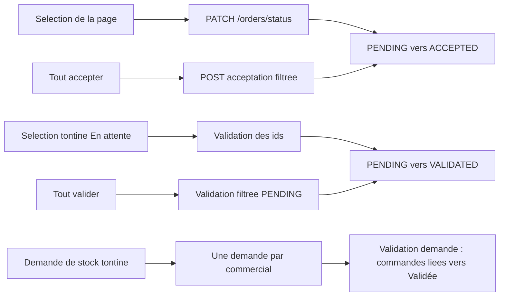

# Acceptation groupée des commandes

## Constat

Les trois listes ne sont pas au même stade.

**Commandes** ([`order-dashboard`](frontend/src/app/orders/pages/order-dashboard/order-dashboard.component.html), route `/orders`) et **commandes en ligne** (le même écran, route `/orders/online`) ont déjà des cases à cocher et une barre **Accepter la sélection** / **Valider la sélection**. Cette barre n’envoie que les lignes de la page courante (10 par défaut, 50 au maximum). Changer de page, d’onglet, de recherche ou de commercial vide la sélection. Il n’existe pas de bouton qui accepte toutes les commandes en attente correspondant au filtre.

L’acceptation unitaire et groupée passe déjà par le même appel : `PATCH /api/v1/orders/status` avec `{ orderIds, newStatus: ACCEPTED }`. Le passage est `PENDING` → `ACCEPTED` (historique + notification client). Le stock et la vente ne bougent pas à cette étape.

**Livraisons tontine** ([`tontine-delivery-list`](frontend/src/app/tontine/pages/delivery-list/tontine-delivery-list.component.html), menu Tontines > Livraison) n’ont ni case, ni validation sur la liste, ni demande de stock. Une commande (statut membre `PENDING`, libellé écran **En attente**) se valide seulement sur la fiche membre, bouton **Valider la Livraison** (`PATCH /api/v1/tontines/deliveries/{id}/validate` → `VALIDATED`). Aucun stock n’est débité à cette étape : la remise reste **Marquer comme Livré**.

Les demandes de sortie tontine existent déjà (**Stock Commercial**, sélecteur **Tontine**), mais elles se saisissent à la main. Rien ne les relie à une livraison. Côté commandes, le geste existe : **Faire une demande de stock** sur la sélection, et **Demande de stock (en attente)** pour toutes les commandes `PENDING` pas encore liées. Une demande par commercial, quantités additionnées, aperçu avant création. À la validation de la demande, les commandes encore en attente passent à **Validée**. Le droit est `ROLE_ORDER_STOCK_REQUEST`. La case **Pour le mois prochain** ne concerne que le stock crédit mensuel : une demande tontine n’a pas de mois.

## Règle commune

- **Sélection** : les lignes cochées de la page, comme aujourd’hui pour les commandes.
- **Tout accepter / Tout valider** : toutes les lignes éligibles des filtres en cours, toutes pages confondues. Le serveur rejoue exactement la requête de la liste. On ne pagine pas côté navigateur.
- Filtres repris :
  - commandes : onglet **En attente** uniquement, commercial s’il est choisi, recherche si elle est saisie, et pour les commandes en ligne la source Espace Client ;
  - livraisons tontine : statut **En attente** seulement, commercial s’il est choisi, période et recherche telles qu’affichées.
- Sans commercial, l’action porte sur tout ce que la liste montre pour cet utilisateur. Un promoteur reste limité à son portefeuille, comme sur la liste.
- Confirmation avant l’appel, avec le nombre et le commercial lorsqu’il est filtré. Bouton inactif si ce nombre est 0.
- Un échec annule tout le lot (même transaction que l’acceptation actuelle).

## Commandes classiques et en ligne

Un seul développement couvre les deux écrans : `onlineMode` envoie `source=CUSTOMER_SPACE` pour **Tout valider**. Sur **Commandes**, la liste mélange déjà les origines ; **Tout accepter** suit ce que le total affiché compte.

Backend, dans [`OrderController`](backend/src/main/java/com/optimize/elykia/core/controller/sale/OrderController.java) / [`OrderService`](backend/src/main/java/com/optimize/elykia/core/service/order/OrderService.java) :

- Nouvel appel du type `POST /api/v1/orders/accept-pending` avec `commercial`, `search` et `source` optionnels.
- Réutiliser `searchOrders` (statut `PENDING`, même résolution du commercial que `getAllOrders`) pour obtenir les identifiants, puis la boucle existante de `updateOrderStatus` vers `ACCEPTED`.
- Réponse : nombre de commandes acceptées.

Frontend, barre d’outils de [`order-dashboard`](frontend/src/app/orders/pages/order-dashboard/order-dashboard.component.html) :

- Bouton **Tout accepter** (libellé **Tout valider** en ligne), visible seulement sur l’onglet **En attente**.
- Confirmation via `AlertService`, texte du type « Accepter 42 commandes de {commercial} ? ».
- La barre **Accepter la sélection** reste pour un choix partiel de la page.

## Livraisons tontine en commande

Backend, [`TontineDeliveryController`](backend/src/main/java/com/optimize/elykia/core/controller/tontine/TontineDeliveryController.java) :

- Validation d’une liste d’identifiants, en réutilisant `validateDelivery`, en ne touchant que les dossiers `PENDING`.
- Validation de toutes les livraisons `PENDING` qui matchent commercial, période et recherche (`TontineDeliveryWebService` / `getFilterCriteria`, même règle promoteur que la liste).
- Ne pas appeler la remise (`deliver`) : pas de stock, pas de crédit.

Frontend, liste des livraisons :

- Case à cocher seulement sur les lignes **En attente**. Case d’en-tête = les lignes **En attente** de la page.
- Barre **Valider la sélection**.
- Bouton **Tout valider** : le serveur compte et valide les commandes `PENDING` du filtre (le total de la liste mélange les statuts, on ne s’en sert pas comme nombre).
- Mêmes droits que **Valider la Livraison** sur la fiche (`ROLE_REPORT`, `ROLE_ADMIN`).

## Demande de stock depuis Tontines > Livraison

Même parcours que les commandes, sur le stock tontine (pas une demande crédit).

Éligible : livraison **En attente** ou **Validée**, avec des articles, un commercial, et sans demande tontine active déjà liée (`CREATED`, `VALIDATED`, `DELIVERED`). Une demande annulée ou refusée libère la livraison. **Livrée** n’est pas éligible.

Deux entrées, droit `ROLE_ORDER_STOCK_REQUEST` (le même que sur les commandes) :

- **Faire une demande de stock** sur les lignes cochées de la page. Plusieurs commandes du même commercial deviennent **une seule** demande : les quantités du même article s’additionnent. Le magasinier livre cette demande en une opération, pas une livraison par commande.
- **Demande de stock (en attente)** : toutes les livraisons **En attente** éligibles des filtres en cours (commercial s’il est choisi, période, recherche), toutes pages, toujours regroupées en une demande par commercial. Un promoteur reste sur son portefeuille. Sur les commandes, ce bouton ignore aujourd’hui le commercial choisi : ici il le respecte, comme **Tout valider**.
- Si la sélection mélange plusieurs commerciaux, il y a une demande par commercial. Chacun est livré à part. On ne mélange pas les stocks de deux commerciaux dans le même bon.

Aperçu (reprise de [`order-stock-request-modal`](frontend/src/app/orders/components/modals/order-stock-request-modal/order-stock-request-modal.component.html)) : un bloc par commercial, articles et quantités additionnés, puis **Créer la demande**. Pas de **Pour le mois prochain**.

Backend, à côté de [`StockTontineRequestService`](backend/src/main/java/com/optimize/elykia/core/service/stock/StockTontineRequestService.java) :

- Aperçu et création depuis des identifiants, et depuis les livraisons **En attente** filtrées.
- Une `StockTontineRequest` par `commercialUsername`, note avec les références, articles agrégés, création via `save`.
- Table de lien `stock_tontine_request_delivery` (migration Flyway), sur le modèle de `stock_request_order`.
- À la validation de la demande : les livraisons liées encore **En attente** passent à **Validée** (événement, comme [`OrderStockRequestListener`](backend/src/main/java/com/optimize/elykia/core/service/order/OrderStockRequestListener.java)). Annuler la demande ensuite ne les repasse pas en attente. Pas de remise physique.
- Liste **Demandes Sortie** (sélecteur **Tontine**) : mention **Commandes liées**, comme sur le crédit.

Catalog IA : ajouter `stock_tontine_request_delivery` dans [`schema-catalog.json`](backend/src/main/resources/ai/schema-catalog.json), sur le modèle de `stock_request_order`.

## Guide, index et version

Mettre à jour le pas à pas métier (sans décrire d’API) :

- [`user-guide/docs/manager/operations.md`](user-guide/docs/manager/operations.md) (commandes en ligne et menu Commandes)
- [`user-guide/docs/commercial/sales_orders.md`](user-guide/docs/commercial/sales_orders.md)
- [`user-guide/docs/commercial/tontine.md`](user-guide/docs/commercial/tontine.md)
- [`user-guide/docs/manager/stock_sales.md`](user-guide/docs/manager/stock_sales.md) (mention **Commandes liées** sur une demande tontine)

Puis `python user-guide/generate_print_docs.py`, `python user-guide/generate_rag_index.py`, et `python -m mkdocs build -f user-guide/mkdocs.yml -d ../frontend/src/user-guide`. Incrémenter la version frontend et backend et noter le changement dans `docs/CHANGELOG.md`.
