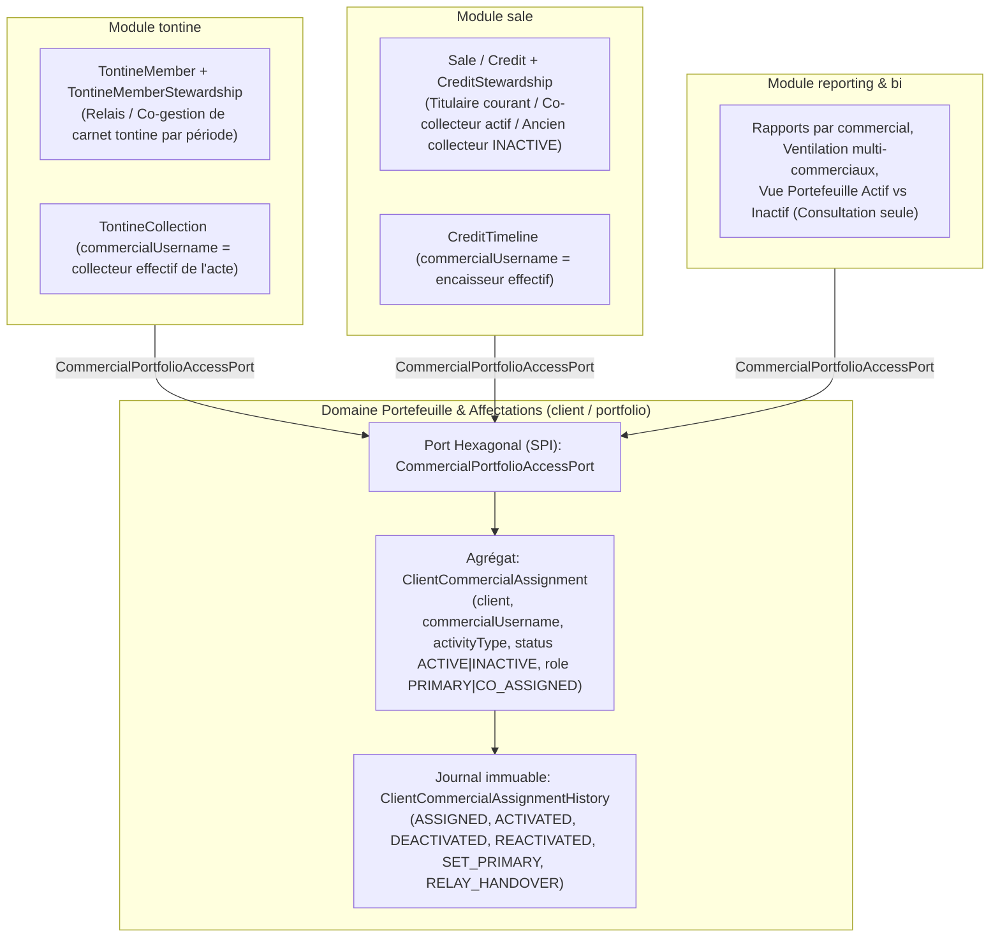
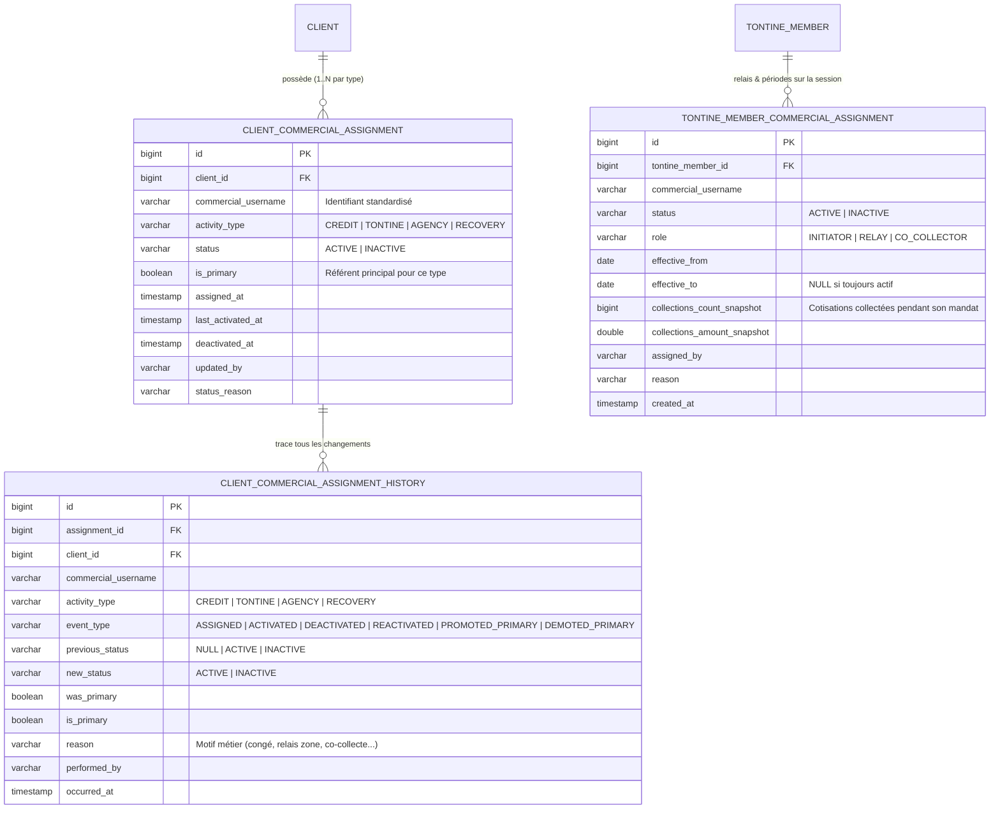

# Plan 2 — Architecture DDD & Hexagonale : Gestion Globale des Commerciaux, Portefeuilles Clients Multi-Attributions & Relais d'Opérations (`CREDIT` & `TONTINE`)

**Branche cible :** `migration/commercial-portfolio-ddd` (ou à la suite de `migration/refactor_commercial_stock`).  
**Copie dépôt (après validation) :** `.cursor/plans/commercial_portfolio_management_ddd.plan.md`.

---

## 1. Diagnostic de l'existant : pourquoi le modèle actuel oblige à « bricoler des transferts » ?

Aujourd'hui, l'appartenance d'un client ou d'un dossier à un commercial est éclatée dans **4 mécanismes rigides à valeur unique** :
1. **Sur la table `client` (colonnes scalaires) :**
   - `collector` (1 seul commercial Crédit), `tontine_collector` (1 seul commercial Tontine), `agency_collector` (1 seul commercial Agence), `recovery_collector` (1 seul commercial Recouvrement).
   - **Conséquence :** dès qu'on réassigne un client (`ClientService.bulkAssignCollectors`), on **écrase** l'ancien commercial. Impossible d'avoir **2 commerciaux actifs en même temps** sur le même type d'opération pour un client, ni de mettre un commercial en **pause (`INACTIVE`)** tout en lui laissant une visibilité explicite et réactivable.
2. **Sur la table `tontine_member` :**
   - `TontineMember` **n'a même pas son propre commercial** ! `TontineService` et `TontineMemberRepository` lisent directement `member.getClient().getTontineCollector()`.
   - **Conséquence critique :** si un commercial $A$ commence la tontine d'un membre, puis qu'un commercial $B$ doit prendre le relais (ou suppléer $A$ pendant un congé/changement de zone), on est forcé de modifier `client.tontine_collector` globalement, et `FormerPortfolioService` doit deviner par heuristique (`existsByTontineMember_IdAndCommercialUsername` ou `client_collector_history`) qui avait le droit de voir quoi !
3. **Sur la table `credit` :**
   - Un seul champ `credit.collector`, modifié par `SaleCollectorService.changeCollector` uniquement si le crédit est `INPROGRESS`, en écrasant la valeur et en écrivant une ligne dans `credit_collector_history`.
4. **Contrôle d'accès dispersé :**
   - `CollectorAudienceSecurity` compare `user.getUsername().equalsIgnoreCase(client.getTontineCollector())` (booléen binaire : titulaire unique ou rejet) et `FormerPortfolioService` reconstruit a posteriori un « ancien portefeuille » en croisant 4 tables.

---

## 2. Architecture DDD & Hexagonale Cible

### 2.1 Positionnement dans Spring Modulith & Ports Hexagonaux

Plutôt que de coupler `client`, `sale`, `tontine` et `reporting` à des colonnes scalaires sur `Client`, nous plaçons la **Politique d'Affectation & Portefeuille Commercial** au cœur du domaine avec un **Port SPI Hexagonal** exposé dans `client :: api` (ou module dédié `portfolio`) et consommé par `sale`, `tontine`, `reporting` et `customer` :



---

## 3. Modèle de Domaine Détaillé — Les 3 Piliers

### Pilier 1 : Multi-affectation Client par type d'activité avec statut `ACTIVE` / `INACTIVE` & Réactivation

Nous introduisons l'entité **`ClientCommercialAssignment`** (table `client_commercial_assignment`) et son journal d'audit **`ClientCommercialAssignmentHistory`** (`client_commercial_assignment_history`) :



#### Règles métier invariantes (enforcées dans l'agrégat) :
1. **Unicité du couple :** contrainte unique `(client_id, commercial_username, activity_type)` dans `client_commercial_assignment`.
   - Si un commercial qui a déjà été affecté par le passé (et mis `INACTIVE`) reprend le client, **on ne crée pas de doublon** : on appelle `assignment.reactivate(performedBy, reason)` qui repasse son statut à `ACTIVE` et écrit un événement `REACTIVATED` dans l'historique !
2. **Multiples commerciaux du même type :**
   - Un client peut avoir **plusieurs commerciaux `CREDIT`** et/ou **plusieurs commerciaux `TONTINE`**.
   - Le gestionnaire décide librement pour chacun s'il est **`ACTIVE`** ou **`INACTIVE`**, ou utilise le mode **« Relais (désactiver le précédent) »** qui passe automatiquement l'ancien commercial à `INACTIVE` tout en activant le nouveau.
   - Parmi les commerciaux `ACTIVE` d'un même type, un seul est marqué `is_primary = true` (sert de valeur par défaut pour synchroniser les colonnes de compatibilité `client.credit_commercial_username` / `client.tontine_commercial_username`).
3. **Sémantique exacte des droits par statut (`PortfolioPermissionLevel`) :**
   - **`ACTIVE`** → **`READ_WRITE` (Opérationnel)** : le commercial voit le client dans son portefeuille actif (web & mobile), peut créer de nouvelles ventes/adhésions, enregistrer des recouvrements crédit ou des collectes tontine, et demander des livraisons.
   - **`INACTIVE`** → **`READ_ONLY_HISTORY` (Consultation seule)** : le commercial conserve l'accès en lecture au client et **aux opérations déjà réalisées** (crédits où il est intervenu, collectes tontine effectuées, historique du dossier), mais **toute tentative d'ajouter une nouvelle opération** (nouvelle vente, nouveau recouvrement, nouvelle collecte tontine) est bloquée avec un message métier clair : *« Votre affectation [Crédit/Tontine] sur ce client est actuellement inactive (consultation seule). Contactez le gestionnaire pour la réactiver. »*
   - **`NONE`** (jamais affecté et aucune opération historique) → **`DENIED`**.
   - **S'il est réactivé (`INACTIVE → ACTIVE`)** : il retrouve immédiatement le droit `READ_WRITE` et continue les opérations sans aucune perte ni transfert artificiel !

---

### Pilier 2 : Relais naturel sur la Tontine (`TontineMember`) et sur les Crédits (`Sale`) sans transfert destructif

Vous avez souligné un point essentiel :
> *« Niveau tontine, un commercial peut commencer, un autre peut prendre le relais et continuer. Actuellement on est obligé de faire des transferts mais si tu peux trouver une bonne structure qui gère ça, alors ça va nous aider à maîtriser une gestion cohérente. »*

Voici la modélisation DDD qui **élimine le besoin de transfert destructif** :

#### A. En Tontine : Mandats de collecte (`TontineMemberCommercialAssignment`) + Attribution à l'acte (`TontineCollection.commercialUsername`)
1. **Distinguer la propriété de l'acte et l'habilitation sur le carnet :**
   - Chaque cotisation enregistrée (`TontineCollection`) porte déjà `commercial_username` = **le commercial qui a effectivement collecté la mise ce jour-là** (et c'est à sa caisse / son rapport journalier et son versement que cette collecte appartient — **cela ne doit jamais être réécrit rétroactivement** !).
   - Le carnet (`TontineMember`) possède une liste de **mandats (`TontineMemberCommercialAssignment`)** :
     - Quand le commercial $A$ inscrit le membre en début d'année : mandat `(member, A, role=INITIATOR, status=ACTIVE, effectiveFrom=dateAdhesion)`.
     - Quand le commercial $B$ **prend le relais** (mode *Relais*) :
       - Le mandat de $A$ passe à `status = INACTIVE`, `effectiveTo = today` (avec snapshot de ses collectes réalisées) — $A$ garde la consultation de ce carnet et de ses collectes !
       - Un mandat `(member, B, role=RELAY, status=ACTIVE, effectiveFrom=today)` est ouvert pour $B$ (et l'affectation `TONTINE` de $B$ sur le `Client` est activée automatiquement si elle ne l'était pas).
     - Quand $A$ et $B$ **co-gèrent** le membre (mode *Co-collecte*, tous deux `ACTIVE`) :
       - Les deux mandats sont `ACTIVE`. $A$ et $B$ peuvent tous deux enregistrer des collectes sur le carnet ; chaque collecte est créditée au commercial qui l'a saisie.
     - Si $A$ **reprend le carnet plus tard** : son mandat repasse à `ACTIVE` (`effectiveTo = null`) !
2. **Livraison en fin de tontine (`TontineDelivery`) :**
   - N'importe quel commercial `ACTIVE` sur le membre (ou le commercial principal `is_primary`) peut effectuer la livraison à partir de son **stock commercial continu `TONTINE`** (`commercial_stock_position`), et `TontineDelivery.commercial_username` trace le commercial livreur tandis que la fiche membre affiche la **ventilation exacte des cotisations par commercial ayant participé au carnet** (`TontineMemberContributionService`).

#### B. En Vente à Crédit : Co-recouvrement ou Relais sur dossier (`Credit`)
- Un crédit conserve son **`originating_commercial_username`** (le commercial qui a sorti la marchandise de son stock continu et réalisé la vente — immuable pour le calcul de performance commerciale et de stock !) et son **`active_commercial_username`** (responsable principal actuel du recouvrement).
- De plus, tout commercial disposant d'une affectation `CREDIT` **`ACTIVE`** sur le client (ou d'un mandat de relais sur le crédit) est autorisé par `CommercialPortfolioAccessPort.canRecordCreditOperation(user, credit)` à enregistrer une échéance (`CreditTimeline`), tandis qu'un commercial passé **`INACTIVE`** voit le dossier en lecture seule (avec le cumul exact de ce qu'il a lui-même encaissé).

---

### Pilier 3 : Port Hexagonal unique (`CommercialPortfolioAccessPort`)

Un seul port SPI dans `client/api/CommercialPortfolioAccessPort.java` remplace tous les contrôles dispersés :

```java
package com.optimize.elykia.client.api;

public interface CommercialPortfolioAccessPort {

    enum AccessMode {
        /** Commercial ACTIVE sur ce client/dossier (ou profil staff) : lecture + nouvelles opérations. */
        READ_WRITE,
        /** Commercial INACTIVE (ou ancien intervenant) : lecture du client et des opérations passées uniquement. */
        READ_ONLY_HISTORY,
        /** Aucun lien actif ni historique : accès refusé. */
        DENIED
    }

    AccessMode resolveClientAccess(String commercialUsername, Long clientId, PortfolioActivityType activityType);

    AccessMode resolveTontineMemberAccess(String commercialUsername, Long tontineMemberId);

    AccessMode resolveCreditAccess(String commercialUsername, Long creditId);

    /** Lève une CustomValidationException explicite si l'accès n'est pas READ_WRITE. */
    void assertCanOperateOnClient(String commercialUsername, Long clientId, PortfolioActivityType activityType);

    void assertCanOperateOnTontineMember(String commercialUsername, Long tontineMemberId);

    void assertCanOperateOnCredit(String commercialUsername, Long creditId);
}
```

---

## 4. Expérience Frontend (Angular 21 Standalone / Lazy-Loaded, `frontend-ui-style`) & Rapports

### 4.1 Sur la Fiche Client (`/client/details/:id` & `/client/view/:id`) et la Liste Clients (`/client/list`)
1. **Encart « Commerciaux & Portefeuille » par activité (`Crédit`, `Tontine`, `Agence`) :**
   - Affiche la liste des commerciaux rattachés au client avec :
     - Badge d'activité (`Crédit` | `Tontine` | `Agence`),
     - Badge de statut (**`Actif — Opérations autorisées`** en vert vs **`Inactif — Consultation seule`** en gris/ambre),
     - Badge **`Principal`** (étoile) sur le référent principal,
     - Actions rapides en 1 clic (avec confirmation `AlertService`) :
       - **« Prendre le relais »** (ajoute le nouveau commercial en `ACTIVE` + passe l'ancien en `INACTIVE` avec motif),
       - **« Ajouter un co-commercial actif »** (les deux restent `ACTIVE`),
       - **« Désactiver (consultation seule) »** / **« Réactiver »** (bascule `ACTIVE ↔ INACTIVE` avec motif),
       - **« Définir comme principal »**.
2. **Onglet / Panneau « Historique des affectations commerciales » (consultable depuis le Frontend) :**
   - Timeline chronologique complète issue de `client_commercial_assignment_history` :
     - Date/heure, Activité (`Crédit`/`Tontine`), Commercial concerné, Action (`Affectation initiale`, `Prise de relais`, `Désactivation → consultation seule`, `Réactivation`, `Passage principal`), Opérateur ayant fait le changement (`performedBy`) et Motif.
   - Filtres par activité (`Crédit` / `Tontine` / `Tous`) et par commercial.

### 4.2 Sur la Fiche Membre Tontine (`/tontine/member/:id`)
- **Bandeau « Commerciaux du carnet (Initial & Relais) » :**
  - Affiche chaque commercial étant intervenu sur le carnet de la session : rôle (`Initiateur`, `Relais`, `Co-collecteur`), période (`du ... au ...`), statut (`Actif` / `Inactif`), **nombre de collectes et montant total cotisé sous son mandat**.
  - Bouton **« Passer le relais / Gérer les commerciaux du carnet »** permettant au gestionnaire de confier la suite de la session à un autre commercial (ou d'ajouter un co-collecteur actif, ou de réactiver le commercial initial) **sans perdre ni réécrire les collectes déjà faites**.

### 4.3 Vue Commercial (Web & Mobile Local-First) & Rapports
- **Pour un commercial connecté (`PROMOTER`) :**
  - Ses listes de travail par défaut (Nouvelle vente, Nouvelle collecte tontine, Recouvrement) filtrent sur ses affectations **`ACTIVE`**.
  - Un filtre / onglet **« En consultation seule (Inactifs / Relais passés) »** lui permet de consulter ses dossiers où il est **`INACTIVE`**, avec les boutons d'ajout d'opération désactivés et un bandeau explicatif.
- **Dans les Rapports (`reporting` / `finance` / `bi`) :**
  - **Rapport journalier & Versements :** chaque encaissement (`CreditTimeline`, `TontineCollection`) reste rattaché au `commercial_username` qui l'a encaissé le jour J (aucune distorsion de caisse lors d'un relais !).
  - **Rapport de portefeuille & Transferts/Relais :** tableau de synthèse montrant, pour chaque relais ou co-gestion, la part collectée par chaque commercial (`Initiateur` vs `Relais`).

---

## 5. Feuille de route d'implémentation par phases (Zéro régression)

### Phase 2A — Schéma BDD (`V051`) & Reprise automatique de l'existant
- Création des tables `client_commercial_assignment`, `client_commercial_assignment_history` et `tontine_member_commercial_assignment`.
- **Backfill SQL idempotent dans `V051` :**
  - Pour chaque `client`, crée automatiquement les lignes `ACTIVE` (`is_primary = true`) dans `client_commercial_assignment` à partir de `collector` (`CREDIT`), `tontine_collector` (`TONTINE`), `agency_collector` (`AGENCY`).
  - Importe `client_collector_history` existant dans `client_commercial_assignment_history` et crée en `INACTIVE` les anciens commerciaux afin qu'ils apparaissent immédiatement dans le nouveau modèle !
  - Pour chaque `tontine_member`, crée les mandats dans `tontine_member_commercial_assignment` à partir du commercial tontine actuel (`ACTIVE`) et des commerciaux ayant déjà collecté sur ce membre (`INACTIVE` si différents de l'actuel).
- Mise à jour de `backend/src/main/resources/ai/schema-catalog.json`.

### Phase 2B — Domaine, Port Hexagonal `CommercialPortfolioAccessPort` & Synchronisation descendante
- Implémentation de l'agrégat `ClientCommercialAssignment`, du service `ClientCommercialPortfolioService` (affecter, prendre le relais, activer, désactiver, réactiver, promouvoir principal) et de `TontineMemberRelayService`.
- **Synchronisation automatique vers les colonnes de `Client` :** chaque fois que le commercial principal `ACTIVE` d'une activité change, `client.credit_commercial_username` (et `collector`) ou `client.tontine_commercial_username` (et `tontine_collector`) est mis à jour automatiquement → **100 % des requêtes legacy et du mobile existant continuent de fonctionner sans aucune casse**.
- Raccordement de `CollectorAudienceSecurity`, `FormerPortfolioService`, `TontineService` et `CreditController` sur `CommercialPortfolioAccessPort` :
  - `ACTIVE` → lecture + écriture ;
  - `INACTIVE` → lecture complète de l'historique, blocage propre de toute nouvelle écriture.

### Phase 2C — API REST & Écrans Frontend (Angular 21)
- Endpoints REST :
  - `GET /api/v1/clients/{clientId}/commercial-assignments` (actifs + inactifs)
  - `GET /api/v1/clients/{clientId}/commercial-assignments/history` (timeline d'audit paginée/filtrable)
  - `POST /api/v1/clients/{clientId}/commercial-assignments` (ajouter co-commercial ou prendre le relais)
  - `PATCH /api/v1/clients/{clientId}/commercial-assignments/{assignmentId}/status` (activer / désactiver / réactiver + motif)
  - `PATCH /api/v1/clients/{clientId}/commercial-assignments/{assignmentId}/primary`
  - `POST /api/v1/clients/bulk-commercial-assignments` (action en masse avec choix du mode : *Remplacer/Relais* vs *Co-affecter en actif* vs *Désactiver*)
  - `GET /api/v1/tontines/members/{memberId}/stewardship` & `POST /api/v1/tontines/members/{memberId}/relay`
- Composants Frontend standalone dans `@features/client` et `@features/tontine` (respectant `frontend-ui-style` et `AlertService`) + tests unitaires Vitest.

### Phase 2D — Mobile Local-First, Guide Utilisateur, Index RAG & Changelog
- Enrichissement de la synchro mobile (`commercialUsername`) avec l'indicateur `assignmentStatus ('ACTIVE' | 'INACTIVE')` pour afficher les dossiers en consultation seule sans permettre la création d'opération hors-ligne sur un dossier inactif.
- Mise à jour du guide utilisateur (`user-guide/docs/manager/` & `commercial/`), régénération de `user-guide-index.json`, mise à jour de `docs/CHANGELOG.md` et `memory-bank/`.

---

## 6. Décisions validées & Opérations en masse (Bulk Portfolio Operations)

> [!IMPORTANT]
> **Décisions confirmées avec le propriétaire :**
> 1. **Branche dédiée :** `migration/commercial-portfolio-and-username` (créée à partir de `migration/refactor_commercial_stock`).
> 2. **Périmètre de lecture en statut `INACTIVE` (`READ_ONLY_OWN_OPERATIONS`) :** un commercial `INACTIVE` sur un client ou un carnet tontine consulte **uniquement les opérations qu'il a lui-même réalisées** (ses propres ventes/crédits et ses propres recouvrements `CreditTimeline.commercial_username == user`, ainsi que ses propres collectes `TontineCollection.commercial_username == user` et le solde cotisé sous son mandat), sans pouvoir ajouter de nouvelle opération tant qu'il n'est pas réactivé.
> 3. **Opérations en masse (Bulk 1 000+ clients / carnets tontine) de premier ordre :** le métier ne passe jamais client par client lorsqu'un commercial $A$ passe le relais au commercial $B$ (congé, départ, réorganisation de zone). Toutes les actions unitaires existent **en version Bulk globale par portefeuille commercial** ET **par sélection filtrée (quartier, session tontine, liste d'IDs)**.

### 6.1 Moteur et Écran « Opérations de Portefeuille en Masse » (Bulk Relay / Co-Affectation / Désactivation / Réactivation)

1. **Modèle de commande Bulk (`BulkPortfolioOperationCommand`) :**
   - **Sélection de la cible (au choix, combinables) :**
     - **Tout le portefeuille d'un commercial source $A$** (`sourceCommercialUsername = 'com01'`, ex. ses 1 000 clients d'un coup, sans avoir à les cocher page par page !),
     - Filtre optionnel par **Activité** (`CREDIT`, `TONTINE`, `ALL`), par **Quartier / Localité**, par **Session Tontine**, ou par **liste explicite `clientIds` / `tontineMemberIds`**,
     - Option **`includeInProgressCredits`** (transférer/co-affecter aussi les crédits `INPROGRESS` de $A$ vers $B$) et **`includeActiveTontineMembers`** (passer aussi le relais sur tous les carnets tontine de la session active).
   - **Modes d'opération Bulk (`BulkPortfolioOperationMode`) :**
     - **`HANDOVER_RELAY` (Passer le relais $A 	o B$)** : sur tous les clients/carnets ciblés de $A$, passe $A$ à `INACTIVE` (garde la lecture de ses propres opérations) et active $B$ en `ACTIVE` (`is_primary = true`), en une seule transaction SQL batchée !
     - **`ADD_CO_COMMERCIAL` (Co-affecter $B$ aux côtés de $A$)** : garde $A$ `ACTIVE` et ajoute/réactive $B$ en `ACTIVE` sur tout le portefeuille ciblé.
     - **`DEACTIVATE_COMMERCIAL` (Mettre $A$ en pause / inactif)** : passe $A$ à `INACTIVE` sur les clients ciblés.
     - **`REACTIVATE_COMMERCIAL` (Retour de $A$ — réactiver son portefeuille)** : repasse en 1 clic toutes les affectations `INACTIVE` de $A$ (ou celles transférées lors d'un relais précédent) à `ACTIVE` (avec option de remettre $A$ principal et de passer le remplaçant $B$ en `INACTIVE`).
2. **Performance Backend (1 000+ clients en < 1 seconde) :**
   - Requêtes SQL/JDBC batchées (`INSERT INTO client_commercial_assignment ... ON CONFLICT (client_id, commercial_username, activity_type) DO UPDATE`, `UPDATE` ensembliste sur `client` et `tontine_member_commercial_assignment`, et insertion en masse dans `client_commercial_assignment_history`), suivies d'une invalidation du cache (`@EvictClientListCaches`).
   - Endpoint d'aperçu avant exécution (`POST /api/v1/clients/commercial-assignments/bulk-preview`) qui renvoie le nombre exact de clients, de crédits en cours et de carnets tontine impactés avant confirmation `AlertService`.

---

## 7. Historique des questions initiales (résolues)

1. **Ordre d'exécution souhaité :** voulez-vous que l'on exécute d'abord le **Plan 1** (uniformisation `commercial_username` + dépréciation `collector`), puis le **Plan 2** (portefeuille multi-commerciaux `ACTIVE`/`INACTIVE` + relais Tontine/Crédit), sur la même branche `migration/refactor_commercial_stock` ou sur une nouvelle branche dédiée ?
2. **Visibilité en statut `INACTIVE` :** lorsqu'un commercial est passé `INACTIVE` sur un client, préférez-vous qu'il puisse consulter **uniquement les opérations réalisées jusqu'à sa date de désactivation (ou par lui-même)**, ou **toutes les opérations passées du client en lecture seule** (sans pouvoir en créer de nouvelles) ? *(Le modèle proposé supporte les deux via un simple paramètre ou règle dans `CommercialPortfolioAccessPort`.)*
