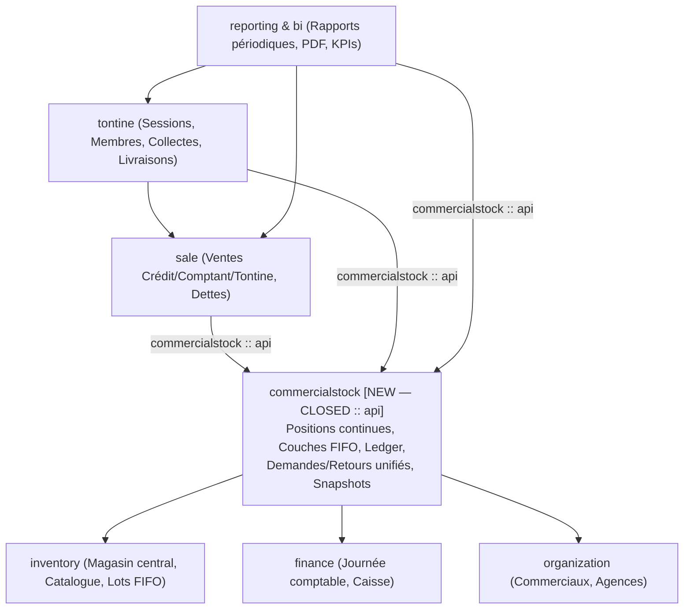

# Plan de refonte DDD — Stock Commercial Continu Unifié (`CREDIT` & `TONTINE`)

> **Statut :** Proposition d'architecture & feuille de route soumise à validation.
> **Contexte technique :** Backend `2.11.2` (Java 25, Spring Boot 4.2.0, Spring Modulith 2.2.0 — 19 modules, Flyway `V046`), Frontend `3.1.0` (Angular 21 LTS standalone/lazy-loaded), Mobile `3.0.0` (Ionic 9 / Angular 21 / Capacitor 8 / SQLite local-first).
> **Note sur les plans :** Une fois validé, ce plan sera également enregistré dans `.cursor/plans/commercial_stock_ddd_refactoring.plan.md` et inclus dans les commits conformément aux conventions du projet.

---

## 1. Objectif et diagnostic de l'existant

### 1.1 Le besoin métier fondamental
Le stock confié aux commerciaux terrain (consignation / stock déporté) doit être **strictement séparé du stock magasin central** (`inventory`) afin de suivre chaque commercial sur la marchandise qu'il détient, à travers ses **deux activités** :
- **Vente à crédit** (`CREDIT`, et historique comptant),
- **Livraison de tontine** (`TONTINE`, rattachée à une session annuelle).

### 1.2 Diagnostic factuel de l'implémentation actuelle

L'audit du codebase met en évidence **4 dettes structurelles majeures** :

| Symptôme | État mesuré dans le dépôt | Conséquence métier & technique |
|---|---|---|
| **1. Duplication en 2 silos miroirs** | `sale` porte `CommercialMonthlyStock`, `CommercialMonthlyStockItem`, `StockRequest`, `StockReturn`, `CommercialStockMovement`, `CommercialMonthlyStockItemSoldValueHistory`. `tontine` duplique tout en miroir : `TontineStock`, `TontineStockLayer`, `StockTontineRequest`, `StockTontineReturn`, `TontineStockMovement`. | Double maintenance (services, contrôleurs, DTOs, écrans Web & Mobile), dépendances croisées bancales (`StockTontineRequest` importe `sale.domain.StockRequestStatus`, `StockPriceRealignmentService` vit dans `tontine` tout en pilotant `sale`). |
| **2. Asymétries et bugs induits** | `StockTontineReturnService.validate()` décrémente `TontineStock` mais **ne réintègre pas le magasin** (seul le chemin `realignOneTontine` appelle `reintegrateToWarehouse`). Côté comptant, `CashSaleService` injecte artificiellement `+qty` dans `quantityTaken` et `quantitySold` sur le stock mensuel alors que la marchandise sort directement du magasin. | Écarts potentiels stock magasin ↔ stock tontine, gonflement artificiel du « stock pris » sur les ventes comptant. |
| **3. Confusion « État physique du stock » vs « Rapport de période »** | Partitionnement physique par `(collector, month, year)` (`CommercialMonthlyStock`) et `(commercial, article_id, year)` (`TontineStock`). | Au 1er du mois M+1, la marchandise physiquement dans le sac du commercial se retrouve piégée dans un bucket `CLOSED`. Cela a forcé 4 contournements lourds : `forNextMonth` sur `StockRequestService`, `RattrapageCreditService` (`RAT-*`), `StockReturn.createHistoriqueReturn`, batch `CommercialMonthlyStockCloseExecutor`, et proratas complexes dans `CommercialMonthlyStockRecoveryService` (384 LOC). Côté tontine, une session à cheval sur décembre N / janvier N+1 expose à des erreurs `Stock introuvable` (requêtes sur `LocalDate.now().getYear()`). |
| **4. Blocages & hacks de changement de prix** | `StockRequestService` bloque toute nouvelle sortie si le prix catalogue change tant qu'il reste du stock au commercial. `StockPriceRealignmentService` contourne ce blocage en générant un **faux retour magasin + fausse re-sortie magasin**, polluant `ArticleHistory`, `StockMovement`, les lots FIFO magasin et le journal journalier. | Pertes de traçabilité, risques de dérive sur le coût d'achat FIFO magasin, friction opérationnelle majeure lors des hausses/baisses de prix marché. |

### 1.3 Contraintes impératives de production (zéro régression)
1. **Zéro rupture sur les clients existants** : le mobile terrain (`mobile/` v3.0.0) est **local-first SQLite** et synchronise `/api/commercial-stocks/available/{collector}`, `/api/stock-requests/**`, `/api/stock-returns/**`, `/api/v1/tontines/stock/**`, `/api/v1/stock-tontine-request/**`, `/api/v1/stock-tontine-return/**` — avec filtrage strict par `commercialUsername`. Les anciens endpoints doivent rester rétrocompatibles par façade pendant toute la transition.
2. **Intégrité comptable & historique** : les données historiques (`commercial_monthly_stock`, `tontine_stock`, `debt_document`, `credit_articles.stock_item_id`, `credit_articles.tontine_item_id`) et les tables exposées à **Elykia IA** (`schema-catalog.json`) ne doivent pas être détruites brutalement.
3. **Architecture & Qualité** : conformité **Spring Modulith `2.2.0`** (`ModularityTests`), préservation des **6 seuils JaCoCo `0.8.16`**, validation Flyway PostgreSQL 15 (`ddl-auto=validate`).

---

## 2. Architecture DDD cible — Décisions validées

> [!IMPORTANT]
> **Décisions métier confirmées avec le propriétaire :**
> 1. **Deux compartiments logiques unifiés** : clé `(collector, article_id, activity_type ∈ {CREDIT, TONTINE})` dans un modèle continu unique, avec **transfert interne** possible entre `CREDIT` et `TONTINE` sans repasser par le magasin.
> 2. **Continuité temporelle (Rollover naturel)** : fin du cloisonnement obligatoire par mois/année sur le stock actif ; les invendus du 31 restent naturellement vendables le 1er (disparition du besoin de rattrapage technique `RAT-*`). La dette marchandise se crée sur **contrôle / arrêté explicite** d'un manquant.
> 3. **Couches FIFO commerciales à coût d'achat immuable + prix de vente configurable** : chaque sortie magasin crée une couche (`CommercialStockLayer`) portant un **`unitPurchaseCost` immuable** et un **`unitSalePrice`**. Le prix de vente appliqué est configurable (`LAYER_FIFO` vs `CATALOG`) et **réalignable** sur le prix marché courant (automatiquement ou manuellement) **sans jamais modifier le coût d'achat FIFO** ni simuler un retour magasin.
> 4. **Feuille de route complète multi-phases** : Backend DDD → Migration données zéro-casse → Reporting/BI/IA → Façades rétrocompatibles → Évolution Frontend & Mobile.

### 2.1 Nouveau Bounded Context Spring Modulith : `commercialstock` (20e module)

En DDD, le stock confié aux commerciaux n'appartient ni aux **ventes/échéanciers** (`sale`), ni à **l'épargne tontine** (`tontine`), ni à la **gestion physique du magasin fournisseur** (`inventory`). C'est le sous-domaine de **Consignation / Garde Commerciale** (`com.optimize.elykia.commercialstock`), **20e module Spring Modulith** (`CLOSED` avec `@NamedInterface("api")`).



**Avantages architecturaux immédiats :**
- **Zéro cycle Spring Modulith** : `inventory` reste en amont pur ; `commercialstock` est au-dessus d'`inventory` ; `sale` et `tontine` dépendent proprement de `commercialstock :: api` (fin de la dépendance anormale `tontine → sale.domain.StockRequestStatus` et `StockPriceRealignmentService` dans `tontine`).
- **Sépération claire des ventes comptant** : une remise magasin de vente comptant (`CashSale`) est un **bon de livraison magasin direct** (magasin → client) et ne pollue plus le stock détenu par le commercial (`quantityTaken`/`quantitySold`).

---

### 2.2 Modèle de domaine — État continu, Couches FIFO, Ledger & Snapshots

Le cœur du nouveau design repose sur **4 piliers orthogonaux** (alignés sur le pattern *Ledger + Checkpoints* déjà validé dans `trajectoire_stock_inventaire`) :

```mermaid
erDiagram
    COMMERCIAL_STOCK_POSITION ||--o{ COMMERCIAL_STOCK_LAYER : "est composé de (FIFO)"
    COMMERCIAL_STOCK_LAYER ||--o{ COMMERCIAL_STOCK_LAYER_PACK : "packs gros/demi-gros"
    COMMERCIAL_STOCK_POSITION ||--o{ COMMERCIAL_STOCK_MOVEMENT : "trace immuable (ledger)"
    COMMERCIAL_STOCK_POSITION ||--o{ COMMERCIAL_STOCK_PERIOD_SNAPSHOT : "arrêtés périodiques"
    COMMERCIAL_STOCK_REQUEST ||--o{ COMMERCIAL_STOCK_REQUEST_ITEM : "contient"
    COMMERCIAL_STOCK_RETURN ||--o{ COMMERCIAL_STOCK_RETURN_ITEM : "contient"

    COMMERCIAL_STOCK_POSITION {
        bigint id PK
        varchar collector UK "Commercial"
        bigint article_id UK "FK articles"
        varchar activity_type UK "CREDIT | TONTINE"
        int quantity_on_hand "Invariant: == SUM(layers.qty_remaining) >= 0"
        double weighted_avg_purchase_cost "Cache lecture (coût FIFO pondéré)"
        double current_sale_unit_price "Prix vente courant de référence"
        bigint version "Optimistic locking"
    }

    COMMERCIAL_STOCK_LAYER {
        bigint id PK
        bigint position_id FK
        int quantity_initial
        int quantity_remaining
        double unit_purchase_cost "IMMUABLE (coût lot FIFO magasin)"
        double initial_sale_price "Prix vente figé à la sortie magasin"
        double effective_sale_price "Prix vente actif (réalignable sans toucher au coût)"
        varchar packaging_type
        int units_per_package
        int units_per_half_package
        double wholesale_sale_price
        double half_wholesale_sale_price
        varchar source_type "STOCK_REQUEST | ACTIVITY_TRANSFER | MIGRATION | CANCEL_RESTORE"
        bigint source_id
        timestamp acquired_at "Ordre FIFO"
    }

    COMMERCIAL_STOCK_MOVEMENT {
        bigint id PK
        bigint position_id FK
        varchar collector
        bigint article_id
        varchar activity_type "CREDIT | TONTINE"
        varchar movement_type "STOCK_IN | CREDIT_SALE | TONTINE_DELIVERY | RETURN | SALE_CANCELLATION | DEBT_WRITE_OFF | DEBT_REVERSAL | ACTIVITY_TRANSFER_OUT | ACTIVITY_TRANSFER_IN | PRICE_REVALUATION | ADJUSTMENT"
        int delta_quantity "Signé (+ entrée, - sortie, 0 réévaluation)"
        int quantity_before
        int quantity_after
        double unit_purchase_cost "Coût FIFO consommé/restauré (immuable)"
        double unit_sale_price "Prix unitaire appliqué"
        double previous_sale_price "Pour PRICE_REVALUATION"
        double total_sale_value
        double total_purchase_value
        double margin_amount "total_sale_value - total_purchase_value"
        varchar reference_type "STOCK_REQUEST | STOCK_RETURN | CREDIT | TONTINE_DELIVERY | DEBT | TRANSFER | PRICE_CHANGE"
        bigint reference_id
        varchar reference_code
        bigint tontine_session_id "Contexte session (si TONTINE)"
        date accounting_date "Date comptable (rattachement période)"
        timestamp occurred_at "Horodatage GMT"
        varchar performed_by
    }

    COMMERCIAL_STOCK_PERIOD_SNAPSHOT {
        bigint id PK
        varchar collector
        bigint article_id
        varchar activity_type "CREDIT | TONTINE"
        varchar period_grain "MONTH | TONTINE_SESSION | CUSTOM"
        int period_year
        int period_month "nullable si TONTINE_SESSION"
        bigint tontine_session_id "nullable si MONTH"
        date period_start
        date period_end
        int opening_quantity
        int in_quantity
        int sold_quantity
        int returned_quantity
        int transfer_net_quantity
        int debt_quantity
        int adjustment_net_quantity
        int closing_quantity
        double opening_purchase_value
        double closing_purchase_value
        double closing_sale_value
        double sold_value
        double purchase_cost_of_sold
        double realized_margin
        timestamp closed_at
    }
```



#### Focus 1 : Stratégie de prix de vente configurable & Coût d'achat FIFO immuable

C'est un point clé exprimé dans votre retour. Modélisons-le explicitement avec le même idiome Java 25 (`sealed interface`) que `SaleLifecyclePolicy` :

```java
public enum CommercialSalePriceSource {
    /** Prix de vente figé sur la couche FIFO au moment de la sortie magasin (ou dernier réalignement). */
    LAYER_FIFO,
    /** Prix catalogue actuel de l'article au moment de la vente (prix du marché en cours). */
    CURRENT_CATALOG
}

public sealed interface StockActivityPolicy permits CreditStockPolicy, TontineStockPolicy {
    StockActivityType activityType();
    double resolveCatalogSalePrice(Articles article);
    CommercialSalePriceSource resolvePriceSource(ParameterService parameters);
    String requestReferencePrefix(); // "REQ" vs "TRQ" (ou unifié "CSQ")
    boolean requiresTontineSessionContext();
}
```

**Paramètres applicatifs (`application.yml` → table `parameter`) :**
- `CREDIT_SALE_PRICE_SOURCE` = `LAYER_FIFO` (défaut) | `CURRENT_CATALOG` — contrôle si les ventes à crédit utilisent le `effectiveSalePrice` de la couche FIFO ou le `creditSalePrice` courant du catalogue.
- `CASH_SALE_PRICE_SOURCE` (déjà existant, `init-data[11]`, valeurs `CATALOG` | `FIFO_LOT`) — conservé tel quel pour Tontine / Comptant !
- `ENABLED_AUTO_STOCK_PRICE_REALIGNMENT` (déjà existant, `init-data[6]`) — **comportement modernisé** : lorsqu'activé et qu'un prix catalogue change (`ArticlePriceChangedEvent`), `CommercialStockPriceRevaluationService` parcourt les couches ouvertes (`quantityRemaining > 0`), met à jour **uniquement `effectiveSalePrice`** (en laissant **`unitPurchaseCost` intact**), met à jour `position.currentSaleUnitPrice`, et inscrit une ligne `PRICE_REVALUATION` (`deltaQuantity = 0`, `previousSalePrice` → `unitSalePrice`) dans `commercial_stock_movement`.
- **Action gestionnaire à la demande** : endpoint `POST /api/v1/commercial-stocks/realign-prices` (filtrable par `articleId`, `activityType`, `collector`) permettant à tout moment de réattribuer le prix catalogue en cours aux couches déjà sorties en stock commercial — **sans retour magasin, sans re-sortie, et sans jamais altérer `unitPurchaseCost`** !

**Consommation FIFO à la vente (et marge comptable exacte) :**
Lorsqu'une vente de quantité $Q$ a lieu :
1. Le moteur consomme les `CommercialStockLayer` ouvertes dans l'ordre `acquired_at ASC, id ASC` (FIFO).
2. Si $Q$ traverse 2 couches (ex. 2 unités à coût d'achat 4 000 FCFA et 1 unité à coût d'achat 4 500 FCFA) :
   - Le coût d'achat total consommé est exact : $2 \times 4\,000 + 1 \times 4\,500 = 12\,500\text{ FCFA}$ (moyenne `unitPurchaseCost = 4 166.67` enregistrée sur la ligne de vente `CreditArticles.unitPurchaseCost` et sur le mouvement).
   - Le prix de vente appliqué est soit celui de chaque couche (`LAYER_FIFO`), soit le prix catalogue courant (`CURRENT_CATALOG`).
   - La marge réalisée est toujours exacte : $\text{marginAmount} = \text{totalSaleValue} - \text{totalPurchaseCost}$.
3. On conserve une table de traçabilité fine `commercial_stock_layer_consumption` `(movement_id, layer_id, quantity, unit_purchase_cost, unit_sale_price)` : ainsi, en cas **d'annulation de vente (`SaleCancellationService`)** ou de **retour au magasin**, on sait exactement quelles couches restaurer (ou recréer avec le **vrai coût d'achat FIFO d'origine**) !

#### Focus 2 : Transfert interne entre activités (`CREDIT` ↔ `TONTINE`)
Un commercial qui possède 10 unités d'un article en `CREDIT` peut transférer 3 unités vers sa poche `TONTINE` (ou inversement) sur validation gestionnaire :
- Consomme 3 unités en FIFO sur les couches `CREDIT` (en conservant leur **`unitPurchaseCost` exact** !).
- Crée les couches correspondantes sur la position `TONTINE` avec le même `unitPurchaseCost` et `effectiveSalePrice` résolu par `TontineStockPolicy` (`sellingPrice` + packs).
- Écrit 2 mouvements atomiques liés par un `transferId` : `ACTIVITY_TRANSFER_OUT` (`-3` sur `CREDIT`) et `ACTIVITY_TRANSFER_IN` (`+3` sur `TONTINE`).
- **Zéro impact sur le stock magasin** (`inventory`), traçabilité comptable parfaite dans les rapports par activité !

#### Focus 3 : Comment répondre à TOUS les besoins de reporting (période libre, mensuel, annuel, session tontine, par activité) ?

L'équation de conservation est garantie mathématiquement sur n'importe quelle fenêtre `[startDate, endDate]`, tout commercial (ou toute l'équipe), toute activité (`CREDIT`, `TONTINE`, ou consolidé `ALL`), et toute session tontine :

$$\text{Stock Ouverture}(D_1) + \text{Entrées} + \text{Transferts}_{\text{in}} + \text{Annulations} - \text{Ventes/Livraisons} - \text{Retours} - \text{Transferts}_{\text{out}} - \text{Dettes} + \text{Ajustements} = \text{Stock Clôture}(D_2)$$

**Algorithme de calcul rapide (CQRS + Snapshots) :**
1. **Arrêté mensuel automatique (1er du mois à 00:05 GMT) et arrêté de clôture de session tontine** :
   - Ne « ferme » plus le stock physique (aucun blocage terrain !).
   - Calcule et fige les lignes `commercial_stock_period_snapshot` pour le mois écoulé (ou la session clôturée), avec `opening_quantity` (= `closing_quantity` du mois précédent), tous les flux du mois, et `closing_quantity` (qui devient l'`opening_quantity` du mois suivant).
2. **Requête de rapport pour n'importe quelle période `[D1, D2]`** (`CommercialStockReportingService`) :
   - **Cas rapide (mois clos exact)** : lecture directe `commercial_stock_period_snapshot` + détail des mouvements si drill-down.
   - **Cas dynamique (mois en cours, trimestre, année, plage libre `[D1, D2]`, session tontine ouverte)** :
     - Cherche le dernier snapshot mensuel strictement antérieur à `D1` (`closing_quantity` à `S`).
     - Ajoute `SUM(delta_quantity)` des mouvements entre `S+1` et `D1-1` → **`openingQuantity(D1)` exact**.
     - Agrège en **une seule requête SQL** (`GROUP BY collector, article_id, activity_type, movement_type`) les mouvements dont `accounting_date BETWEEN D1 AND D2`.
     - Déduit `closingQuantity(D2) = openingQuantity(D1) + SUM(delta_quantity)`.
     - Recouvrement des ventes de la période : jointure directe sur `reference_type = 'CREDIT'` des mouvements `CREDIT_SALE` de `[D1, D2]` (suppression totale des 200+ lignes de heuristiques `RattrapageCreditSupport` et prorata `SoldValueHistory` !).

#### Focus 4 : Contrôle physique & Dette marchandise sur stock continu
En l'absence de « bucket mensuel fermé », comment le gestionnaire constate-t-il une dette marchandise ?
- **Nouvel acte métier explicite : « Arrêté / Régularisation de stock commercial »** (déclenchable en fin de mois ou à tout moment lors d'un contrôle du sac du commercial) :
  - L'écran affiche le **stock théorique courant (`quantityOnHand`)** du commercial pour l'activité choisie (`CREDIT` ou `TONTINE`), plus le résumé des mouvements de la période.
  - Pour chaque article où un manquant non vendu / non rendu est constaté (quantité $q_{\text{dette}} \le \text{quantityOnHand}$) :
    - Consomme $q_{\text{dette}}$ en FIFO sur les couches ouvertes.
    - Enregistre un mouvement `DEBT_WRITE_OFF` (`-q_{\text{dette}}`) dans le ledger, lié au `DebtDocument` (`referenceType = 'DEBT_DOCUMENT'`, `referenceId = debt.id`).
    - Crée le `DebtDocument` (`DebtType.MERCHANDISE`) avec ses `DebtLine` (portant `commercial_stock_position_id` et `commercial_stock_movement_id`, et `activity_type` — ce qui permet désormais aussi les dettes marchandise sur du stock **Tontine**, impossible aujourd'hui !).
  - Si la dette est annulée (`DebtService.cancelDebt`) : mouvement inverse `DEBT_REVERSAL` (`+q_{\text{dette}}`) et restauration des couches FIFO !

---

## 3. Décisions validées & compléments (itération 2)

### 3.1 Vente oubliée du mois passé — « Régularisation antidatée »
Dans le modèle continu il n'y a plus de « stock du mois passé » : une vente du mois M enregistrée en M+1 **consomme la position courante (FIFO)**, mais le mouvement est **daté comptablement en M**.
- Le ledger porte deux dates : `occurred_at` (saisie réelle) et `accounting_date` (période de rattachement) + `backdated=true`, `backdated_reason`, `performed_by`.
- **Garde-fou de cohérence** : on reconstruit le solde à `accounting_date` (`opening + Σdelta`) ; la régularisation n'est acceptée que si le solde reste ≥ 0 à *chaque* date entre `accounting_date` et aujourd'hui (aucun stock négatif historique). Sinon refus explicite (« stock insuffisant à cette date »).
- **Fenêtre & droits** : nouveau paramètre `BACKDATED_SALE_MAX_DAYS` (défaut : jusqu'à la fin du mois suivant) + permission `COMMERCIAL_STOCK_BACKDATE` (responsable). Au-delà : validation manager.
- **Période verrouillée** : si un *arrêté* (dette marchandise) est déjà établi pour M, la régularisation est refusée tant que l'arrêté n'est pas annulé/recalculé (`DEBT_REVERSAL`) ; sinon autorisée.
- **Reporting** : les rapports de M sont calculés depuis le ledger par `accounting_date` ⇒ la vente apparaît en M. Le snapshot de M est marqué `restated_at` (+ audit) et recalculé ; le rapport indique « révisé ». Les snapshots non verrouillés sont toujours recalculables.
- Remplace fonctionnellement `RattrapageCreditService` (`RAT-*` conservé en lecture seule).

### 3.2 Retour Tontine → magasin : **bug existant confirmé** (Phase 0)
Vérifié : `StockTontineReturnService.save()/validate()` n'appellent jamais `reintegrateToWarehouse` (seul le chemin de réalignement de prix le fait, `createAndValidateForPriceRealignment`). Aucun listener ne le compense. À l'inverse `sale.StockReturnService.validateReturn` réintègre bien.
**Phase 0 (PR indépendante, avant la refonte)** : réintégrer stock magasin + lot FIFO (coût de retour) + `StockMovement` RETURN + `article.makeEntry` dans la validation du retour tontine ; éviter la double réintégration dans le chemin de réalignement ; tests ; patch Backend + changelog ; **audit de réconciliation** des retours tontine passés (script de diff `StockTontineReturn` validés vs `StockMovement`) et proposition de correction du stock magasin à valider avec vous.

### 3.3 Caisse dédiée « Ventes comptant » (nouveau)
Constat : le module `finance` gère déjà `DailyAccountancy` (caisse par collecteur, `api/v1/cash-desks`: open/close/ticketing/PDF) et `AccountingDay`. Proposition : une **caisse comptoir `CASH_SALES`** distincte des caisses de collecte :
- Entité `CashSalesRegister` / `CashSalesRegisterSession` (ouverture, fond de caisse, clôture, billetage, écart théorique/compté) rattachée au jour comptable ; l'encaissement d'une `CashSale` crée une écriture `RECEIPT`, l'annulation de vente une écriture `REVERSAL` (journal immuable).
- Découplage par événements (`CashSaleCompletedEvent`/`Cancelled`) → `finance` (pas de dépendance directe sale→finance concrète).
- **Rapport** par session/jour/période : encaissements par mode, par article/commercial/vendeur, annulations, écart ; export PDF (`elykia-pdf-style`), page Angular (`frontend-ui-style`), permissions dédiées, guide utilisateur + index RAG, `schema-catalog.json`.
- Les ventes comptant restent des bons de livraison magasin directs (n'alimentent pas le stock commercial).
- Livré en **Phase 7** (après stabilisation du stock continu) pour ne pas mélanger les chantiers.

**Précision validée (itération 3)** : les journées comptables/caisses de collecte étant peu utilisées, la caisse « Ventes comptant » est autonome (sans dépendance à `AccountingDay`). Nouveau rôle **`CASHIER` (Caissier)** qui ouvre/clôture la caisse et encaisse ; **secrétaire, gestionnaire et administrateurs** (ADMIN/SUPER_ADMIN) peuvent aussi vendre en caisse (permissions de vente caisse attribuées par défaut à ces rôles via init-data/Flyway) ; seuls CASHIER/gestionnaire/admin clôturent la session.

**Précision rapport journalier (itération 4)** : aujourd'hui, un compte « commercial d'agence » sert à faire remonter les ventes comptant et opérations d'agence dans le rapport journalier. En Phase 7 (caisse ventes comptant), **le rapport journalier devra intégrer une section dédiée aux opérations de caisse / ventes comptant d'agence** (encaissements, sorties magasin comptant, annulations, total caisse), sans dépendre de ce compte commercial d'agence. Tant que la Phase 7 n'est pas en place, **le flux actuel des ventes comptant (`CashSaleService`) et son rattachement au commercial d'agence sont conservés intacts** pour ne rien perdre sur le rapport journalier (seul le nouveau ledger `commercial_stock_ledger_entry` ignore `CASH_SALE`).

### 3.4 Dette marchandise
`DebtDocument`/`DebtService` restent dans `sale` pendant les phases 1–4, découplés via le port SPI `CommercialStockDebtPort` ; extraction ultérieure à réévaluer.

### 3.5 Rattrapage `RAT-*`
Création de nouveaux `RAT-*` masquée une fois le stock continu activé ; historique conservé en lecture seule (remplacé par la régularisation antidatée §3.1).

> [!IMPORTANT]
> Ordre de livraison : **Phase 0** (bug retour tontine) → P1 → P2 → P3 → P4 → P5 → P6 → **P7** (caisse ventes comptant).

---

## 4. Plan de changements par phases incrémentales (chaque phase = 1 PR livrable & testable)

Pour éviter un « Big Bang » risqué sur une base en production, nous appliquons le **Strangler Fig Pattern** en **6 phases incrémentales**, exactement comme pour `sale_domain_refactoring` et `core_ddd_migration`.

---

### Phase 1 — Fondations DDD : Module `commercialstock` + Schéma BDD (`V047`) + Moteur FIFO & Pricing

**Objectif :** Créer le 20e module Spring Modulith `commercialstock` en complète isolation, sans modifier aucun comportement existant.

#### [NEW] `backend/src/main/resources/db/migration/V047__commercial_stock_continuous_model.sql`
Création des nouvelles tables (sans toucher aux tables historiques) :
- `commercial_stock_position` (unique `(collector, article_id, activity_type)`, contrainte `CHECK (quantity_on_hand >= 0)`, index `(collector, activity_type)`)
- `commercial_stock_layer` (FK `position_id`, `unit_purchase_cost NOT NULL`, `initial_sale_price`, `effective_sale_price`, champs conditionnement/gros/demi-gros, `acquired_at`, index `(position_id, acquired_at)` filtré `WHERE quantity_remaining > 0`)
- `commercial_stock_layer_pack` (FK `layer_id`, packs gros/demi-gros unifiant `tontine_stock_layer_sale_pack`)
- `commercial_stock_movement` (ledger immuable append-only, index `(collector, activity_type, accounting_date)`, `(position_id, occurred_at)`, `(reference_type, reference_id)`, `(tontine_session_id)`)
- `commercial_stock_layer_consumption` (lien `movement_id` ↔ `layer_id` pour annulations & retours exacts)
- `commercial_stock_period_snapshot` (unique `(collector, article_id, activity_type, period_grain, period_year, COALESCE(period_month, 0), COALESCE(tontine_session_id, 0))`)
- `commercial_stock_request` / `commercial_stock_request_item` (colonne `activity_type`, `tontine_session_id`, lien commandes/livraisons)
- `commercial_stock_return` / `commercial_stock_return_item` (colonne `activity_type`, `tontine_session_id`)
- Colonnes additionnelles nullables sur `debt_line` (`commercial_stock_position_id`, `commercial_stock_movement_id`) et `debt_document` (`activity_type`).

#### [NEW] `backend/src/main/java/com/optimize/elykia/commercialstock/`
Structure DDD pragmatique identique aux 19 autres modules :
- `package-info.java` — `@ApplicationModule(displayName = "Commercial Stock (Continuous Consignment)", type = Type.CLOSED, allowedDependencies = {"entities", "securities", "shared", "organization", "inventory", "finance", "notification :: api"})`
- `api/` (`@NamedInterface("api")`) :
  - `StockActivityType` (`CREDIT`, `TONTINE`)
  - `CommercialSalePriceSource` (`LAYER_FIFO`, `CURRENT_CATALOG`)
  - `CommercialStockFacade` (port d'entrée unique : `checkAvailability`, `consumeForSale`, `restoreFromSaleCancellation`, `recordDebtWriteOff`, `reverseDebtWriteOff`, `transferBetweenActivities`, `realignSalePrices`, `getAvailablePositions`)
  - `CommercialStockReportingFacade` (rapport période libre / mensuel / session tontine / équipe / timeline mouvements)
  - `CommercialStockConsumptionResult` (record Java 25 : coût d'achat FIFO exact, prix de vente résolu, marge, `movementId`, détails couches)
  - Événements domaine (`CommercialStockDeliveredEvent`, `CommercialStockReturnedEvent`, `CommercialStockTransferredEvent`, `CommercialStockPriceRevaluedEvent`)
- `domain/` :
  - `CommercialStockPosition`, `CommercialStockLayer`, `CommercialStockLayerPack`
  - `CommercialStockMovement`, `CommercialStockMovementType`, `CommercialStockReferenceType`, `CommercialStockLayerConsumption`
  - `CommercialStockPeriodSnapshot`, `SnapshotPeriodGrain`
  - `CommercialStockRequest`, `CommercialStockRequestItem`, `CommercialStockReturn`, `CommercialStockReturnItem`
  - `policy/StockActivityPolicy` (`sealed interface` + `CreditStockPolicy`, `TontineStockPolicy`, `StockActivityPolicies`)
  - `policy/SalePriceResolver` (`LAYER_FIFO` vs `CURRENT_CATALOG` avec `unitPurchaseCost` strictement immuable)
- `application/` :
  - `CommercialStockLedgerService` (opérations atomiques d'entrée, consommation FIFO, restauration exacte, transfert interne, mise en dette, annulation dette)
  - `CommercialStockPriceRevaluationService` (réalignement prix de vente en place — auto sur `ArticlePriceChangedEvent` ou manuel à la demande, coût d'achat intouché)
  - `CommercialStockRequestService` (workflow unifié `CREATED → VALIDATED → DELIVERED / CANCELLED / REFUSED`, livraisons partielles)
  - `CommercialStockReturnService` (workflow unifié avec **réintégration magasin + FIFO systématique** pour `CREDIT` et `TONTINE`)
  - `CommercialStockSnapshotService` (calcul & persistance des jalons mensuels / fin de session)
  - `CommercialStockReportingService` (moteur analytique multi-périodes & multi-activités)
- `infrastructure/persistence/` : repositories JPA + requêtes SQL d'agrégation optimisées.

#### [MODIFY] `backend/src/main/resources/application.yml` & `backend/src/test/resources/application.yml`
- Ajout du paramètre `init-data[15]` : `CREDIT_SALE_PRICE_SOURCE` (`LAYER_FIFO` par défaut ; valeur `CATALOG` pour vendre au prix catalogue courant en conservant le coût d'achat FIFO).
- Mise à jour de la description de `ENABLED_AUTO_STOCK_PRICE_REALIGNMENT` (réévaluation tarifaire en place sans retour magasin).

---

### Phase 2 — Migration idempotente des données historiques (`V048` + Backfill vérifié)

**Objectif :** Peupler le modèle continu à partir de la base de production réelle avec **vérification comptable au franc près**.

#### [NEW] `backend/src/main/resources/db/migration/V048__backfill_commercial_stock_from_legacy.sql` (ou runner Spring idempotent exécuté + validé)
Stratégie de reprise recommandée (script SQL Flyway versionné + commande de contrôle d'intégrité) :
1. **Reprise des soldes courants `CREDIT`** :
   - Agrège par `(collector, article_id)` tous les `commercial_monthly_stock_item` ayant `quantity_remaining > 0` (mois courant **et** éventuels mois antérieurs non convertis en dette — ce qui absorbe proprement les restes qui nécessitaient auparavant `RattrapageCreditService` !).
   - Crée `commercial_stock_position` (`activity_type = 'CREDIT'`) + une `commercial_stock_layer` par mois résiduel (`source_type = 'LEGACY_MIGRATION'`, `unit_purchase_cost = weighted_average_purchase_price`, `initial_sale_price = effective_sale_price = weighted_average_unit_price`, `acquired_at` = date du mois).
2. **Reprise des soldes courants `TONTINE`** :
   - Pour chaque `tontine_stock` actif (`available_quantity > 0`), crée `commercial_stock_position` (`activity_type = 'TONTINE'`).
   - Copie fidèlement les `tontine_stock_layer` + `tontine_stock_layer_sale_pack` existants vers `commercial_stock_layer` + `commercial_stock_layer_pack` (fallback sur 1 couche au PMP si pas de layer).
3. **Reprise du Ledger historique** :
   - Importe `commercial_stock_movement` (legacy) et `tontine_stock_movement` (legacy) dans le nouveau ledger unifié avec leurs `accounting_date`, `occurred_at`, `credit_id`, `tontine_delivery_id`, `tontine_session_id`.
4. **Reprise des Snapshots historiques** :
   - Génère les `commercial_stock_period_snapshot` (`period_grain = 'MONTH'`) à partir des `commercial_monthly_stock` clôturés et (`period_grain = 'TONTINE_SESSION'`) à partir des sessions tontine terminées, garantissant **100 % de continuité des archives**.
5. **Requête d'audit post-migration** (intégrée en test Testcontainers + script de vérification) :
   - Vérifie `SUM(legacy_remaining) == SUM(new_position.quantity_on_hand)` et `new_position.quantity_on_hand == SUM(layers.quantity_remaining)` pour chaque `(collector, article_id, activity_type)`.

---

### Phase 3 — Raccordement des modules métier (`sale`, `tontine`, `inventory`) & Façades rétrocompatibles

**Objectif :** Basculer les écritures sur `commercialstock :: api` tout en maintenant **100 % de compatibilité** sur les contrats REST existants (pour que Frontend et Mobile continuent de fonctionner sans interruption).

#### Module `sale`
- **[MODIFY] `CreditSaleService`** : `distributeArticlesV2` consomme le stock via `CommercialStockFacade.consumeForSale(CREDIT, ...)`, obtient le `unitPurchaseCost` FIFO exact et le `unitSalePrice` résolu (selon `CREDIT_SALE_PRICE_SOURCE`).
- **[MODIFY] `CashSaleService`** : suppression de l'injection artificielle `+qtyTaken / +qtySold` sur le stock commercial mensuel (la vente comptant reste un bon de sortie magasin direct sur `StockRequest` dédié ou `WarehouseDirectDelivery`).
- **[MODIFY] `SaleCancellationService`** : restauration exacte des couches FIFO via `CommercialStockFacade.restoreFromSaleCancellation(...)`.
- **[MODIFY] `DebtService`** : ajout de `createMerchandiseDebtFromContinuousStock(collector, activityType, items)` + `cancelDebt` appelant `CommercialStockFacade.reverseDebtWriteOff(...)` ; maintien de la lecture des anciennes dettes marchandise mensuelles.
- **[MODIFY] `CommercialMonthlyStockController`, `StockRequestController`, `StockReturnController`, `CommercialStockMovementController`** :
  - Deviennent des **adaptateurs/façades rétrocompatibles** déléguant à `commercialstock :: api` (par ex. `GET /api/commercial-stocks/available/{collector}` lit directement `CommercialStockPosition(CREDIT)` — **le mobile local-first fonctionne immédiatement sans changement !** ; `GET /api/commercial-stocks/team-overview?year=Y&month=M` lit `CommercialStockReportingFacade` !).

#### Module `tontine`
- **[MODIFY] `TontineDeliveryService`** : validation et déduction via `CommercialStockFacade.consumeForSale(TONTINE, sessionId, ...)` ; `TontineStockReservationService` continue de calculer les réservations indicatives par rapport à `position.quantityOnHand`.
- **[MODIFY] `StockTontineRequestController`, `StockTontineReturnController`, `TontineStockMovementController`, `TontineController`** : façades rétrocompatibles déléguant à `commercialstock :: api`.
- **[MODIFY] `StockPriceRealignmentService`** : remplacé par un listener dans `commercialstock` abonné à `ArticlePriceChangedEvent` (plus de faux retour/re-sortie !).

#### Module `commercialstock` — Nouvelle API v2 unifiée
- **[NEW] `CommercialStockController`** (`/api/v2/commercial-stocks`) :
  - `GET /positions` (filtres : `collector`, `activityType`, `onlyPositive`) — position continue en temps réel + détail couches FIFO (`unitPurchaseCost`, `effectiveSalePrice`)
  - `GET /reports/period` (`startDate`, `endDate`, `collector`, `activityType`, `tontineSessionId`) — balance complète ouverture/flux/clôture + valorisation + recouvrement
  - `GET /reports/team-overview` (`startDate`, `endDate` ou `year`/`month`, `activityType`) — vue équipe unifiée Crédit **et** Tontine (fin de l'agrégation bricolée côté client dans `StockTontineTeamComponent` !)
  - `GET /movements` (filtres : `collector`, `articleId`, `activityType`, `movementType`, `startDate`, `endDate`, `tontineSessionId`) — timeline unifiée
  - `POST /transfers` — transfert interne `CREDIT ↔ TONTINE`
  - `POST /realign-prices` — réalignement manuel du prix de vente sur le prix catalogue courant (coût d'achat FIFO préservé)
  - `POST /regularize-debt` — arrêté physique & constitution de dette marchandise (`CREDIT` ou `TONTINE`)
- **[NEW] `CommercialStockRequestController`** (`/api/v2/commercial-stock-requests`) & **`CommercialStockReturnController`** (`/api/v2/commercial-stock-returns`) — endpoints unifiés paramétrés par `activityType`.

---

### Phase 4 — Reporting, Batch de snapshots, BI & Catalogue IA (`schema-catalog.json`)

#### Module `reporting`
- **[MODIFY] `DailyReportEventListener`** : écoute `CommercialStockDeliveredEvent` et `CommercialStockReturnedEvent` (un seul handler par flux, ventilé par `activityType`).
- **[MODIFY] `MonthlyReportAggregationService` & `CommercialStockTraceabilityService`** : lecture du ledger unifié `commercial_stock_movement` et des `commercial_stock_period_snapshot` pour les rapports mensuels commerciaux/agence et PDF (respect du design system `elykia-pdf-style`).
- **[MODIFY] `MonthlyReportJobOrchestrator` / `CommercialMonthlyStockCloseExecutor`** : remplacé par `CommercialStockSnapshotScheduler` qui génère les snapshots mensuels (et sur événement de clôture de session tontine) sans jamais bloquer le stock terrain.

#### Module `ai`
- **[MODIFY] `backend/src/main/resources/ai/schema-catalog.json`** (obligatoire — règle `update-ai-schema-catalog-on-ddl-change`) :
  - Ajout des nouvelles tables `commercial_stock_position`, `commercial_stock_layer`, `commercial_stock_movement`, `commercial_stock_period_snapshot`, `commercial_stock_request`, `commercial_stock_return` avec relations et règles métier (ex. formule d'ouverture/clôture par période, séparation `unit_purchase_cost` vs `effective_sale_price`).
  - Marquage `[LEGACY — archives]` sur les anciennes tables et mise à jour de `sql-examples.json` si nécessaire.

---

### Phase 5 — Évolution Frontend Web (Angular 21 LTS standalone/lazy-loaded)

Respect strict des règles `frontend-lazy-loading-migration` (standalone, control flow natif `@if`/`@for`, `AlertService`, Vitest) et `frontend-ui-style` (breadcrumb, KPI strip, toolbar, table-card) :

- **[MODIFY] `frontend/src/app/features/stock/`** (fusion progressive avec `features/stock-tontine/`) :
  1. **Vue Équipe & Rapports périodiques unifiés (`/stock/my-stock`)** :
     - Sélecteur de **période libre** (Mois, Trimestre, Année, Session Tontine, ou Plage personnalisée `[D1 → D2]`) + segment **Activité** (`Crédit` | `Tontine` | `Tous`).
     - Affiche `Ouverture` → `Entrées` → `Ventes/Livraisons` → `Retours` → `Transferts` → `Dettes` → `Clôture` + KPIs valeur & recouvrement.
  2. **Fiche Stock Commercial Continu (`/stock/my-stock/:collector`)** :
     - Onglet **Position actuelle (Stock en main)** avec détail des **couches FIFO** (coût d'achat immuable vs prix de vente actif) et bouton gestionnaire **« Réaligner prix sur catalogue »** + bouton **« Transférer Crédit ↔ Tontine »**.
     - Onglet **Activité sur la période** (tableau mouvements + ventes liées).
     - Onglet **Arrêté / Mise en dette** (régularisation explicite d'un manquant sur Crédit ou Tontine).
  3. **Demandes de sortie & Retours unifiés** :
     - Suppression de l'option `forNextMonth` (devenue obsolète) et des retours historiques sur mois clos.
     - Un seul écran Demandes de sortie et un seul écran Retours avec filtre/sélecteur d'activité (`Crédit` / `Tontine`).
  4. **Dépréciation propre de l'écran Rattrapage (`RAT-*`)** : conservation en lecture seule des crédits `RAT-*` existants dans les listes de crédits.
  5. **Paramètres généraux** : exposition visuelle de `CREDIT_SALE_PRICE_SOURCE` (`LAYER_FIFO` vs `CATALOG`) à côté de `CASH_SALE_PRICE_SOURCE`.

---

### Phase 6 — Évolution Mobile Terrain (Ionic 9 / Angular 21 / Local-First SQLite) & Documentation

Respect strict des règles `mobile-local-first-architecture`, `user-specific-data-access` (`commercialUsername`) et `mobile-version-bump` :

- **Phase 3 garantit déjà la compatibilité immédiate** des versions mobiles déjà déployées sur le terrain (les APK `3.0.0` continuent de synchroniser `/api/commercial-stocks/available/{username}` et `/api/v1/tontines/stock` sans aucune casse).
- **Évolution Mobile (`3.1.0`)** :
  - Unification locale SQLite (nouvelle migration SQLite v40) vers `commercial_stock_positions` filtré par `commercialUsername` + `activity_type` (`CREDIT` | `TONTINE`), sans `month`/`year` bloquants.
  - Suppression du besoin de ré-initialiser le stock au changement de mois : la synchro ramène simplement les positions continues à jour.
  - Préservation intégrale du `StockSnapshotRepository` local (garde hors-ligne contre le dépassement de stock lors des distributions terrain).
  - Mise à jour synchronisée des 3 fichiers de version (`mobile/package.json`, `environment.ts`, `environment.prod.ts`).
- **Documentation & Guide Utilisateur** (obligatoire à chaque phase visible) :
  - Mise à jour des parcours Gestionnaire, Magasinier et Commercial dans `user-guide/docs/`.
  - Régénération de l'index RAG (`python user-guide/generate_rag_index.py` → `backend/src/main/resources/ai/user-guide-index.json`) et du guide embarqué dans `frontend/src/user-guide/`.
  - Mise à jour de `docs/CHANGELOG.md` et de `memory-bank/{activeContext,systemPatterns,decisions,techContext}.md`.
- **Nettoyage final (Phase 6 bis — après 1 cycle mensuel validé en prod)** :
  - Suppression des anciennes entités/services dupliqués (`CommercialMonthlyStock*`, `TontineStock*` legacy) et des façades de transition une fois les anciens APK mobiles retirés.

---

### Phase 0 — Correctif retour Tontine (bug magasin) — cf. §3.2
### Phase 7 — Caisse dédiée « Ventes comptant » — cf. §3.3

## 5. Plan de vérification

### 5.1 Tests automatisés (à exécuter à chaque phase)

1. **Backend — Tests unitaires, intégration Testcontainers, Spring Modulith & JaCoCo :**
   ```bash
   JAVA_HOME=/usr/lib/jvm/java-25-openjdk-amd64 mvn -B -f backend/pom.xml clean verify
   ```
   - `ModularityTests` vérifie les **20 modules** (dont `commercialstock` `CLOSED` sans violation de frontière ni cycle).
   - **Tests domaine critiques à écrire en Phase 1-3 :**
     - Conservation comptable : `opening + in - sold - returned - debt + transferNet == closing` sur toute période arbitraire `[D1, D2]`.
     - Consommation FIFO multi-couches avec calcul exact de `unitPurchaseCost` et de `marginAmount`.
     - **Invariant d'immutabilité du coût d'achat** : lors d'un réalignement de prix (auto ou manuel) ET en mode `CURRENT_CATALOG`, `unitPurchaseCost` ne change **jamais**, seule la marge et `effectiveSalePrice` évoluent.
     - Annulation de vente (`SaleCancellation`) et retour magasin : restauration exacte des quantités et coûts FIFO d'origine (Crédit **et** Tontine).
     - Transfert interne `CREDIT ↔ TONTINE` : conservation exacte du stock total et du coût d'achat FIFO, zéro mouvement magasin.
     - Concurrence (`@Version`) : deux ventes simultanées sur le dernier article en stock ne peuvent pas produire `quantityOnHand < 0`.
     - Migration `V048` sur jeu de données legacy (Testcontainers Postgres 15) : réconciliation à 0 écart entre legacy et nouveau modèle.
   - Respect strict des **6 seuils JaCoCo `0.8.16`**.

2. **Validation Flyway & Hibernate sur PostgreSQL 15 réel :**
   - Boot complet en profil `prod` avec `SPRING_FLYWAY_ENABLED=true` (`V000 → V048`), `SPRING_JPA_HIBERNATE_DDL_AUTO=validate`, `ELYKIA_JPA_BOOTSTRAP_MODE=default`, vérification `/actuator/health = UP`.

3. **Frontend (Phase 5) :**
   ```bash
   cd frontend && npm run test:ci && npm run build
   python3 .github/scripts/check-frontend-architecture.py
   ```
   - Tests E2E Playwright (`npm run test:e2e:smoke`) sur les parcours stock / sortie / retour / vente crédit / tontine.

4. **Mobile (Phase 6) :**
   ```bash
   cd mobile && npm run test:ci && npm run build
   ```
   - Vérification local-first SQLite, filtrage `commercialUsername`, et compatibilité sync offline/online.

### 5.2 Vérification manuelle métier (recette)
1. Sortir un article au commercial en fin de mois (ex. 28 du mois) → vérifier qu'il reste vendable le 1er du mois suivant sans rattrapage, et que le rapport mensuel du mois M affiche `closing = stock restant` et celui du mois M+1 affiche `opening = closing(M)`.
2. Modifier le prix de vente d'un article détenu par un commercial :
   - En mode `LAYER_FIFO` : la vente utilise l'ancien prix de la couche ; puis déclencher « Réaligner prix » → la vente suivante utilise le nouveau prix tandis que le coût d'achat FIFO et la marge reflètent le coût d'achat original.
   - En mode `CURRENT_CATALOG` : la vente applique immédiatement le prix catalogue courant en conservant le coût d'achat FIFO de la couche.
3. Transférer 2 unités d'un article de `CREDIT` vers `TONTINE` → vérifier que le stock magasin est inchangé et que les deux rapports d'activité affichent le transfert.
4. Valider un retour Tontine → vérifier que le stock magasin est bien réincrémenté (+ lot FIFO).
5. Constater un manquant lors d'un arrêté → vérifier la création de la dette marchandise et la sortie du stock disponible, puis annuler la dette → vérifier la restauration exacte du stock.
