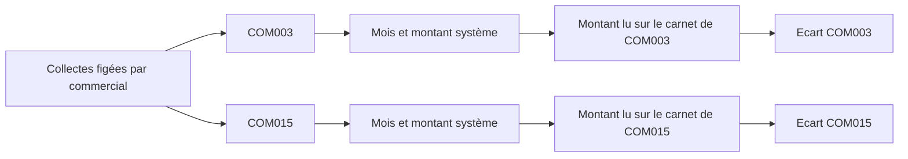

---
todos:
  - id: aggregate
    status: completed
    content: 'Agréger les collectes par commercial et par mois, et persister commercial_username sur la ligne de contrôle'
  - id: api
    status: completed
    content: 'Étendre création et lecture du contrôle : lignes par commercial, récap, commerciaux non contrôlés'
  - id: pack-mobile
    status: completed
    content: 'Pack et détail en ligne + sheet Terrain : un bloc de mois par commercial, file hors ligne'
  - id: web
    status: completed
    content: Modal web et section Contrôle terrain de la fiche membre
  - id: guide
    status: in_progress
    content: 'Guide, index RAG, HTML MkDocs, changelog et versions'
name: Contrôle par commercial
overview: 'Le contrôle terrain tontine compare aujourd’hui le carnet au total de tous les commerciaux. Chaque collecte garde déjà le commercial qui l’a enregistrée : on s’appuie sur ce montant figé pour contrôler COM003 et COM015 séparément, mois par mois, et attribuer l’écart.'
isProject: false
---

# Contrôle terrain tontine par commercial

## Constat

Chaque collecte tontine fige le commercial du moment dans `TontineCollection.commercialUsername` ([TontineService.resolveCollectionCommercialUsername](backend/src/main/java/com/optimize/elykia/core/service/tontine/TontineService.java)). Un changement de commercial ensuite ne réécrit pas l’historique : COM003 reste propriétaire de ses collectes, COM015 des siennes.

La fiche membre web le montre déjà, mais seulement en total : « Cotisations par commercial » ([TontineMemberContributionService](backend/src/main/java/com/optimize/elykia/core/service/tontine/TontineMemberContributionService.java)).

Le contrôle terrain, lui, additionne **toutes** les collectes du mois (`collectionDate`) sans regarder le commercial ([TontineMemberFieldControlService.sumCollectionsForMonth](backend/src/main/java/com/optimize/elykia/core/service/tontine/TontineMemberFieldControlService.java)). Un écart de 15 000 F ne dit pas si c’est COM003 ou COM015, ni sur quel mois. Le formulaire mobile ([rm-tontine-field-control-sheet](mobile/src/app/features/rm/tontine-field-control/rm-tontine-field-control-sheet.component.ts)) et le modal web font la même chose.

Le crédit n’est pas dans ce lot : son contrôle est un seul total, sans mois ni succession de commerciaux tontine.

## Règle métier

- Un contrôle reste **une visite** (une référence, une note, un auteur).
- À l’intérieur, une ligne = **un commercial + un mois** (février–novembre, axe `collectionDate`, identique à aujourd’hui).
- Le montant système de la ligne est recalculé côté serveur : somme des collectes actives de **ce** commercial pour **ce** mois. Le montant envoyé par l’écran n’est pas repris.
- Le carnet saisi est ce que **ce** commercial a marqué pour ce mois. Si les deux ont collecté en juin, juin apparaît deux fois, avec deux montants système.
- L’écart du commercial = somme carnet − somme système de ses lignes saisies. L’écart du membre = somme des écarts. Statut **CONFORME** seulement si toutes les lignes saisies tombent juste ; sinon **ECART**, avec le commercial et le montant en cause.
- Un commercial qui a des collectes mais aucune ligne dans ce contrôle reste « non contrôlé ». On ne le déclare pas conforme. On n’empêche pas d’enregistrer : le chef peut ne traiter que COM003 sur cette visite.
- S’il n’y a qu’un seul commercial, l’écran reste une liste de mois, avec son nom en en-tête.
- Les anciens contrôles (lignes sans commercial) s’affichent comme aujourd’hui, sous « Ensemble des commerciaux ».

Ordre d’affichage : commercial le plus ancien d’abord (première collecte), commercial actuel badgé **Actuel**. Le commercial actuel sans collecte apparaît à 0, comme sur la fiche web.

## Backend

- Migration : colonne nullable `commercial_username` sur `tontine_member_field_control_line`. Pas d’entrée au catalog IA (table absente de la whitelist).
- Agrégat JPQL : membre + `commercialUsername` + année + mois de `collectionDate`. Réutilisé par le pack hors ligne et par le détail en ligne.
- [CreateTontineMemberFieldControlMonthDto](backend/src/main/java/com/optimize/elykia/core/dto/CreateTontineMemberFieldControlMonthDto.java) : `commercialUsername` obligatoire pour un nouveau contrôle. Clé d’unicité `année-mois-commercial`.
- DTO de réponse : les lignes portent le commercial ; un récapitulatif `collectors[]` donne pour chacun le total système, le total carnet, l’écart et le statut. Les commerciaux du membre absents du contrôle sont listés à part comme non contrôlés.
- Tests service : deux commerciaux le même mois, un seul commercial, montant client ignoré, ancien contrôle sans commercial toujours lisible.

## Écrans

Même forme de données en ligne et dans le pack du jour, pour que le sheet Terrain fonctionne hors ligne :

- `collectors[]` sur le membre : identifiant, badge actuel, total, mois `{ year, month, systemAmount }`.
- Le tableau `months` agrégé reste pour les packs déjà téléchargés : sans `collectors`, le sheet garde l’ancien formulaire unique et l’indique comme non découpé. Un pack retéléchargé est découpé.

Mobile : [rm-tontine-field-control-sheet](mobile/src/app/features/rm/tontine-field-control/rm-tontine-field-control-sheet.component.html) — un bloc par commercial, mois cochables, saisie carnet, écart du bloc, puis écart global. La file hors ligne envoie `commercialUsername` avec chaque mois.

Web : le modal [tontine-field-control-modal](frontend/src/app/tontine/components/modals/tontine-field-control-modal/tontine-field-control-modal.component.ts) reçoit la même répartition (les résumés mensuels actuels ne portent pas le commercial). La section Contrôle terrain de la fiche membre affiche le récapitulatif par commercial sous les totaux. Les cartes « Cotisations par commercial » restent le total système ; le contrôle est l’endroit où l’écart est attribué.

## Livraison

Guide chef de recouvrement (web et mobile) : contrôle mois par mois **à l’intérieur de chaque commercial**, écart nommé, commerciaux non contrôlés. Régénérer l’index RAG et le HTML. Changelog backend + mobile + frontend, versions patch.
