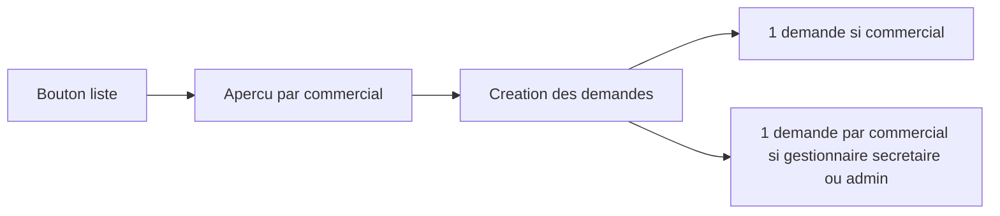

# Fiche de commande et demande de stock globale

## 1. Fiche PDF

Nouveau PDF backend, thème navy déjà en place (`PdfDocumentIdentity`, fragments `pdf/fragments`, `PdfHtmlRenderer`). Pas de HTML généré côté Angular.

- Endpoint `GET /api/v1/orders/{id}/pdf` dans [`OrderController`](backend/src/main/java/com/optimize/elykia/core/controller/sale/OrderController.java), même accès que la consultation (`assertOrderPortfolioAccess` : un commercial ne télécharge que les commandes de son portefeuille).
- Service `OrderSheetPdfService` + template `order-sheet-export.html` + DTO.
- Contenu : en-tête entreprise (AMENOUVEVE-YAVEH, TOKOIN HÔPITAL, téléphone), titre **Fiche de commande**, référence `CMD-{id}`, date, statut en français, source si commande en ligne.
- Bloc client : nom, prénom, téléphone, quartier, adresse.
- Commercial associé : nom affiché du collecteur crédit (`client.collector`), avec le nom/prénom du compte s’il existe (même résolution que [`ClientListPdfService`](backend/src/main/java/com/optimize/elykia/core/service/client/ClientListPdfService.java)).
- Tableau des articles : désignation, quantité, prix unitaire, montant de ligne, puis montant total.
- Le téléchargement est possible **quel que soit le statut** : en attente, validée, livrée, refusée ou annulée. Le backend ne filtre pas sur `OrderStatus`. Le bouton n’entre pas dans `getAvailableActions` (qui masque des actions selon le statut) : il est toujours affiché, à côté des autres actions.
- Frontend : bouton **Télécharger la fiche** sur chaque ligne de [`order-table.component.html`](frontend/src/app/orders/components/order-table/order-table.component.html) et dans la barre d’actions de [`order-details.component.html`](frontend/src/app/orders/pages/order-details/order-details.component.html). Téléchargement blob comme la fiche client (`client-list.component.ts`), fichier `fiche-commande-{id}.pdf`.

## 2. Demande de stock pour toutes les commandes en attente

Le flux actuel [`POST /api/stock-requests/from-orders`](backend/src/main/java/com/optimize/elykia/core/controller/stock/StockRequestController.java) ne traite que les ids envoyés (page ou sélection). Le bouton global charge **toutes** les commandes `PENDING` éligibles, hors pagination, recherche et filtre commercial de l’écran.

- Nouveau `POST /api/stock-requests/from-pending-orders` (permission `ROLE_ORDER_STOCK_REQUEST` déjà exigée), body `{ forNextMonth, source? }`.
- Périmètre :
  - Commercial (`isPromoterOnly`) : uniquement `client.collector` = son identifiant.
  - Gestionnaire, secrétaire ou admin (`isStaffAllAccess`) : toutes les commandes en attente, **une demande par commercial**.
- Éligibilité reprise de [`OrderStockRequestService.validateEligible`](backend/src/main/java/com/optimize/elykia/core/service/order/OrderStockRequestService.java) : statut en attente, commercial renseigné, pas de demande de stock active. Les commandes déjà liées sont **ignorées** (le lot ne doit pas échouer pour elles). S’il n’en reste aucune : message explicite.
- `source` : renseigné seulement depuis **Services en ligne > Commandes** (`CUSTOMER_SPACE`), pour ne pas mélanger les commandes agence. Sur **Menu Commandes**, toutes les sources.
- Aperçu : `GET` du même chemin qui renvoie, par commercial, le nombre de commandes et les articles agrégés. La modale existante [`order-stock-request-modal`](frontend/src/app/orders/components/modals/order-stock-request-modal/order-stock-request-modal.component.ts) affiche cet aperçu et conserve le choix « mois suivant », puis appelle la création.
- Bouton **Demande de stock (en attente)** dans la barre d’outils de [`order-dashboard.component.html`](frontend/src/app/orders/pages/order-dashboard/order-dashboard.component.html), visible si `canRequestStock`. Il ne dépend pas de l’onglet affiché.

## 3. Livraison

- Test unitaire : commercial limité à son portefeuille ; staff produit une demande par commercial ; commandes déjà liées ignorées.
- Guide : [`user-guide/docs/commercial/sales_orders.md`](user-guide/docs/commercial/sales_orders.md) (fiche + bouton sur ses commandes en attente) et [`user-guide/docs/manager/operations.md`](user-guide/docs/manager/operations.md) (fiche + une demande par commercial). Puis index RAG et build MkDocs vers `frontend/src/user-guide/`.
- Versions Frontend et Backend + `docs/CHANGELOG.md`.
