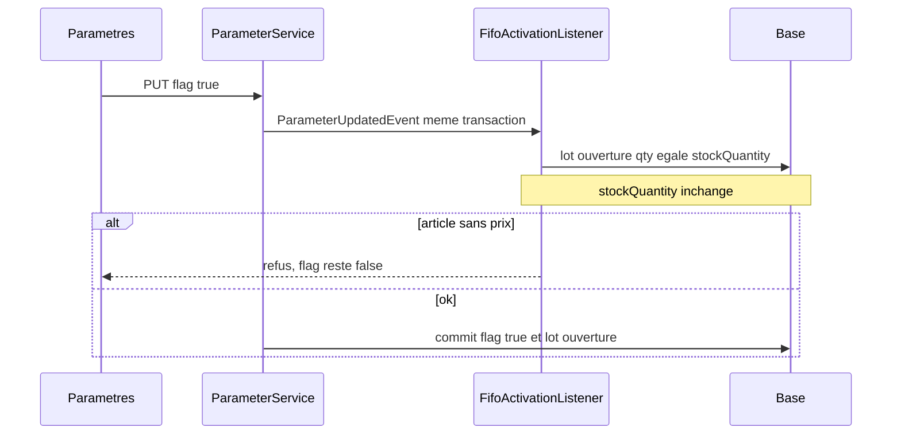

---
todos:
  - id: tx-parameter
    status: completed
    content: 'Rendre ParameterService.create/update transactionnels, sans y mettre de logique stock'
  - id: opening-lot
    status: completed
    content: 'À l''activation, un lot MIGRATION par article en stock, quantité = stockQuantity, sans modifier le stock'
  - id: listener
    status: completed
    content: 'Listener synchrone dans le backend sur ParameterUpdatedEvent (false vers true), refus du true vers false'
  - id: lock-writes
    status: completed
    content: 'Verrouiller la ligne du paramètre au début des écritures déjà branchées FIFO, pour que le lot d''ouverture soit le premier'
  - id: tests-guide
    status: in_progress
    content: 'Tests du lot d''ouverture, guide utilisateur, index RAG et changelog'
name: Activation FIFO atomique
overview: 'Activer ENABLED_FIFO_STOCK_VALUATION crée, dans la même transaction, un lot d''ouverture égal au stock existant. Le stockQuantity n''est pas modifié. Les réceptions suivantes créent les lots suivants, consommés après ce premier lot.'
isProject: false
---

# Activation FIFO en un seul paramètre

## Décision

La migration ne modifie pas `stockQuantity`. Elle pose un seul lot d'ouverture par article dont le stock est supérieur à 0 : quantité = stock actuel, source `MIGRATION`. Ce lot est le premier consommé. Les réceptions validées ensuite passent déjà par `registerEntry` et deviennent les lots suivants.

Pas de reconstitution des réceptions passées. Pas de complément, pas de réduction de lots, pas d'ajustement d'inventaire dans ce changement.

`common-securities` ne contient pas le flux stock. Il publie déjà [`ParameterUpdatedEvent`](backend-lib/common-securities/src/main/java/com/optimize/common/securities/event/ParameterUpdatedEvent.java). La seule modification de la librairie : `create` et `update` de [`ParameterService`](backend-lib/common-securities/src/main/java/com/optimize/common/securities/service/ParameterService.java) deviennent `@Transactional`, pour qu'un refus annule aussi le paramètre.

L'utilisateur active `ENABLED_FIFO_STOCK_VALUATION`. Rien d'autre.

## Flux

## 1. Transaction dans common-securities

Annoter `create` et `update` avec `@Transactional`. Aucune clé FIFO, aucun appel stock.

## 2. Listener dans le backend

`@EventListener` synchrone, pas `AFTER_COMMIT` :

- `ENABLED_FIFO_STOCK_VALUATION` de `false` vers `true`, ou création à `true` : [`FifoStockActivationService`](backend/src/main/java/com/optimize/elykia/core/service/stock/FifoStockActivationService.java).
- `true` vers `false` : refuser, le flag reste actif.
- Une exception annule le paramètre et les lots.

## 3. Lot d'ouverture

Remplacer le backfill par réceptions. Pour chaque article verrouillé :

- `stockQuantity <= 0` : aucun lot.
- Aucun lot ouvert : un lot `MIGRATION`, `quantityInitial` = `quantityRemaining` = `stockQuantity`. `entry_date` du jour ; l'ordre FIFO `(entry_date, id)` le place avant les réceptions créées après le commit.
- Un lot `MIGRATION` couvre déjà exactement le stock : ne rien refaire.
- Des lots existent et leur somme diffère du stock : refuser l'activation, sans toucher au stock ni aux lots. Le message cite l'article.
- Prix : `purchasePrice` si `> 0`, sinon dernier `unitPrice` d'une réception `VALIDATED`. Sinon refus, articles listés, aucun lot conservé.

## 4. Verrou le temps du basculement

`StockValuationFacade.lockAndIsFifoEnabled()` au début des écritures déjà branchées sur la façade, avant de lire le flag :

- [`StockReceptionService`](backend/src/main/java/com/optimize/elykia/core/service/stock/StockReceptionService.java)
- [`StockRequestService`](backend/src/main/java/com/optimize/elykia/core/service/stock/StockRequestService.java) et [`StockTontineRequestService`](backend/src/main/java/com/optimize/elykia/core/service/stock/StockTontineRequestService.java)
- [`StockReturnService`](backend/src/main/java/com/optimize/elykia/core/service/stock/StockReturnService.java) et [`StockTontineReturnService`](backend/src/main/java/com/optimize/elykia/core/service/stock/StockTontineReturnService.java)

Une réception qui attend le verrou voit le flag à `true` et crée son lot après le lot d'ouverture.

## 5. Tests et guide

- Article sans prix : flag reste `false`, aucun lot.
- Stock 10 : un lot `MIGRATION` de 10, `stockQuantity` inchangé, flag `true`.
- Stock 0 : pas de lot.
- Second passage inutile : pas de deuxième lot.
- `true` vers `false` refusé.
- Après activation, une réception ajoute un lot distinct, consommé après le lot d'ouverture.

Guide gestionnaire : activer l'option dans Paramètres suffit. Le stock déjà en magasin est repris sur un premier lot. Les entrées suivantes s'y ajoutent. Si un article n'a pas de prix d'achat, l'activation ne se fait pas. Puis index RAG, build MkDocs et changelog.

## Hors périmètre

Inventaire, remise à zéro et `makeStockRelease` ne sont pas rebranchés ici. Pas de désactivation FIFO. Pas de reconstruction des coûts historiques. Pas de logique stock dans `common-securities`.
