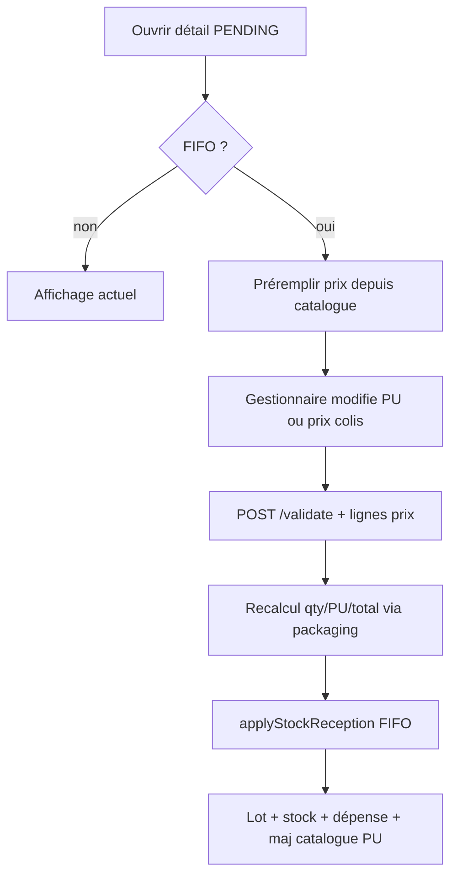

# Prix éditables à la validation (FIFO)

## Constat

Aujourd’hui, en FIFO :

- La création fige `unitPrice` / `packagePrice` / `totalAmount` via [`ArticlePackagingPricingService.resolveFifoEntry`](backend/src/main/java/com/optimize/elykia/core/service/stock/ArticlePackagingPricingService.java).
- [`POST .../validate`](backend/src/main/java/com/optimize/elykia/core/controller/stock/StockReceptionController.java) n’accepte **aucun body**.
- [`applyStockReception`](backend/src/main/java/com/optimize/elykia/core/service/stock/StockReceptionService.java) réutilise le snapshot ligne ; le total réception n’est pas recalculé.
- Le détail ([`stock-reception-detail`](frontend/src/app/stock/pages/stock-reception-detail/)) affiche PU / total en lecture seule ; `packagePrice` n’est pas éditable.
- La liste permet un **Valider** en un clic sans passer par les prix.

Le plan legacy [prix_catalogue_validation_r_ception_c436b90a.plan.md](.cursor/plans/prix_catalogue_validation_r_ception_c436b90a.plan.md) reste hors périmètre (legacy déjà au catalogue serveur).

## Cible



| Mode ligne | Champ éditable | Préremplissage catalogue | Recalcul |
|---|---|---|---|
| `UNIT` | Prix unitaire | `article.purchasePrice` | `total = PU × quantity` |
| `WHOLESALE` | Prix du colis | `article.wholesalePurchasePrice` (sinon `purchasePrice × unitsPerPackage` si gros prix absent) | via `resolveFifoEntry` : PU dérivé, `total = packagePrice × packageCount` |
| `HALF_WHOLESALE` | Prix du demi-colis | `article.halfWholesalePurchasePrice` (sinon `purchasePrice × units/2`) | idem |

- Quantités / mode packaging / nombre de colis : **non modifiables** à la validation (déjà figés à la création).
- Prix ≤ 0 : refus côté front et backend.
- Après validation FIFO : comportement actuel conservé (`article.purchasePrice = PU retenu`, lot créé, dépense sur `totalAmount` recalculé).

### Règle de vérité des prix (critique)

Le **catalogue ne sert qu’à préremplir l’UI**. Une fois le gestionnaire sur l’écran de validation :

1. Le front envoie **pour chaque ligne** le prix exact affiché/saisi (`unitPrice` ou `packagePrice`), même s’il est différent du catalogue.
2. Le backend **ne recalcule jamais** ce prix à partir du catalogue lorsqu’il est présent dans le body.
3. Seuls les dérivés autorisés restent : en gros/demi-gros, `unitPrice = packagePrice / unitsInMode` et `totalPrice` — à partir du `packagePrice` **envoyé**, pas du catalogue.
4. Le catalogue du jour n’est utilisé **que** si une ligne n’apparaît pas dans le body (filet de sécurité, ex. appel sans body). Dès qu’un prix est fourni pour la ligne, c’est **cette valeur exacte** qui part dans le lot, la dépense et la mise à jour du PU catalogue article.

```text
prix body présent  → utiliser tel quel (arrondi money existant uniquement)
prix body absent   → fallback catalogue du jour
ne jamais         → écraser un prix body par le catalogue
```

## Backend

### Contrat API

Étendre [`StockReceptionController.validateReception`](backend/src/main/java/com/optimize/elykia/core/controller/stock/StockReceptionController.java) :

```java
@PostMapping("/{id}/validate")
ResponseEntity<Response> validateReception(
    @PathVariable Long id,
    @RequestBody(required = false) StockReceptionValidateRequest request)
```

Nouveau DTO, ex. `StockReceptionValidateRequest` :

```java
List<Line> items; // pour le parcours détail FIFO : une entrée par ligne
// Line: Long itemId; Double unitPrice; Double packagePrice;
```

- **Legacy** : ignorer le body (comportement catalogue actuel inchangé).
- **FIFO** :
  1. Charger la réception + items.
  2. Pour chaque ligne, résoudre le prix d’achat à appliquer :
     - si la ligne est dans le body avec un prix `> 0` → **retenir exactement ce prix** (gestionnaire) ;
     - sinon seulement → catalogue du jour (filet si body incomplet).
  3. Reconstruire un `StockEntry` (mode / qty ou packageCount déjà sur l’item) avec ce prix, puis `articlePackagingPricingService.resolveFifoEntry` — sans releire le catalogue pour remplacer le prix.
  4. Écrire sur l’item : `unitPrice`, `packagePrice`, `totalPrice` (qty inchangée si cohérente avec le snapshot packaging).
  5. `reception.setTotalAmount(Σ totalPrice)`.
  6. Appeler `applyStockReception` (qui lit les lignes déjà à jour ; en FIFO ne pas écraser `item.unitPrice` / `packagePrice` par le catalogue).

Dans `applyStockReception` (FIFO) : utiliser le snapshot déjà posé sur l’item ; recalculer `reception.totalAmount` avant la dépense.

### Permissions

Inchangées : gestionnaire / admin pour valider. Les prix d’achat restent masqués sans `ROLE_SHOW_PURCHASE_PRICE` dans les réponses GET ; le body de validation n’est accepté que pour les rôles qui valident déjà.

## Frontend

### Détail réception (écran principal)

[`stock-reception-detail.component`](frontend/src/app/stock/pages/stock-reception-detail/) :

1. Lire `StockFifoFeatureService.isFifoEnabled()`.
2. Si `PENDING` + FIFO + `canShowPurchasePrice` + `canValidateOrRefuse()` :
   - charger les articles des lignes (GET article ou enrichir le DTO détail avec `catalogPurchasePrice`, `catalogWholesalePurchasePrice`, `catalogHalfWholesalePurchasePrice`) pour préremplir ;
   - **UNIT** : input « Prix unitaire » ;
   - **WHOLESALE / HALF_WHOLESALE** : input « Prix du colis / demi-colis », afficher PU dérivé + total ligne en lecture seule ;
   - KPI « Montant total » = somme des totaux recalculés localement.
3. `validateReception()` envoie **toutes** les lignes avec le prix exact du formulaire (`unitPrice` ou `packagePrice` selon le mode), y compris si le gestionnaire n’a rien modifié après le préremplissage, et y compris si la valeur diffère du catalogue.
4. Ne pas omettre une ligne « parce que égale au catalogue » : le body doit être exhaustif depuis le détail.
5. Hors FIFO ou hors PENDING : affichage actuel (lecture seule).

Préférer enrichir le DTO détail backend (évite N+1 front) : champs catalogue optionnels sur [`StockReceptionItemDto`](backend/src/main/java/com/optimize/elykia/core/dto/StockReceptionItemDto.java), remplis uniquement si FIFO + PENDING + droit prix d’achat — **uniquement pour le préremplissage UI**, jamais comme source à la validation si un body est envoyé.

### Liste Historique Entrée

[`stock-reception-list`](frontend/src/app/stock/pages/stock-reception-list/) :

- **FIFO ON** : le bouton **Valider** navigue vers `/stock/receptions/:id` (le gestionnaire ajuste les prix puis valide).
- **FIFO OFF** : conserver le Valider en un clic (legacy catalogue serveur).

### Service

[`stock-reception.service.ts`](frontend/src/app/stock/services/stock-reception.service.ts) : `validateReception(id, body?: StockReceptionValidateRequest)`.

## Tests

Backend (`StockReceptionServiceTest`) :

- FIFO UNIT : body PU 180 alors que catalogue = 120 → lot / item / total / dépense / `article.purchasePrice` = **180** (pas 120).
- FIFO UNIT : body vide → PU = catalogue du jour (fallback uniquement).
- FIFO WHOLESALE : body `packagePrice` non catalogue → PU dérivé de **ce** packagePrice, total = packagePrice × count.
- Legacy : body ignoré, catalogue inchangé (non-régression).
- Prix ≤ 0 → `CustomValidationException`.

Frontend : pas d’e2e obligatoire sauf spec existante de réception ; adapter si un test clique Valider depuis la liste en FIFO.

## Guide / changelog

- [`user-guide/docs/manager/stock_sales.md`](user-guide/docs/manager/stock_sales.md) : à la validation, le gestionnaire peut ajuster le prix d’achat (unitaire ou par colis) prérempli depuis le catalogue, puis valider. Style métier (`user-guide-writing-style`).
- Régénérer index RAG + `frontend/src/user-guide/`.
- Versions : Backend **mineur** (feature validation), Frontend **patch** (UI détail/liste) + `docs/CHANGELOG.md`.
- Inclure ce plan sous `.cursor/plans/` dans le commit.

## Hors périmètre

- Modifier quantités ou mode packaging à la validation.
- Changer le comportement legacy (déjà catalogue à la validation).
- Désactivation FIFO / migration des lots.
- Édition des prix sur la liste sans ouvrir le détail.
