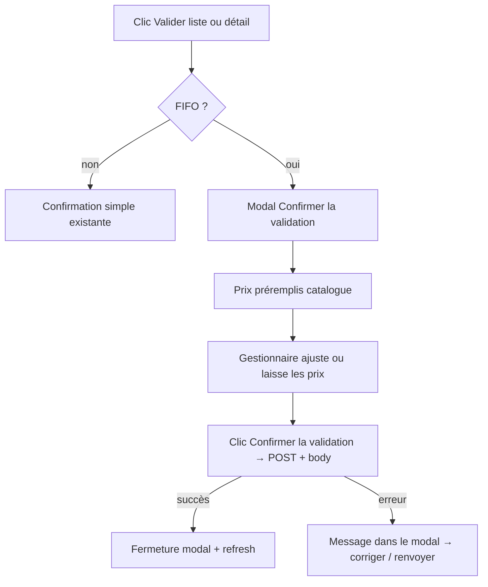

# Prix éditables à la validation (FIFO)

## Constat (avant cette feature)

En FIFO, la création figeait les prix, `POST .../validate` n’acceptait aucun body, et le détail / la liste validaient sans possibilité d’ajuster les prix d’achat.

Le plan legacy [prix_catalogue_validation_r_ception_c436b90a.plan.md](.cursor/plans/prix_catalogue_validation_r_ception_c436b90a.plan.md) reste hors périmètre (legacy déjà au catalogue serveur).

## Cible UX



Le détail PENDING reste **lecture seule** (pas d’édition inline des prix).

| Mode ligne | Champ éditable | Préremplissage catalogue | Recalcul |
|---|---|---|---|
| `UNIT` | Prix unitaire | `article.purchasePrice` | `total = PU × quantity` |
| `WHOLESALE` | Prix du colis | `article.wholesalePurchasePrice` (sinon `purchasePrice × unitsPerPackage` si gros prix absent) | via `resolveFifoEntry` : PU dérivé, `total = packagePrice × packageCount` |
| `HALF_WHOLESALE` | Prix du demi-colis | `article.halfWholesalePurchasePrice` (sinon `purchasePrice × units/2`) | idem |

- Quantités / mode packaging / nombre de colis : **non modifiables** à la validation (déjà figés à la création).
- Prix ≤ 0 : refus côté front et backend.
- Après validation FIFO : comportement actuel conservé (`article.purchasePrice = PU retenu`, lot créé, dépense sur `totalAmount` recalculé).

### Règle de vérité des prix (critique)

Le **catalogue ne sert qu’à préremplir l’UI**. Une fois le gestionnaire sur l’écran de validation :

1. Le front envoie **pour chaque ligne** le prix exact affiché/saisi (`unitPrice` ou `packagePrice`), même s’il est différent du catalogue.
2. Le backend **ne recalcule jamais** ce prix à partir du catalogue lorsqu’il est présent dans le body.
3. Seuls les dérivés autorisés restent : en gros/demi-gros, `unitPrice = packagePrice / unitsInMode` et `totalPrice` — à partir du `packagePrice` **envoyé**, pas du catalogue.
4. Le catalogue du jour n’est utilisé **que** si une ligne n’apparaît pas dans le body (filet de sécurité, ex. appel sans body). Dès qu’un prix est fourni pour la ligne, c’est **cette valeur exacte** qui part dans le lot, la dépense et la mise à jour du PU catalogue article.

```text
prix body présent  → utiliser tel quel (arrondi money existant uniquement)
prix body absent   → fallback catalogue du jour
ne jamais         → écraser un prix body par le catalogue
```

## Backend

### Contrat API

Étendre [`StockReceptionController.validateReception`](backend/src/main/java/com/optimize/elykia/core/controller/stock/StockReceptionController.java) :

```java
@PostMapping("/{id}/validate")
ResponseEntity<Response> validateReception(
    @PathVariable Long id,
    @RequestBody(required = false) StockReceptionValidateRequest request)
```

Nouveau DTO, ex. `StockReceptionValidateRequest` :

```java
List<Line> items; // pour le parcours détail FIFO : une entrée par ligne
// Line: Long itemId; Double unitPrice; Double packagePrice;
```

- **Legacy** : ignorer le body (comportement catalogue actuel inchangé).
- **FIFO** :
  1. Charger la réception + items.
  2. Pour chaque ligne, résoudre le prix d’achat à appliquer :
     - si la ligne est dans le body avec un prix `> 0` → **retenir exactement ce prix** (gestionnaire) ;
     - sinon seulement → catalogue du jour (filet si body incomplet).
  3. Reconstruire un `StockEntry` (mode / qty ou packageCount déjà sur l’item) avec ce prix, puis `articlePackagingPricingService.resolveFifoEntry` — sans releire le catalogue pour remplacer le prix.
  4. Écrire sur l’item : `unitPrice`, `packagePrice`, `totalPrice` (qty inchangée si cohérente avec le snapshot packaging).
  5. `reception.setTotalAmount(Σ totalPrice)`.
  6. Appeler `applyStockReception` (qui lit les lignes déjà à jour ; en FIFO ne pas écraser `item.unitPrice` / `packagePrice` par le catalogue).

Dans `applyStockReception` (FIFO) : utiliser le snapshot déjà posé sur l’item ; recalculer `reception.totalAmount` avant la dépense.

### Permissions

Inchangées : gestionnaire / admin pour valider. Les prix d’achat restent masqués sans `ROLE_SHOW_PURCHASE_PRICE` dans les réponses GET ; le body de validation n’est accepté que pour les rôles qui valident déjà.

## Frontend

### Modal de confirmation (parcours principal)

Nouveau composant MatDialog [`stock-reception-validate-dialog`](frontend/src/app/stock/components/stock-reception-validate-dialog/) :

1. Ouvert au clic **Valider** (liste ou détail) lorsque FIFO est actif.
2. Charge toutes les lignes (pagination API), préremplit les prix depuis les champs catalogue du DTO.
3. Affiche articles + champs éditables (PU ou prix colis) + total recalculé.
4. **Confirmer la validation** → `POST /validate` avec le body exhaustif des prix exacts saisis.
5. Succès → ferme le modal (`true`) ; erreur → bandeau d’erreur dans le modal, correction possible, renvoi.
6. Page détail reste en lecture seule.

### Liste / détail

- FIFO ON : **Valider** ouvre le modal (plus de redirect détail ni édition inline).
- FIFO OFF : confirmation simple existante (legacy).

### Service

[`stock-reception.service.ts`](frontend/src/app/stock/services/stock-reception.service.ts) : `validateReception(id, body?: StockReceptionValidateRequest)`.

## Tests

Backend (`StockReceptionServiceTest`) :

- FIFO UNIT : body PU 180 alors que catalogue = 120 → lot / item / total / dépense / `article.purchasePrice` = **180** (pas 120).
- FIFO UNIT : body vide → PU = catalogue du jour (fallback uniquement).
- FIFO WHOLESALE : body `packagePrice` non catalogue → PU dérivé de **ce** packagePrice, total = packagePrice × count.
- Legacy : body ignoré, catalogue inchangé (non-régression).
- Prix ≤ 0 → `CustomValidationException`.

Frontend : pas d’e2e obligatoire sauf spec existante de réception ; adapter si un test clique Valider depuis la liste en FIFO.

## Guide / changelog

- [`user-guide/docs/manager/stock_sales.md`](user-guide/docs/manager/stock_sales.md) : à la validation, le gestionnaire peut ajuster le prix d’achat (unitaire ou par colis) prérempli depuis le catalogue, puis valider. Style métier (`user-guide-writing-style`).
- Régénérer index RAG + `frontend/src/user-guide/`.
- Versions : Backend **mineur** (feature validation), Frontend **patch** (UI détail/liste) + `docs/CHANGELOG.md`.
- Inclure ce plan sous `.cursor/plans/` dans le commit.

## Hors périmètre

- Modifier quantités ou mode packaging à la validation.
- Changer le comportement legacy (déjà catalogue à la validation).
- Désactivation FIFO / migration des lots.
- Édition des prix sur la liste sans ouvrir le détail.
