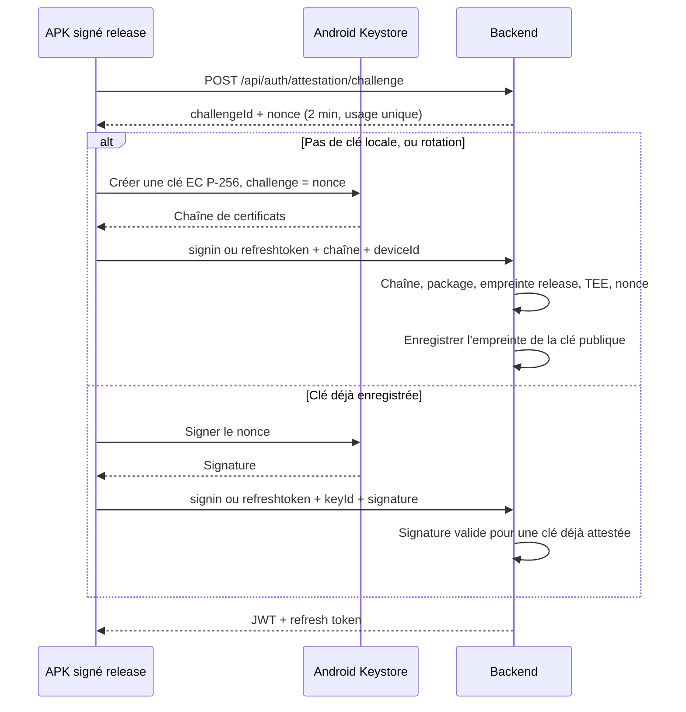

# Plan — Attestation de l'APK mobile hors Play Store

## Menace

Un employé de l'agence a un compte valide. Le dépôt est public. Il modifie le client, signe un APK avec sa propre clé, et appelle le backend de production avec son mot de passe. Le JWT lui est délivré aujourd'hui, parce que le backend authentifie la personne et pas le binaire.

Le contrôle des appareils (`X-Device-Id`, `DeviceAuthorizationFilter`) ne couvre pas ce cas : l'identifiant est choisi par l'application.

Hors périmètre de ce plan : le frontend web, l'espace client, iOS. Le web n'a pas d'équivalent matériel. L'espace client APK pourra réutiliser le même vérificateur plus tard, avec son propre package et son propre certificat.

## Décision

**Android Key Attestation**, pas Play Integrity. L'APK est publié sur MinIO (`/api/v1/mobile/app/release`), pas sur le Play Store. Play Integrity refuse ou classe « non reconnu » un binaire installé hors Play.

Le secret déjà présent dans GitHub Actions (`ANDROID_KEYSTORE_BASE64` et mots de passe associés, workflow `build-mobile-apk.yml`) signe l'APK. Il n'est pas envoyé dans un header. Le téléphone certifie, dans une chaîne signée par Google au niveau matériel, le package `com.optimize.elykia` et l'empreinte du certificat qui a réellement signé l'application. Un APK re-signé porte une autre empreinte. Le backend la refuse.

Android isole les données par certificat de signature. L'APK modifié, même avec le même package, ne s'installe pas par-dessus l'application officielle sans la désinstaller, et ne lit ni sa base locale ni sa clé Android Keystore. L'employé doit donc se reconnecter en ligne. C'est là que l'attestation bloque la délivrance du JWT.

## Flux

La clé privée est créée une fois dans le TEE et n'en sort pas. Le challenge d'attestation Android est fixé à la génération : on ne le change pas sur une clé existante. Les connexions suivantes prouvent la possession de cette clé en signant un nonce frais.

Avec le paramètre désactivé, le backend ignore la preuve et conserve le comportement actuel. Les APK déjà sur le terrain continuent de fonctionner.

## Backend

Module `backend-lib/common-securities`, à côté de `AuthController` et `DeviceAuthorizationFilter`.

### Preuve exigée

Au `POST /api/auth/signin` et au `POST /api/auth/refreshtoken`, quand `ENABLED_MOBILE_APP_ATTESTATION` vaut `true` :

- package `com.optimize.elykia` ;
- empreinte SHA-256 du certificat de signature égale à celle du keystore de release (config `elykia.attestation.release-cert-sha256`, une empreinte par environnement, pas de secret dans le dépôt : l'empreinte est publique, le calcul se fait avec `keytool -list -v` sur le keystore de CI) ;
- chaîne jusqu'à une racine d'attestation Google épinglée dans les resources (jeu publié par Google, y compris les racines RKP, avec date d'expiration) ;
- niveau de sécurité TEE ou StrongBox (le niveau SOFTWARE est refusé en prod) ;
- `verifiedBootState = Verified` et bootloader verrouillé ;
- nonce égal au challenge consommé, ou signature du nonce par une clé déjà enregistrée.

Échec : HTTP 403, corps `{ "code": "APP_NOT_GENUINE", "message": "..." }`. Le JWT n'est pas émis. Le mot de passe déjà vérifié ne suffit pas : en cas d'échec d'attestation après authentification du mot de passe, aucune session n'est créée (même ordre que le contrôle device actuel dans `authenticateUser`).

Le refresh dure 24 h en prod (`jwtRefreshExpirationMs`). Sans preuve au refresh, un jeton volé sur l'application officielle serait renouvelable depuis l'APK modifié. Le refresh exige donc la même preuve. L'access token reste à 24 h : l'application est hors-ligne dans la journée. Fenêtre résiduelle documentée plus bas.

`POST /api/auth/attestation/challenge` est public, comme `/api/auth/signin`. Il ne révèle aucun compte. Il enregistre un nonce de 32 octets, TTL 2 minutes, usage unique. Stockage en base pour les plusieurs instances du backend. Réponse : `challengeId`, `nonce` (base64), `expiresAt`.

### Données

Prochaine migration Flyway libre (V024 à la date de ce plan) :

- `mobile_attested_key` : identifiant, `device_id`, empreinte SHA-256 de la clé publique, clé publique (SPKI), package, empreinte du certificat d'application, niveau de sécurité, état de boot, dates de création, dernier usage, révocation.
- `attestation_challenge` : identifiant, nonce, expiration, date de consommation.

Tables techniques de sécurité. Ne pas les ajouter à `schema-catalog.json`.

La clé est liée à l'installation (appareil + binaire), pas à un utilisateur. Plusieurs commerciaux sur le même téléphone officiel passent. L'APK modifié ne possède pas la clé.

Rotation : au changement de `appVersion`, l'application génère une nouvelle clé (nouveau challenge). L'ancienne reste valide 7 jours puis le backend la refuse, pour ne pas couper un téléphone au milieu d'une mise à jour.

Révocation : endpoint admin réservé au même périmètre que la révocation d'appareil (`UserDeviceController`), qui pose `revoked_at`. Utile si un téléphone est compromis alors que l'APK officiel est encore dessus.

### Paramètre et configuration

Même mécanisme que `ENABLED_MOBILE_DEVICE_RESTRICTION` :

- clé `ENABLED_MOBILE_APP_ATTESTATION` ;
- valeur initiale `false` dans `backend/src/main/resources/application.yml` (bloc `init-data` des paramètres) et dans `backend-lib/common-securities` ;
- modifiable dans l'écran Paramètres déjà utilisé pour le contrôle des appareils.

Propriétés, profil `prod` strictes, profils locaux assouplies :

| Propriété | Prod | Local / test auto |
|-----------|------|-------------------|
| `elykia.attestation.release-cert-sha256` | empreinte du keystore CI | empreinte debug en plus, pour les tests instrumentés |
| `elykia.attestation.allow-software` | `false` | `true` |
| `elykia.attestation.require-locked-boot` | `true` | `false` |

Le vérificateur s'appuie sur le parseur de référence Apache 2.0 [google/android-key-attestation](https://github.com/google/android-key-attestation), vendu dans `common-securities` (pas de dépendance Maven publiée stable). Les racines Google sont des fichiers dans `src/main/resources/attestation/`. Une racine expirée ou inconnue fait échouer la vérification (échec fermé).

Les tests unitaires utilisent des chaînes figées (vecteurs du dépôt Google, plus des cas construits : mauvais package, mauvaise empreinte, nonce rejoué, niveau SOFTWARE, boot déverrouillé). Pas de téléphone dans la CI pour le parseur.

### Ce qui ne change pas

`DeviceAuthorizationFilter` reste en place. Il répond à « quel téléphone ». L'attestation répond à « quel binaire ». Les deux flags sont indépendants.

Les routes déjà publiques (licence, release APK, health) ne demandent pas d'attestation. Elles ne délivrent pas de droit métier au nom de l'employé.

## Mobile

Plugin Capacitor local dans `mobile/android` (pas de plugin communautaire équivalent) :

- alias de clé `elykia_app_attest` ;
- `KeyGenParameterSpec` : EC P-256, clé non exportable, `setAttestationChallenge(nonce)`, usage signature ;
- `attest(nonce)` crée la clé et renvoie la chaîne en base64 DER ;
- `sign(nonce)` signe avec la clé existante ;
- `keyId` = empreinte SHA-256 de la clé publique, conservée dans `Preferences`.

`AuthService.login` et le refresh existant :

1. demander un challenge ;
2. signer, ou attester si aucune clé ou si `environment.version` a changé ;
3. envoyer la preuve avec le body déjà enrichi par `DeviceIdentityService`.

Échec `APP_NOT_GENUINE` : pas de repli sur le login hors-ligne (contrairement à une erreur réseau). Message affiché : « Cette installation n'est pas reconnue. Installez l'application fournie par votre agence. » Puis déconnexion, sur le modèle de `handleDeviceNotAuthorized`.

Le login hors-ligne actuel reste pour une coupure réseau après une installation officielle déjà connectée. Un APK modifié fraîchement installé n'a pas de session locale : il doit passer par l'API.

Build debug : le plugin fonctionne, le backend local accepte le certificat debug. Le backend de prod n'a que l'empreinte release. Un APK debug ne obtient pas de JWT de prod une fois le flag activé.

Aucun secret n'est ajouté au bundle. Le keystore reste uniquement dans les secrets du workflow.

## Ordre de mise en service

1. Livrer le code avec le paramètre à `false`. Déployer le backend. Publier l'APK sur MinIO. Les deux mondes cohabitent : les anciens APK se connectent encore, les nouveaux envoient déjà une preuve que le serveur ne vérifie pas.
2. UAT sur les modèles réellement utilisés par les commerciaux (pas seulement un émulateur). Relever les échecs TEE absents ou bootloader déverrouillé. Ajuster `require-locked-boot` seulement si des téléphones légitimes sont exclus, et le noter.
3. Quand la version publiée est celle qui atteste, et que les téléphones l'ont installée, passer `ENABLED_MOBILE_APP_ATTESTATION` à `true` dans Paramètres. L'effet est immédiat. Le retour arrière est le même interrupteur, sans republier l'APK.
4. Au moment de cette livraison (pas dans ce plan seul) : entrée dans `docs/CHANGELOG.md`, version mobile, et une phrase dans `user-guide/docs/commercial/mobile_app.md` sur le message d'installation non reconnue, puis index RAG et build MkDocs.

## Ce que l'employé ne peut plus faire

- Cloner le dépôt, modifier l'app, signer avec une autre clé, se connecter avec son mot de passe : le TEE inscrit son empreinte, le backend refuse, pas de JWT.
- Copier la chaîne de certificats d'un téléphone officiel : le nonce est à usage unique, et la clé privée n'est pas dans la chaîne.
- Lire la base ou le JWT de l'application officielle depuis son APK : Android sépare les données par certificat de signature.
- Renouveler un refresh token dérobé : le refresh redemande une signature de la clé matérielle.

## Ce qui reste possible

- Utiliser l'application officielle avec son compte pour faire une action que le backend autorise à ce compte. L'attestation ne remplace pas les contrôles métier (rôle, périmètre, propriété). Un champ envoyé par le client, comme le `collector` posé par `SecurityContextInterceptor`, ne doit pas être la source de la décision.
- Extraire un access token de l'application officielle (téléphone rooté, proxy) et l'utiliser jusqu'à son expiration, 24 h. Le refresh ne prolonge pas cette fenêtre. Allonger la protection au-delà demanderait de raccourcir l'access token, ce qui casse la journée hors-ligne : hors de ce lot.
- Instrumenter l'APK officiel sur un appareil dont le bootloader est déverrouillé (Frida). Le refus du boot déverrouillé et du niveau SOFTWARE ferme ce chemin sur les téléphones qui attestent honnêtement. Un TEE lui-même compromis sort du modèle.

## Critères d'acceptation

- Flag à `false` : un APK actuel se connecte et se rafraîchit comme aujourd'hui, avec ou sans preuve.
- Flag à `true`, APK signé release, téléphone avec TEE et boot vérifié : login et refresh obtiennent un JWT.
- Flag à `true`, APK signé avec une autre clé : 403 `APP_NOT_GENUINE`, aucun JWT, aucun refresh.
- Le même nonce présenté deux fois est refusé.
- Une signature dont la clé n'a pas été attestée pour `com.optimize.elykia` et l'empreinte release est refusée.
- Niveau SOFTWARE ou bootloader déverrouillé refusé quand les propriétés prod sont actives.
- Les tests du parseur passent sans appareil. Un essai manuel UAT sur au moins un téléphone du parc est noté avant l'activation prod.
