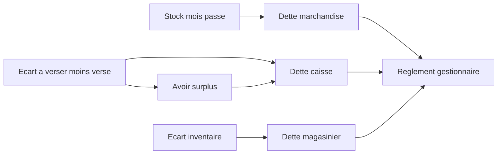

---
todos:
  - id: ledger
    status: completed
    content: 'Modèle Flyway, entités, service de registre, règlements et permissions ROLE_DEBT_MANAGEMENT'
  - id: merchandise
    status: completed
    content: 'Colonne et valeur dette (y compris réglée) dans le total dû, bouton ROLE_DEBT_MANAGEMENT, blocage rattrapage/retour'
  - id: cash
    status: completed
    content: 'Constitution jour et mois de l’écart de caisse, ventes comptant, avoir et imputation'
  - id: inventory
    status: completed
    content: 'Réconciliation inventaire : choisir le magasinier, ajuster le stock et créer la dette'
  - id: frontend
    status: completed
    content: 'Module /debts, cartes stock (vendu + dette + restant) et bilan annuel (dette globale, total réglé)'
  - id: delivery
    status: in_progress
    content: 'Tests, guide utilisateur, index RAG, schema catalog IA, changelog'
name: Module dettes
overview: 'Un registre unique de dettes pour les commerciaux et le magasinier : marchandises restantes des mois passés, écarts de caisse (manquant et surplus), écarts d’inventaire, avec règlement et pilotage depuis un module frontend.'
isProject: false
---

# Module Dettes commerciaux et magasinier

## Ce qui existe déjà

- Le stock commercial est mensuel : [`CommercialMonthlyStockItem`](backend/src/main/java/com/optimize/elykia/core/entity/stock/CommercialMonthlyStockItem.java) calcule `quantityRemaining = quantityTaken - quantitySold - quantityReturned`. Aucun report automatique au mois suivant. Le mois passé reste consultable dans **Stock mensuel** ([`my-stock-dashboard.component.html`](frontend/src/app/stock/pages/my-stock-dashboard/my-stock-dashboard.component.html)), vue Historique. La valeur affichée est `quantityRemaining × weightedAverageUnitPrice` (prix de vente moyen du stock).
- Tant que le reste est là, un rattrapage ([`RattrapageCreditService`](backend/src/main/java/com/optimize/elykia/core/service/sale/RattrapageCreditService.java)) ou un retour de stock antérieur peut encore le consommer.
- La caisse est déjà comparée au jour le jour : « à verser » (`DailyCommercialReport.totalAmountToDeposit` : avances, recouvrements, reliquats, tontine, soldes de nouveaux comptes) moins « versé » (`totalAmountDeposited`). L’écart n’est pas enregistré. Les ventes au comptant n’entrent pas dans « à verser » aujourd’hui.
- L’inventaire marque déjà un manque comme « dette du magasinier » ([`InventoryReconciliationService.reconcileDebt`](backend/src/main/java/com/optimize/elykia/core/service/store/InventoryReconciliationService.java), action `MARK_AS_DEBT`) sans montant, sans personne responsable et sans baisser le stock système.

Le rapport journalier cité sert au deuxième type (argent). Le bouton du premier type se place sur le stock mensuel des mois passés, là où les colonnes Pris / Vendu / Retourné / Restant sont affichées.

## Décisions

- **Prix marchandise** : au moment de la création, on fige le prix de vente du stock (`weightedAverageUnitPrice`) par article. C’est le prix déjà utilisé pour la valeur restante. Le prix d’achat est conservé sur la ligne pour le pilotage, il n’entre pas dans le montant dû.
- **Prix magasinier** : prix d’achat de l’article au moment de la réconciliation, figé. Un prix d’achat à zéro bloque la création.
- **La quantité en dette quitte le reste** : elle n’est plus vendable (rattrapage) ni retournable. Après paiement, la quantité reste dans la colonne Dette : c’est l’historique. Seul le statut financier passe à réglé.
- **Surplus de caisse** : avoir de la même personne. Il s’impute d’abord, du plus ancien au plus récent, sur ses manquants de caisse. Le gestionnaire peut ensuite l’affecter explicitement à une dette marchandise ou magasinier. Il ne s’impute pas tout seul sur ces autres dettes.
- **Ventes au comptant** : elles entrent dans les entrées d’argent du calcul de dette (montant des ventes `CASH` du commercial sur la période), en plus du « à verser » actuel. Le rapport journalier lui-même n’est pas recalculé dans ce lot.
- **Inventaire** : « Marquer comme dette du magasinier » crée la dette et aligne le stock système sur le comptage physique, dans la même opération. « Ajuster au physique » reste une correction de stock sans dette. Un surplus d’inventaire augmente le stock et ne crée pas d’avoir.
- **Période** : marchandise et caisse mensuelle seulement pour un mois déjà terminé. Caisse journalière seulement pour un jour déjà terminé. Pas de création automatique au changement de mois : le gestionnaire décide.
- **Permission** : `ROLE_DEBT_MANAGEMENT` dans [`application.yml`](backend/src/main/resources/application.yml), accordée par défaut à `GESTIONNAIRE`, `ADMIN` et `SUPER_ADMIN`. Elle protège la création, l’annulation et le règlement. Le commercial et le magasinier consultent seulement leur propre position.
- **Identité du stock** : pour un mois, valeur vendue + valeur dette + valeur restante = valeur totale due. La dette réglée reste dans ce total. Le règlement est affiché à part (« dont réglé »), il ne retire pas la quantité de la colonne Dette.

## Registre

Nouvelles tables (migration Flyway), un langage commun aux trois origines.

- `debt_document` : référence `DET-…`, titulaire (identifiant utilisateur), profil `COMMERCIAL` ou `STOREKEEPER`, type `MERCHANDISE`, `CASH_SHORTAGE`, `CASH_SURPLUS`, `INVENTORY_SHORTAGE`, grain `MONTH` ou `DAY`, année / mois / jour, lien vers le stock mensuel, le rapport du jour ou l’inventaire, statut `OPEN`, `PARTIALLY_SETTLED`, `SETTLED`, `CANCELLED`, montants brut, imputé, payé, restant, auteur et dates.
- `debt_line` : snapshot. Article, quantité, prix unitaire figé, montant, base de prix (`SALE_PMP` ou `PURCHASE`). Pour la caisse : une ligne par rubrique (avances, recouvrements, tontine, nouveaux comptes, ventes comptant, versé).
- `debt_settlement` + `debt_allocation` : règlement (espèces encaissées par le gestionnaire, imputation d’un surplus, abandon exceptionnel avec motif), ventilé sur une ou plusieurs dettes.

Contrainte d’unicité : une seule dette active (non annulée) par titulaire, type, grain et période. Création idempotente.

## 1. Dette marchandise

Colonne `quantityDebt` sur [`CommercialMonthlyStockItem`](backend/src/main/java/com/optimize/elykia/core/entity/stock/CommercialMonthlyStockItem.java), plus le prix unitaire figé au transfert.

`updateRemaining()` devient : pris − vendu − retourné − dette.

Bouton **Créer la dette** sur chaque panneau de mois passé dans [`my-stock-dashboard`](frontend/src/app/stock/pages/my-stock-dashboard/my-stock-dashboard.component.html). Il n’est rendu que si les trois conditions sont vraies : mois déjà terminé, `ROLE_DEBT_MANAGEMENT`, et au moins un article avec un reste strictement positif. S’il n’y a aucun reste, le bouton est absent. L’API de création porte le même `@PreAuthorize`. Le bouton résume le montant (somme des quantités restantes × prix de vente du stock). Confirmation, puis pour chaque ligne :

- `quantityDebt` reçoit l’ancien reste
- le reste tombe à 0
- une ligne de dette fige article, quantité et prix

La grille gagne les colonnes **Dette** et **Valeur dette** (quantité × prix figé). Cette valeur reste après le paiement.

Aujourd’hui le total dû du mois est restant + vendu, côté écran (`getTotalDueValue`) et côté service ([`CommercialMonthlyStockRecoveryService.aggregate`](backend/src/main/java/com/optimize/elykia/core/service/stock/CommercialMonthlyStockRecoveryService.java) : `remainingFromPhysicalStock + totalSoldValue`). Après constitution, le reste baisse : sans la valeur dette, le total dû baisserait aussi. Les deux calculs deviennent :

- valeur restante = reste × prix de vente du stock
- valeur dette = quantité en dette × prix figé à la constitution (ouverte ou déjà réglée)
- valeur vendue = inchangée
- valeur totale due = valeur restante + valeur dette + valeur vendue

Une carte **Valeur dette** s’ajoute à côté de Restant, Vendu et Total dû. Sous le montant : « dont réglé » (somme des règlements de la dette marchandise de ce mois) et le reste à payer sur cette dette. Le paiement ne sort pas de l’égalité. Il fait baisser le **Reste à recouvrer** et monter le taux : le recouvré du taux inclut les encaissements clients et la part de dette marchandise déjà réglée.

Une fois la dette créée, le bouton ouvre le détail (même permission). Tant qu’aucune somme n’est réglée, **Annuler la dette** rend les quantités au reste.

Dès qu’une dette marchandise active existe pour ce mois, rattrapage, retour antérieur et toute autre sortie sur ce stock sont refusés. Les tests de [`RattrapageCreditService`](backend/src/main/java/com/optimize/elykia/core/service/sale/RattrapageCreditService.java) couvrent ce refus.

Le DTO de stock expose `quantityDebt` pour que le mobile ne propose plus ces quantités comme disponibles. Pas d’écran dette dans l’application mobile dans ce lot.

## 2. Dette et avoir de caisse

Calcul, par commercial et par période close :

- entrées = à verser du rapport + ventes au comptant de la période
- sorties = montant versé (versements, y compris annulations)
- écart = entrées − sorties
- écart &gt; 0 : dette `CASH_SHORTAGE`
- écart &lt; 0 : avoir `CASH_SURPLUS`
- écart = 0 : rien à créer

Deux actions gestionnaire :

- **Jour passé**, depuis le rapport journalier : constituer le manquant ou le surplus de ce commercial pour cette date.
- **Mois passé** : constituer une seule position mensuelle. Les jours déjà constitués un par un sont exclus, pour ne pas compter deux fois. Inversement, un mois déjà constitué bloque la constitution jour par jour sur ce mois.

Le détail montre les rubriques et les versements. Tant que la pièce n’est pas réglée, **Recalculer** la remet à jour si un versement tardif est arrivé. Après le premier règlement, le snapshot ne bouge plus.

À la création d’un avoir, il s’impute aussitôt sur les manquants de caisse ouverts du même commercial, du plus ancien au plus récent. Le reste de l’avoir reste disponible.

## 3. Dette magasinier

Depuis la réconciliation d’inventaire, **Marquer comme dette** demande le magasinier responsable (par défaut l’auteur de la session s’il a le profil magasinier). Pour chaque article en manque :

- quantité = écart absolu
- prix = prix d’achat figé
- le stock système est abaissé au physique, avec le même mouvement d’inventaire qu’un ajustement
- une dette `INVENTORY_SHORTAGE` regroupe la session

Annuler une dette magasinier non réglée restaure le stock système et rouvre l’écart. Une dette déjà payée en partie ne s’annule pas.

## Règlement et pilotage

Module frontend `/debts`, réservé au gestionnaire pour les actions, consultation de ses propres dettes pour le commercial et le magasinier.

- Synthèse : total ouvert, par type, par personne, position nette (dettes − avoirs), âge (mois de constatation).
- Liste par mois : total du mois, filtre personne / type / statut / période.
- Détail : articles ou rubriques, prix figé à la date du stock, de la caisse ou de l’inventaire, historique des règlements.
- **Marquer comme payés** : un ou plusieurs mois de dettes marchandise, ou toute dette ouverte. Un dialogue affiche le montant, le mode (espèces, avoir de surplus, abandon avec motif) et enregistre un règlement ventilé. Le paiement partiel est possible : le mois n’est « payé » que lorsque le restant est à zéro.
- Alertes dans la synthèse : mois passés avec un reste non constitué, jours ou mois passés avec un écart de caisse non constitué.
- Relevé PDF pour une personne (pièces ouvertes et réglées).

`ROLE_DEBT_MANAGEMENT` est dans les profils `GESTIONNAIRE`, `ADMIN` et `SUPER_ADMIN`. Le commercial et le magasinier ne voient que leur position, sans bouton de création ni de règlement.

### Bilan annuel

Sur le bilan annuel crédit du commercial sélectionné ([`daily-report.component.html`](frontend/src/app/report/pages/daily-report/daily-report.component.html), DTO [`CommercialYearlySummaryDto`](backend/src/main/java/com/optimize/elykia/core/dto/report/CommercialYearlySummaryDto.java)), deux indicateurs pour l’année et le commercial affichés :

- **Dette globale** : somme des valeurs figées des dettes marchandise dont le mois tombe dans l’année. Les dettes déjà réglées restent dans ce total, comme sur le stock.
- **Total réglé** : somme des règlements imputés sur ces mêmes dettes.

La dette globale de l’année est donc la somme des cartes « Valeur dette » des mois de cette année pour ce commercial. Les dettes de caisse et du magasinier restent dans le module Dettes. L’égalité vendu + dette + restant ne concerne que la marchandise.

## Garde-fous

- Transaction unique : quantités, stock magasin et pièce de dette avancent ensemble, ou pas du tout.
- Pas de seconde dette active sur la même période.
- Annulation interdite dès qu’un règlement est imputé.
- Montants en FCFA entiers, comme le reste de la caisse (arrondi déjà utilisé sur les dépôts).
- Écriture d’audit : qui a constitué, recalculé, annulé, réglé.

## Livraison autour du code

- Guide métier : page gestionnaire (constituer, consulter, régler), page commercial (sa position), page magasinier (dette d’inventaire). Puis index RAG et guide HTML frontend.
- [`schema-catalog.json`](backend/src/main/resources/ai/schema-catalog.json) : les nouvelles tables, filtrées par titulaire pour le commercial.
- Changelog du backend et du frontend.
- Tests de service : transfert reste → dette, total dû inchangé (vendu + dette + restant), dette réglée encore dans le total dû et dans le bilan annuel, refus du rattrapage, écart de caisse jour et mois sans double compte, imputation du surplus, inventaire stock + dette, règlement de plusieurs mois, annulation non réglée, création refusée sans `ROLE_DEBT_MANAGEMENT`.
