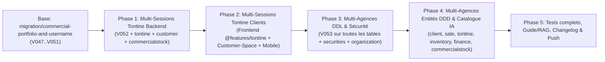

# Plan d'Intégration Unifié — PR #113 (Gestion Multi-Agences) & PR #184 (Plusieurs Sessions de Tontine dans l'Année)

**Branche tronc d'intégration :** `origin/migration-develop` (contenant `migration/refactor_commercial_stock` + `migration/commercial-portfolio-and-username`).
**Branche de travail :** `migration/multi-agency-and-multi-tontine-sessions` (tirée depuis `migration-develop`, avec ouverture d'une PR vers `migration-develop` en fin d'évolution, qui embarque déjà les refontes Stock Commercial Continu `V047`/`V048`, Caisse Ventes Comptant `V049`, Uniformisation `commercial_username` `V050` et Portefeuille Multi-Commerciaux & Relais `V051`).  
**Copie dépôt (après validation) :** `.cursor/plans/multi_agency_and_multi_tontine_sessions_integration.plan.md`.

---

## 1. Analyse d'écart entre les PR #113 / #184 et notre nouvelle architecture DDD

Les deux PR ont été développées sur l'ancienne structure pré-DDD. Un merge Git direct produirait des conflits massifs et violerait `ModularityTests` et `check-frontend-architecture.py`. Voici le diagnostic précis :

### 1.1 Écarts d'architecture communs aux deux PR
| Dimension | État dans PR #113 / PR #184 (ancien) | État dans notre architecture actuelle (cible obligatoire) |
|---|---|---|
| **Structure Maven & Packages Backend** | Multi-modules `backend-lib/common-securities`, `backend-lib/elykia-client`, et package `com.optimize.elykia.core.{entity,repository,service,controller,dto}` | **Monolithe modulaire unique** `backend/pom.xml` (`optimize-elykia-core`, Java 25, Spring Boot 4.2, **20 modules Spring Modulith** vérifiés par `ModularityTests`, `core/` et `backend-lib/` supprimés) |
| **Numérotation Flyway** | PR #113 utilise `V102__multi_agency_management.sql` ; PR #184 utilise `V026__tontine_multiple_sessions.sql` (déjà pris par `V026__carnet_ecart_decisions.sql` !) | Dernière migration = **`V051`**. Les deux migrations doivent devenir **`V052__tontine_multiple_sessions.sql`** et **`V053__multi_agency_management.sql`** |
| **Structure Frontend Web** | PR #184 modifie `frontend/src/app/tontine/...` et `TontineModule` | **Angular 21 LTS 100 % standalone & 4 couches** : `frontend/src/app/features/tontine/...` (aliases `@core/*`, `@shared/*`, `@features/*`, control flow `@if`/`@for`, Vitest) |
| **Mobile Terrain** | PR #184 cible Ionic 7 / Karma (`2.37.0`) ; PR #113 force un bump `3.0.0` | **Mobile `3.0.x` (Ionic 9 standalone, Angular 21, Capacitor 8, Vitest)** avec architecture local-first SQLite et filtrage par `commercialUsername` |

---

### 1.2 Analyse détaillée de la PR #184 (« Plusieurs sessions de tontine dans l'année ») & Synergie avec nos refontes récentes

#### Ce que fait la PR #184 :
1. **Schéma & Entité `TontineSession` :**
   - Ajout de `name VARCHAR(120) NOT NULL`, `code VARCHAR(40) NOT NULL UNIQUE`, `kind VARCHAR(20) NOT NULL CHECK (kind IN ('ANNUAL', 'EXTRA'))`.
   - Suppression de la contrainte d'unicité globale sur `tontine_session.year`, remplacée par un **index unique partiel** : `CREATE UNIQUE INDEX uk_tontine_session_annual_year ON tontine_session(year) WHERE kind = 'ANNUAL'` (une seule session annuelle par année civile, créée automatiquement du 1er février au 30 novembre : `ANNUELLE-{year}`, plus autant de sessions complémentaires `EXTRA` que nécessaire : Pâques, Vacances, Événement…).
   - Index unique sur `tontine_member(client_id, tontine_session_id) WHERE visibility = 'ENABLED'` : un même client peut être membre de **plusieurs sessions actives simultanément**, mais une seule fois par session.
2. **Services & API `tontine` (`TontineSessionService`, `TontineService`, `TontineDeliveryService`, `TontineMemberCarnetVerificationService`, `TontineMemberFieldControlService`) :**
   - `ensureAnnualSession(year)` + création/édition de session `EXTRA` réservée à `GESTIONNAIRE`, `ADMIN`, `SUPER_ADMIN`.
   - Inscription d'un membre avec `sessionId` (repli sur la session annuelle si `sessionId` absent pour compatibilité anciens APK).
   - Cotisation, rattrapage, contrôle de carnet, commande et livraison validés par rapport **à la session du membre (`member.getTontineSession()`)** et à ses dates `startDate`/`endDate` (ex. la session Pâques clôturée en avril peut être livrée en avril pendant que la session annuelle est toujours `ACTIVE`).
   - Mois de carnet dérivés dynamiquement de `[session.startDate, session.endDate]`.
3. **Espace Client (`customer` / `customer-space`), Frontend (`@features/tontine`) & Mobile (`mobile/`) :**
   - Sélection de session, modale de création de session complémentaire, adhésion multi-sessions dans l'Espace Client, synchronisation multi-sessions dans SQLite mobile.

#### Adaptations nécessaires à notre nouvelle architecture :
- **Stock Commercial Continu (`commercialstock`, `V047`) :** notre nouveau ledger `commercial_stock_ledger_entry` et nos arrêtés `commercial_stock_period_snapshot` possèdent **déjà** la colonne `tontine_session_id` et le grain `SnapshotPeriodGrain.TONTINE_SESSION` ! Lors d'une livraison tontine (`TontineDeliveryService`), nous passerons `member.getTontineSession().getId()` dans `LegacyStockMovementEvent.tontineSessionId` pour que les rapports de stock continu puissent ventiler les livraisons par session (`ANNUELLE-2026` vs `PAQUES-2026`).
- **Portefeuille Multi-Commerciaux & Relais (`V051`) :** `TontineMemberCommercialAssignment` est déjà rattaché à `tontine_member_id` (et donc à une session précise). Un commercial $A$ peut gérer le carnet `ANNUELLE-2026` d'un client tandis qu'un commercial $B$ (ou $A$ + $B$) gère son carnet `PAQUES-2026`, ou prend le relais en cours de session.

---

### 1.3 Analyse détaillée de la PR #113 (« Gestion Multi-Agences — Vague 1 & 2 ») & Synergie avec nos refontes récentes

#### Ce que contient la branche `cursor/multi-agency-wave1-ddl-f6e3` (qui inclut déjà la PR #114 mergée dedans) :
1. **Sécurité & JWT (`com.optimize.common.securities`) :**
   - `UserAccount.currentAgencyId` (`uacc.current_agency_id`), `UserDetailsImpl.agencyId`, claim JWT `agencyId`, `JwtResponse.agencyId`.
   - `AgencyContext` (`ThreadLocal<Long>`), `AgencyProfils` (`TERRAIN` vs `GLOBAL`), `AgencyScopeFilter` (`@Order(100)` : bloque en HTTP 403 un profil terrain sans `agencyId`, laisse passer les profils globaux `GESTIONNAIRE`, `ADMIN`, `SUPER_ADMIN`).
2. **Domaine `organization` (`Agency`, `AgencyAssignment`) :**
   - Enrichissement de `Agency` (`code` unique non null, `active`, `deactivatedAt`, `deactivatedBy`).
   - Nouvelle entité `AgencyAssignment` (`agency_assignment`, `user_id = users.useid`, `agency_id`, `start_date`, `end_date`, `assigned_by`, `notes`) + `AgencyAssignmentRepository` et méthodes enrichies sur `AgencyRepository`.
3. **Colonne `agency_id` sur les entités opérationnelles :**
   - Tables de la PR #113 : `client`, `credit`, `recovery`, `mobile_transaction`, `stock_request`, `stock_return`, `commercial_monthly_stock`, `commercial_stock_movement`, `tontine_session`, `orders`, `daily_commercial_report`, `inventory`, `expense`, `accounting_day`.
   - Création de l'agence `DEFAULT` (`Agence par défaut`), backfill de toutes les lignes existantes et création automatique des `agency_assignment` + `uacc.current_agency_id` pour les profils terrain.

#### Adaptations indispensables à nos nouvelles tables (`V047` → `V051`) :
1. **Rôle `CASHIER` (`V049`) dans `AgencyProfils` :**
   - Le nouveau profil **`CASHIER` (Caissier)** créé en Phase 7 travaille dans une agence physique : il doit être inclus dans `AgencyProfils.TERRAIN` (`PROMOTER`, `STOREKEEPER`, `SECRETARY`, `RECOVERY_MANAGER`, **`CASHIER`**) aussi bien dans la classe Java `AgencyProfils` que dans le backfill SQL `V053` !
2. **Propagation de `agency_id` sur nos nouvelles tables (`V047`, `V049`, `V051`) :**
   - **Stock commercial continu (`V047`) :** ajout de `agency_id BIGINT REFERENCES agency(id)` (+ backfill `DEFAULT` + index) sur `commercial_stock_position`, `commercial_stock_ledger_entry`, `commercial_stock_period_snapshot`, ainsi que sur `stock_tontine_request`, `stock_tontine_return`, `tontine_stock`, `tontine_stock_movement`.
   - **Caisse dédiée Ventes comptant (`V049`) :** ajout de `agency_id BIGINT REFERENCES agency(id)` sur `cash_sales_register_session` et `cash_sales_register_entry` (chaque agence a ainsi sa propre caisse comptoir et son propre rapport journalier de caisse !).
   - **Portefeuille commercial (`V051`) :** ajout de `agency_id BIGINT REFERENCES agency(id)` sur `client_commercial_assignment` (hérité de `client.agency_id`).
3. **Unicité des sessions de tontine avec Multi-Agences :**
   - Si `tontine_session` porte `agency_id`, l'index unique partiel de la session annuelle de la PR #184 doit être `ON tontine_session (year, COALESCE(agency_id, 0)) WHERE kind = 'ANNUAL'` (ou `ON tontine_session (year) WHERE kind = 'ANNUAL'` tant que la session annuelle est partagée sur l'agence `DEFAULT`).
4. **Compatibilité des tests existants avec `AgencyScopeFilter` :**
   - Dans les tests d'intégration / `@WebMvcTest` où un utilisateur `PROMOTER` / `STOREKEEPER` / `SECRETARY` est mocké sans `agencyId`, `AgencyScopeFilter` renverrait 403 si le backfill ou le fallback n'est pas géré proprement. Nous veillerons à ce que `UserDetailsImpl.build(user)` ou un mode configurable résolve l'agence par défaut lorsque `currentAgencyId` n'est pas encore renseigné en test unitaire, tout en appliquant strictement le 403 quand le compte terrain est explicitement sans agence.

---

## 2. Plan d'Exécution par Phases sur la Branche Unifiée `migration/multi-agency-and-multi-tontine-sessions`

Nous proposons **un plan unifié en 5 phases séquentielles** sur une seule branche `migration/multi-agency-and-multi-tontine-sessions` créée depuis `migration/commercial-portfolio-and-username` :

### Phase 1 — Backend « Plusieurs sessions de tontine dans l'année » (`V052` + modules `tontine`, `customer`, `commercialstock`)
1. **`V052__tontine_multiple_sessions.sql` :**
   - Ajout de `name`, `code`, `kind` (`ANNUAL` | `EXTRA`) sur `tontine_session`, backfill `'Session annuelle ' || year` / `'ANNUELLE-' || year` / `'ANNUAL'`, suppression de la contrainte unique sur `year`, création de `uk_tontine_session_code`, `uk_tontine_session_annual_year` et `uk_tontine_member_client_session_enabled`.
2. **Module `tontine` (`com.optimize.elykia.tontine`) :**
   - `domain/TontineSessionKind.java` (`ANNUAL`, `EXTRA`), enrichissement de `domain/TontineSession.java`.
   - `web/dto/{CreateTontineSessionDto, TontineSessionUpdateDto, TontineSessionDto, TontineMemberDto}.java`.
   - `infrastructure/persistence/{TontineSessionRepository, TontineMemberRepository, TontineCollectionRepository}.java`.
   - `application/{TontineSessionService, TontineService, TontineDeliveryService, TontineMemberCarnetVerificationService, TontineMemberFieldControlService, TontineAllocationMigrationService, TontineSessionScheduler}.java` + propagation de `tontineSessionId` vers `LegacyStockMovementEvent` (`commercialstock`).
   - `web/{TontineSessionController, TontineController}.java`.
3. **Module `customer` (`com.optimize.elykia.customer`) :**
   - `CustomerTontineSessionDto`, `CustomerTontineJoinRequest`, `CustomerTontineContributionSummaryDto`, `CustomerTontineContributionDetailDto`, `CustomerPortalService`, `CustomerApiController` (adhésion et consultation multi-sessions).
4. **Tests unitaires & intégration Backend de la PR #184** adaptés aux nouveaux packages (`TontineSessionServiceTest`, `TontineServiceTest`, `CustomerPortalServiceTest`, `TontineAllocationMigrationServiceTest`, `TontineMemberCarnetVerificationServiceTest`).

### Phase 2 — Frontend Angular 21 (`@features/tontine`), Espace Client (`customer-space`) & Mobile (`mobile/`) pour Multi-Sessions Tontine
1. **Frontend (`frontend/src/app/features/tontine/`) :**
   - Adaptation en **composants Angular 21 standalone** (control flow `@if`/`@for`, path aliases) de `CreateSessionModalComponent`, `SessionSettingsModalComponent`, `SessionSelectorComponent`, `AddMemberModalComponent`, `AddMultipleMembersModalComponent`, `TontineDashboardComponent`, `TontineSessionService`, `TontineService` et `tontine.types.ts`.
2. **Customer-Space (`customer-space/src/app/`) :**
   - Report des évolutions de `tontines.page.*`, `tontine-join.page.*`, `tontine-detail.page.*`, `customer.model.ts`, `customer-api.service.ts` + tests unitaires.
3. **Mobile Ionic 9 (`mobile/src/app/`) :**
   - Adaptation de la migration SQLite locale, `TontineSessionRepository`, `TontineMemberSyncService`, `SynchronizationService`, `TontineService` et `TontineDashboardPage` (sélecteur de session mobile) dans l'architecture Ionic 9 standalone (`3.0.x`), en respectant `mobile-local-first-architecture` et `user-specific-data-access`.

### Phase 3 — Backend « Gestion Multi-Agences » : Migration `V053`, Module `securities` & Module `organization`
1. **`V053__multi_agency_management.sql` :**
   - Enrichissement de `agency` (`code` unique, `active`, `deactivated_at`, `deactivated_by`), création de `agency_assignment` (`user_id = users.useid`), `uacc.current_agency_id`.
   - Ajout de `agency_id BIGINT REFERENCES agency(id)` sur les 14 tables de la PR #113 **PLUS** nos nouvelles tables : `commercial_stock_position`, `commercial_stock_ledger_entry`, `commercial_stock_period_snapshot`, `stock_tontine_request`, `stock_tontine_return`, `tontine_stock`, `tontine_stock_movement`, `cash_sales_register_session`, `cash_sales_register_entry`, `client_commercial_assignment`.
   - Création de l'agence `DEFAULT`, backfill de toutes les tables, et assignation automatique des profils terrain (`PROMOTER`, `STOREKEEPER`, `SECRETARY`, `RECOVERY_MANAGER`, **`CASHIER`**).
2. **Module `securities` (`backend/src/main/java/com/optimize/common/securities/`) :**
   - `UserAccount.currentAgencyId`, `UserDetailsImpl.agencyId`, `JwtUtils` (claim `agencyId`), `JwtResponse.agencyId`, `AuthController`.
   - `AgencyContext`, `AgencyProfils` (incluant `CASHIER`), `AgencyScopeFilter` et enregistrement dans `WebSecurityConfig`.
3. **Module `organization` (`backend/src/main/java/com/optimize/elykia/organization/`) :**
   - Enrichissement de `domain/Agency.java`, création de `domain/AgencyAssignment.java`, `infrastructure/persistence/AgencyAssignmentRepository.java` et enrichissement de `AgencyRepository.java`.

### Phase 4 — Rattachement `agencyId` sur toutes les Entités DDD & Mise à jour du Catalogue IA (`schema-catalog.json`)
- Ajout du champ `@Column(name = "agency_id") private Long agencyId;` sur :
  - `client` : `Client`, `ClientCommercialAssignment`
  - `sale` : `Credit`, `Recovery`, `Order`, `StockRequest`, `StockReturn`, `CommercialMonthlyStock`, `CommercialStockMovement`
  - `tontine` : `TontineSession`, `StockTontineRequest`, `StockTontineReturn`, `TontineStock`, `TontineStockMovement`
  - `commercialstock` : `CommercialStockPosition`, `CommercialStockLedgerEntry`, `CommercialStockPeriodSnapshot`
  - `finance` : `DailyCommercialReport`, `Expense`, `AccountingDay`, `CashSalesRegisterSession`, `CashSalesRegisterEntry`
  - `inventory` : `Inventory`
  - `bootstrap` : `MobileTransaction`
- Mise à jour de `backend/src/main/resources/ai/schema-catalog.json` (colonnes `name`/`code`/`kind` de `tontine_session`, table `agency_assignment`, colonnes `agency_id`, règles métier IA).

### Phase 5 — Vérification complète, Guide Utilisateur, Index RAG, Changelog & Push
1. **Exécution et validation PostgreSQL (`V000 → V053`) + Validation Hibernate (`hbm2ddl.auto=validate`).**
2. **Tests Backend (`mvn test`, `ModularityTests` sur les 20 modules, tests Multi-Sessions Tontine + tests Multi-Agences `AgencyScopeFilter` / `JwtUtils`).**
3. **Tests & Build Frontend (`npm run test:ci`, `check-frontend-architecture.py`, `npm run build`).**
4. **Mise à jour du Guide Utilisateur (`user-guide/docs/commercial/tontine.md`, `customer/tontine.md`, `manager/`), régénération de `user-guide-index.json`, mise à jour de `docs/CHANGELOG.md`, `memory-bank/` et push de la branche.**

---

## 3. Points à confirmer avant lancement

1. **Base de départ de la branche :** souhaitez-vous que la nouvelle branche (ex. `migration/multi-agency-and-multi-tontine-sessions`, ou un autre nom de votre choix) parte bien de notre dernière branche **`migration/commercial-portfolio-and-username`** (afin d'avoir dans une seule branche consolidée : Stock continu + Caisse `CASHIER` + `commercial_username` + Portefeuille multi-commerciaux + Multi-sessions Tontine + Multi-agences) ?
2. **Politique de versionning :** la PR #113 avait été créée à une époque où le backend était en `1.x` et tentait de le passer en `2.0.0` (alors que le backend est aujourd'hui en **`2.14.0`**, le frontend en **`3.3.0`**, le mobile en **`3.0.1`** et customer-space en **`0.18.0`**). Confirmez-vous qu'on incrémente proprement à partir des versions actuelles (ex. Backend **`2.15.0`**, Frontend **`3.4.0`**, Mobile **`3.1.0`**, Customer-space **`0.19.0`**) plutôt que de rétrograder le backend en `2.0.0` ?
