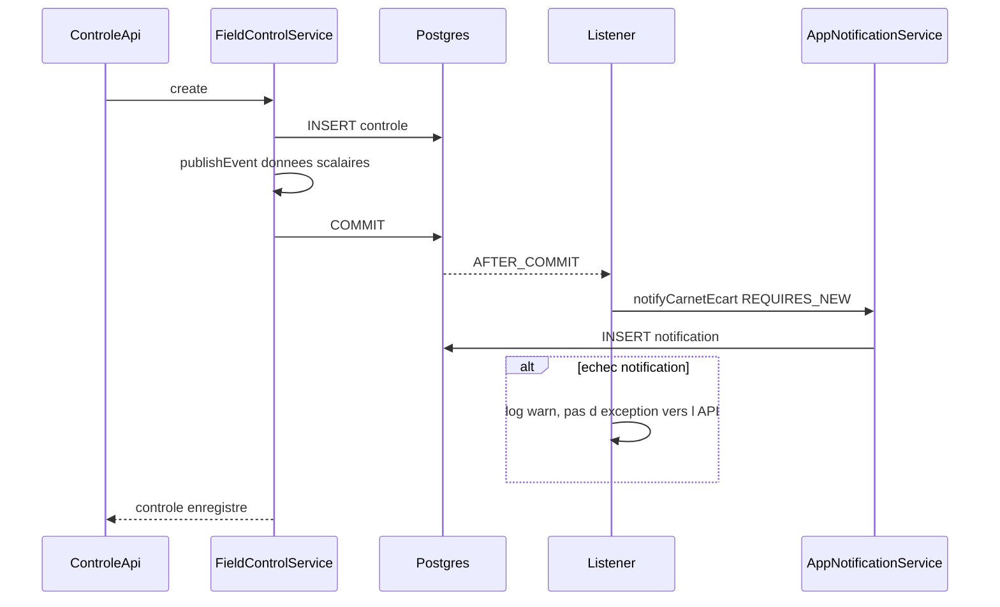

# Notification d’écart hors de la transaction du contrôle

## Pourquoi le try/catch actuel ne suffit pas

`CreditFieldControlService.create` et `TontineMemberFieldControlService.create` sont `@Transactional`. Ils appellent `AppNotificationService.notifyCarnetEcart`, lui aussi `@Transactional` (propagation `REQUIRED`) : l’INSERT part dans la même transaction Postgres.

Si l’INSERT échoue, Postgres annule toute la transaction. Le `catch` Java n’ouvre pas de savepoint. L’entité `AppNotification` reste dans la session, le flush suivant lève `AssertionFailure`, et le contrôle est annulé. Le téléphone voit un échec de synchronisation.

## Choix

Publier un événement dans la transaction du contrôle, et n’écrire la notification qu’après le commit, dans une transaction neuve. C’est le modèle déjà utilisé par [`AccountOpeningAdhesionListener`](backend/src/main/java/com/optimize/elykia/core/service/adhesion/AccountOpeningAdhesionListener.java) : `@TransactionalEventListener(AFTER_COMMIT)` puis `REQUIRES_NEW`.

`REQUIRES_NEW` appelé avant le commit est écarté : la notification serait conservée même si le contrôle était ensuite annulé.

Hors périmètre : déclarations de paiement, commandes et rattrapages tontine. Eux restent dans la transaction de leur opération.

## Flux

## Fichiers

1. Événement dans `backend/src/main/java/com/optimize/elykia/core/event/`.
   - Champs copiés tant que la session est ouverte : `commercialUsername`, `clientName`, `controlId`, `referenceKey`, `amount`.
   - Une liste : un crédit = une entrée ; une tontine = une entrée par commercial en écart (logique actuelle de `notifyEcart`).
   - Aucune entité JPA : après le commit la session est fermée.

2. [`CreditFieldControlService`](backend/src/main/java/com/optimize/elykia/core/service/sale/CreditFieldControlService.java) et [`TontineMemberFieldControlService`](backend/src/main/java/com/optimize/elykia/core/service/tontine/TontineMemberFieldControlService.java).
   - Remplacer l’appel direct et le `try/catch` par `ApplicationEventPublisher.publishEvent` uniquement si le statut est `ECART` et qu’il y a au moins un destinataire.
   - Retirer le setter optionnel `AppNotificationService`.
   - Les tests Mockito n’ont pas de transaction : `AFTER_COMMIT` ne part pas. Ajouter un `ApplicationEventPublisher` mocké pour que `publishEvent` ne tombe pas sur null. Un contrôle `CONFORME` ne publie rien.

3. Listener `CarnetEcartNotificationListener`.
   - `@TransactionalEventListener(phase = AFTER_COMMIT)`, sans `@Async`.
   - Pour chaque entrée, appeler `notifyCarnetEcart` et attraper `RuntimeException` (un commercial en échec n’empêche pas les suivants, et l’API ne reçoit pas l’exception).
   - `notifyCarnetEcart` passe en `@Transactional(propagation = REQUIRES_NEW)`. L’appel vient d’un autre bean, donc le proxy s’applique. L’idempotence déjà en place (`findByTypeAndEntityIdAndEntityReferenceAndResolvedAtIsNull`) reste.

4. Test unitaire du listener : une exception de `notifyCarnetEcart` est journalisée et n’est pas relancée ; l’entrée suivante est quand même tentée.

5. Changelog, section Backend `1.44.4` déjà ouverte sur cette branche : une puce Fixed. Pas de nouveau numéro. Pas de guide utilisateur : le parcours à l’écran ne change pas, l’échec de notification cesse seulement d’annuler le contrôle. Pas de catalog IA : pas de colonne nouvelle.

La migration `V028` reste le correctif de la contrainte. Ce plan empêche qu’un prochain échec de notification annule encore le contrôle.
