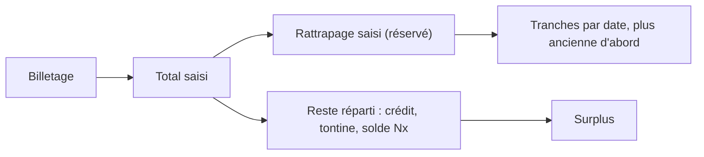

# Rattrapage dans le versement et KPI « dû à la caisse »

## Constat sur l'existant

- Un rattrapage = cotisation tontine saisie aujourd'hui pour une date passée. Il est rattaché au rapport de la date de cotisation, pas à celui du jour de saisie. Il n'entre donc pas dans « A Verser » du jour.
- `CashDepositCatchupService.preview` calcule déjà `catchupTotal` et les tranches par date. Le modal ne l'affiche pas comme KPI.
- Dans [cash-deposit-modal.component.ts](frontend/src/app/report/components/cash-deposit-modal/cash-deposit-modal.component.ts), `autoAllocate()` remplit dans l'ordre crédit, tontine du jour, solde Nx, puis rattrapages avec le reste. Si le billetage est inférieur au dû du jour, les rattrapages ne reçoivent rien. Le rattrapage est fondu dans le champ « Tontine », sans champ propre.
- Le KPI « Total encaissé » de [daily-report.component.html](frontend/src/app/report/pages/daily-report/daily-report.component.html) (panneau par commercial de la Vue d'ensemble) montre déjà `Opérations · Rattrapages`, calculés à partir des versements (`cashEncaisseBreakdown`).

## 1. Backend : versement avec rattrapage explicite

- [CashDeposit.java](backend/src/main/java/com/optimize/elykia/core/entity/report/CashDeposit.java) : ajouter `@Transient Double catchupAmount`. Aucune migration, donc pas de mise à jour du schema catalog IA.
- [CashDepositCategoryCalculator.java](backend/src/main/java/com/optimize/elykia/core/util/CashDepositCategoryCalculator.java) : accepter un montant de rattrapage dans `validateCategorySplit`. Règle : `credit + tontine + soldeNx + rattrapage + surplus == montant`.
- [CashDepositCatchupAllocator.java](backend/src/main/java/com/optimize/elykia/core/service/accounting/CashDepositCatchupAllocator.java) : nouvelle méthode `allocateExplicit(...)`. Elle répartit le rattrapage saisi sur les `CatchupCap`, du plus ancien au plus récent. Elle refuse un montant supérieur au total des plafonds, avec un message clair.
- [CashDepositService.java](backend/src/main/java/com/optimize/elykia/core/service/accounting/CashDepositService.java) `createDeposit` : si `catchupAmount` est renseigné, utiliser `allocateExplicit`. Sinon, garder l'ancien comportement (compatibilité avec les anciens clients). Le reste du flux ne change pas : lignes enfants, rapports des dates, imputation écart terrain.
- Nouveau « rattrapages saisis » par période : requête dans [TontineCollectionRepository.java](backend/src/main/java/com/optimize/elykia/core/repository/TontineCollectionRepository.java). Elle somme, par commercial, les collectes créées dans la période dont la `collectionDate` est hors période. Le total est ajouté à `CatchupCashAdjustmentDto` et à `CatchupCashAdjustmentLineDto` (`catchupEnteredAmount`), renseigné dans `catchupCashAdjustment(start, end)`.
  - Pourquoi hors période seulement : sur plusieurs jours, `tontineCatchupAmount` additionne aussi des rattrapages dont la date de cotisation est dans la période. Ceux-là sont déjà dans « A Verser », donc les compter encore les doublerait.

## 2. Frontend : fenêtre « Nouveau versement »

Fichiers : `cash-deposit-modal.component.{ts,html,scss}`.

- Nouveau KPI **« Reste rattrapages »** dans `kpi-strip`, égal à la somme des tranches (`catchupTotal` de l'aperçu). Il apparaît seulement s'il y a des rattrapages.
- Nouveau champ **« Rattrapage »** dans `allocation-grid`, avec `data-testid="e2e-cash-deposit-catchup"`, plafonné au total des rattrapages et au total saisi.
- `autoAllocate()` :
  - Sans saisie manuelle : comportement actuel (le reste va aux rattrapages), avec le rattrapage en champ séparé.
  - Avec saisie manuelle : le rattrapage est réservé en premier. Le billetage restant est réparti sur crédit, tontine du jour et solde Nx. Les saisies manuelles survivent à un changement de billetage.
- Le champ « Tontine » ne contient plus que la tontine du jour. `onCategoryChange()` et `allocationMismatch` incluent le rattrapage dans la somme.
- La liste « Rattrapages du jour » reflète la répartition par date.
- `submitDeposit()` envoie `catchupAmount` en plus des montants actuels.

## 3. Frontend : Vue d'ensemble, KPI « Total encaissé »

- [cash-synthesis.ts](frontend/src/app/report/models/cash-synthesis.ts) : ajouter `catchupEnteredAmount` aux modèles et à `normalizeCatchupCashAdjustment`. Ajouter une fonction pure `cashDueBreakdown(totalAmountToDeposit, catchupEntered)` qui renvoie `{ total, operations, catchups }`.
- [daily-report.component.ts](frontend/src/app/report/pages/daily-report/daily-report.component.ts) : `getCashDueBreakdown(report)`, sur le modèle de `getCashBreakdown`. Il prend `totalAmountToDeposit` du rapport et `catchupEnteredAmount` du commercial.
- [daily-report.component.html](frontend/src/app/report/pages/daily-report/daily-report.component.html), carte « Total encaissé » du commercial (vers la ligne 626) :
  - Ligne principale : « Dû à la caisse » = dû de la période + rattrapages saisis.
  - Sous-ligne : détail `Dû du jour : … · Rattrapages saisis : …`.
  - Le « Total encaissé » actuel et son hint restent dans la même carte.
  - Test id pour l'e2e : `e2e-daily-report-cash-due-<commercial>`.
- Le KPI « Tontine Rattrapages » du rapport, déjà présent, reste inchangé. Le nouveau KPI du modal reprend le même terme.

## 4. Tests

- Backend : `CashDepositCatchupAllocatorTest` (rattrapage explicite, dépassement refusé, ordre des dates). `CashDepositServiceTest` (versement avec `catchupAmount` ; ancien format inchangé). Test du calcul `catchupEnteredAmount` sur la période.
- Frontend : `cash-synthesis.spec.ts` (`cashDueBreakdown`, normalisation). Spec du modal si elle existe, sinon test de la logique d'allocation (billetage inférieur au dû, rattrapage réservé).
- Ajuster le test e2e `golden-path` ou la fixture de versement si le modal change de sélecteurs. Le champ ajouté ne casse pas les sélecteurs existants.

## 5. Livraison (règles du dépôt)

- Guide : mettre à jour [user-guide/docs/manager/reporting_config.md](user-guide/docs/manager/reporting_config.md), en langage métier : nouveau KPI, champ « Rattrapage » du versement, carte « Dû à la caisse / Total encaissé ». Puis `python user-guide/generate_rag_index.py` et `python -m mkdocs build -f user-guide/mkdocs.yml -d ../frontend/src/user-guide`.
- `docs/CHANGELOG.md` : Frontend 2.52.0 et Backend 1.55.0 (fonctionnalité visible), avec les fichiers de version correspondants (`frontend/package.json`, `backend/pom.xml`).
- `memory-bank/activeContext.md` : une entrée (rattrapage versement et KPI dû à la caisse).
- Inclure `.cursor/plans/` au commit. Pas de modification de `schema-catalog.json` : `catchupAmount` est transitoire, sans DDL.

## Décision utilisateur

- Le champ Rattrapage est pré-rempli automatiquement (reste du billetage servi aux rattrapages, plafonné par date) et reste modifiable à la main. Une saisie manuelle prime sur le calcul automatique.

## Points retenus (à corriger si besoin)

- « Dû à la caisse » = A Verser de la période + rattrapages saisis pour des dates hors période. Il ne soustrait pas les cotisations de la période saisies plus tard.
- Un rattrapage saisi supérieur au disponible est refusé par le serveur. Il ne bascule pas en surplus.