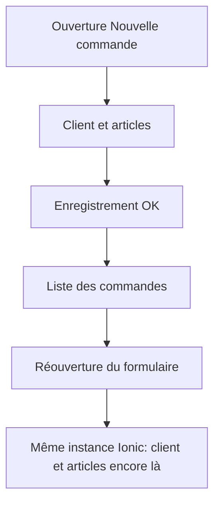

---
todos:
  - id: reset-form
    status: completed
    content: 'Réinitialiser client, articles, montant et recherche à chaque entrée sur Nouvelle commande'
  - id: valider-button
    status: completed
    content: Rendre le bouton bas visible au-dessus des onglets et le libeller Valider
  - id: guide-version
    status: in_progress
    content: 'Mettre à jour le guide commercial, l’index RAG, le HTML, la version mobile et le changelog'
name: Reset commande Valider
overview: 'À chaque réouverture du formulaire « Nouvelle commande », le client et les articles repartent à zéro. Un bouton « Valider » reste visible en bas de l’écran, en plus de la coche du header.'
isProject: false
---

# Formulaire commande : reset et bouton Valider

## Constat

Le formulaire de création est [`mobile/src/app/features/orders/pages/new-order/new-order.page.ts`](mobile/src/app/features/orders/pages/new-order/new-order.page.ts). Il délègue l’écran à [`mobile/src/app/shared/components/base-transaction/base-transaction.component.ts`](mobile/src/app/shared/components/base-transaction/base-transaction.component.ts) (aussi utilisé par la modification).

Après un enregistrement réussi, la page navigue vers `/tabs/orders`. L’app mobile réutilise les pages (`IonicRouteStrategy` dans [`mobile/src/app/app.module.ts`](mobile/src/app/app.module.ts)) : au retour sur `/tabs/orders/new`, `ngOnInit` ne repart pas. Deux états restent donc en mémoire :

- `selectedClient` sur `NewOrderPage`
- `articleQuantities` / `totalAmount` dans `BaseTransactionComponent`

La coche du header appelle déjà `validateTransaction()`. Un bouton bas existe aussi, mais son libellé est **CRÉER LA COMMANDE** et la page est en `height: 100vh` ([`new-order.page.scss`](mobile/src/app/features/orders/pages/new-order/new-order.page.scss)). L’écran est dans l’onglet (barre du bas toujours visible), donc ce bouton se retrouve sous la barre d’onglets. Les utilisateurs ne voient que la coche.

## Correctif 1 — formulaire vide à chaque ouverture

Uniquement sur **Nouvelle commande** (pas sur Modifier : les données chargées doivent rester).

- `NewOrderPage` : `ionViewWillEnter` remet `selectedClient` à `null` et appelle `reset()` sur le composant (`ViewChild`).
- `BaseTransactionComponent.reset()` : vide les quantités, le montant, le résumé et le texte de recherche, puis rafraîchit la liste d’articles.
- Le flux de filtre garde aujourd’hui la référence des quantités dans un `BehaviorSubject` créé une seule fois. Le reset publiera un nouvel état pour que les articles précédemment choisis ne restent pas marqués.
- La modale de choix du client ne quitte pas la page : elle ne déclenche pas ce reset.

## Correctif 2 — bouton « Valider » en bas

- Conserver la coche du header.
- Libellé du bouton bas de création : **Valider** (`submitButtonText` dans `NewOrderPage`). Modification : **Enregistrer** (même emplacement, libellé adapté).
- Hauteur de la page en `100%` au lieu de `100vh` sur création et modification, pour que le pied de page reste au-dessus de la barre d’onglets.
- Le bouton bas appelle la même action que la coche (`validateTransaction()`), désactivé tant qu’il n’y a pas de client et au moins un article.
- Zone tactile suffisante (bouton pleine largeur, hauteur confortable).

## Guide, version, changelog

- Mettre à jour le pas à pas commercial dans [`user-guide/docs/commercial/mobile_app.md`](user-guide/docs/commercial/mobile_app.md) (section « Prendre une commande client ») : après le choix du client et des articles, toucher **Valider** en bas de l’écran.
- Régénérer l’index RAG et le guide HTML du frontend.
- Incrément PATCH mobile (les trois fichiers de version) et une ligne dans `docs/CHANGELOG.md`.
