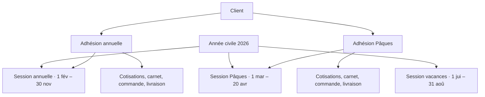

# Sessions de tontine multiples

## Besoin

Aujourd’hui l’agence ne mène qu’une campagne par année civile (ouverte en pratique du 1er février au 30 novembre). Le métier veut ouvrir d’autres campagnes dans la même année — fêtes de Pâques, vacances, événement spécial — sans fermer la campagne annuelle.

Règles demandées :

- Créer autant de sessions que nécessaire.
- Chaque session a une date de début et une date de fin.
- Un client peut être membre de plusieurs sessions en même temps.
- Chaque adhésion conserve sa mise, ses cotisations, son carnet et sa livraison.

## Constat dans le code

Une session est déjà une entité (`TontineSession`) et une adhésion (`TontineMember`) pointe déjà vers une session. Les cotisations, la commande et la livraison sont portées par l’adhésion, donc par une session. Le blocage n’est pas l’absence de lien : c’est l’hypothèse « une seule session = l’année ».

| Verrou | Où | Effet |
| --- | --- | --- |
| `UNIQUE (year)` sur `tontine_session` | `V000__init_schema.sql`, contrainte `ukg7b9f4xtwknlon44a4websnw9` | Impossible d’enregistrer deux sessions la même année |
| Création automatique | `TontineService.getActiveSession()` | Si aucune ligne pour l’année civile, crée le 1er février → 30 novembre, statut `ACTIVE` |
| Recherche par année | `TontineSessionRepository.findByYear` renvoie un `Optional` | Inscription, cotisation, Espace Client, carnet, export, reset et comparaison supposent une seule ligne |
| Doublon client | `findByTontineSession_YearAndClient_Id` | « Déjà inscrit pour la session de cette année » bloque toute seconde adhésion, même pour une autre campagne |
| Dates | `updateCurrentSession` | Début et fin doivent tomber dans l’année civile en cours |
| Fin d’année | `TontineSessionScheduler.endYearlyTontineSessions` | Le 31 décembre, toutes les sessions `CLOSED` passent `ENDED`, quelle que soit leur date de fin |
| Mois de carnet | `TontineMemberFieldControlService` | Seuls février à novembre sont acceptés |
| Plafond d’épargne | politiques d’allocation V1 et V2 | 10 mois de 31 jours, calés sur la campagne annuelle |
| Drapeau client | `updateTontineStatus(true)` à l’inscription, `false` à la livraison | Livrer une campagne retire le statut tontine alors qu’une autre adhésion est encore ouverte |
| Stock | unicité `(commercial, article_id, year)` | Le stock tontine est un pot annuel. `tontineSessionId` est stocké mais ne sépare pas les campagnes |
| Mobile | `getTontineSession()` : `ORDER BY year DESC LIMIT 1` | Une seule session en mémoire, alors que la table locale `tontine_sessions` peut en contenir plusieurs |
| Web | sélecteur de session | Le libellé affiché est l’année ; la session `ACTIVE` est prise par défaut |
| Espace Client | `getCurrentTontineSession()` | Une carte « session de l’année » ; déjà membre = impossible de rejoindre une autre campagne |
| Archives | `TontineCollectionResetService` | Archive et remise à zéro de « la » session active, sans choix |

Le cycle déjà en place reste le bon cycle, à appliquer **par session** et non plus pour l’année :

- `ACTIVE` : inscription, cotisation, commande.
- `CLOSED` : plus d’écriture d’épargne ni de commande ; remise des marchandises.
- `ENDED` : plus aucune écriture.

La clôture quotidienne (session `ACTIVE` dont `endDate` est passée → `CLOSED`, adhérents `SESSION_INPROGRESS` → `PENDING`) est déjà écrite dans `closeExpiredTontineSessions`. Elle fonctionne pour plusieurs sessions. Le job du 31 décembre, lui, est annuel et doit disparaître.

## Cible



Une session est une campagne nommée, avec un début, une fin et son propre stock d’adhérents. L’année reste un regroupement (année de la date de début), plus une identité.

Deux sessions peuvent se chevaucher. Pâques tombe pendant la campagne annuelle : le client cotise les deux, sur deux adhésions, deux mises, deux carnets.

## Décisions proposées

1. **Identité.** Colonnes ajoutées : `name` (obligatoire, ex. « Session Pâques »), `code` (stable, unique, ex. `PAQUES-2026`). `year` = année de `startDate`, conservé pour les archives et les tris. La contrainte d’unicité sur `year` est retirée. Unicité nouvelle : `code`.
2. **Dates.** `startDate` et `endDate` restent obligatoires, avec `endDate` strictement après `startDate`. Une session peut traverser le 31 décembre (vacances de fin d’année) : `year` est alors l’année du début. Le contrôle « les deux dates dans l’année civile en cours » est retiré.
3. **Chevauchement.** Autorisé. À la création, l’écran signale les sessions ouvertes dont les dates se croisent, sans bloquer.
4. **Adhésion.** Unicité `(client_id, tontine_session_id)` pour les adhésions actives. Le même client a une ligne `TontineMember` par session. Mise, fréquence, part société, mois validés, carnet et livraison restent sur cette ligne.
5. **Commercial tontine.** Inchangé : le commercial est celui du client (`tontineCollector`). Pas de commercial différent par session dans ce lot.
6. **Statut tontine du client.** Vrai tant qu’il existe au moins une adhésion active non livrée. La livraison d’une session ne retire le statut que si aucune autre adhésion n’est ouverte.
7. **Écritures.** Inscription, cotisation, rattrapage, contrôle de carnet, commande et livraison lisent le statut **de la session de l’adhésion**, plus « la session de l’année ». Une cotisation n’est acceptée que si sa date tombe dans `[startDate, endDate]` de cette session et que la session est `ACTIVE`.
8. **Carnet.** Les mois proposés sont les mois calendaires couverts par `[startDate, endDate]`, plus la liste fixe février–novembre. Une session de décembre ou de janvier devient contrôlable. Le plafond de 10 × 31 jours reste un maximum : une session courte valide moins de mois parce qu’elle a moins de jours.
9. **Stock.** L’unicité passe à `(commercial, article_id, tontine_session_id)`. Chaque campagne a son stock de livraison. Les lignes actuelles sont rattachées à la session annuelle de leur année (la colonne `tontineSessionId` existe déjà).
10. **Création.** Plus de création silencieuse au premier appel. Une session naît d’un écran ou d’un appel explicite : nom, code, début, fin. Un raccourci « Session annuelle » préremplit le 1er février et le 30 novembre. Droit : le même périmètre que l’édition tontine (`ROLE_EDIT_TONTINE` / admin).
11. **Modification.** Tant que la session est `ACTIVE` : nom et dates modifiables si aucune cotisation ne tombe hors du nouvel intervalle. Session avec adhérents : pas de suppression. Session vide : désactivation.
12. **Clôture.** La tâche quotidienne ferme chaque session dont la date de fin est passée. Le passage à `ENDED` se fait quand toutes les livraisons sont faites, ou par une action manuelle. Le job du 31 décembre est retiré.
13. **Session par défaut, le temps de la bascule.** `getActiveSession()` ne peut plus être le point d’entrée métier. Les appels existants sont classés : ceux qui reçoivent déjà un `memberId` ou un `sessionId` utilisent cette session ; le repli « session annuelle de l’année » (`code` `ANNUELLE-{year}`) ne sert que pour les clients pas encore migrés (mobile ancien, exports sans filtre). Il ne crée plus de ligne.
14. **Archives.** « Archiver » et « Archiver et réinitialiser » exigent une session choisie. La réinitialisation efface les cotisations de cette session seulement. Elle ne sert pas à ouvrir Pâques.
15. **Reconduction.** Le guide dit que les membres n’ont pas à être réinscrits d’une année sur l’autre. Le code, lui, remet à zéro la session en cours et laisse la session de l’année suivante vide. Ce lot ne change pas ce geste en copie automatique. Une action ultérieure « Reconduire les membres » copiera client et mise d’une session close vers une session nouvelle, en créant de nouvelles adhésions, sans effacer l’historique.

Hors de ce lot : mise minimum ou part société différente par session, commercial différent par session, fusion de deux campagnes, paiement unique ventilé automatiquement sur plusieurs adhésions.

## Modèle

```text
tontine_session
  id, name, code UNIQUE, year, start_date, end_date, status, total_revenue

tontine_member
  id, tontine_session_id, client_id
  UNIQUE (client_id, tontine_session_id) WHERE visibility = ENABLED
  mise, cotisations, carnet, livraison  -- inchangés, déjà par adhésion

tontine_stock
  UNIQUE (commercial, article_id, tontine_session_id)
```

Migration des lignes existantes :

- `name` = `Session annuelle {year}`
- `code` = `ANNUELLE-{year}`
- dates déjà présentes, on ne les réécrit pas
- puis suppression de l’unicité sur `year`, ajout de l’unicité sur `code`, `name` obligatoire

Le catalog IA (`tontine_session.description` = « Session annuelle tontine ») est mis à jour dans le même commit que la migration : nom, code, dates, et la relation membre → session.

## Parcours

### Gestionnaire — créer une session

1. Menu Tontines → Sessions → Nouvelle session.
2. Saisir le nom, le début et la fin. Le code est proposé à partir du nom et de l’année, modifiable.
3. Enregistrer. La session apparaît dans le sélecteur sous la forme « Pâques 2026 · 1 mar – 20 avr · Ouverte ».
4. Les indicateurs, la liste, l’export et la comparaison suivent la session choisie, par identifiant.

### Commercial — inscrire et encaisser

1. Le tableau de bord affiche la session choisie. Le mobile en télécharge plusieurs : toutes les `ACTIVE` et les `CLOSED` pas encore `ENDED`.
2. Inscription : la session cible est celle affichée. Si le client y est déjà, le message cite le nom de la session. S’il est seulement dans une autre, l’inscription est acceptée.
3. Cotisation : l’adhésion choisie porte la session. Deux cotisations le même jour pour deux campagnes font deux lignes de caisse. Le versement du jour continue d’additionner la tontine encaissée, toutes campagnes confondues.
4. Commande pendant que cette session est ouverte. Remise une fois cette session clôturée. Une session Pâques clôturée en avril se livre en avril, pendant que l’annuelle est encore ouverte.

### Client — Espace Client

1. « Mes tontines » liste chaque adhésion : nom de la session, dates, mise, total cotisé, statut de livraison.
2. « Rejoindre une session » liste les sessions ouvertes dont la fin n’est pas passée et dont il n’est pas déjà membre.
3. L’inscription et le premier paiement visent l’identifiant de session choisi.

### Contrôle terrain

Le formulaire de carnet s’ouvre sur une adhésion. Les mois cochables sont ceux de sa session. Le libellé affiche le nom de la session à côté de l’année.

## Lots de livraison

### Lot 1 — Modèle et création

- Migration et catalog IA.
- API créer / modifier / lister une session (nom, code, dates, statut, nombre d’adhérents).
- Arrêt de la création automatique.
- Les lectures actuelles par année continuent de résoudre `ANNUELLE-{year}` tant que les lots 2 et 3 ne sont pas livrés, pour ne pas casser le mobile déjà en magasin.
- Tests : deux sessions la même année ; rejet si fin ≤ début ; rejet si code déjà pris ; la session historique reste lisible.

### Lot 2 — Adhésion et écritures

- Inscription avec `sessionId`. Doublon = même client dans la même session.
- Cotisation, rattrapage, contrôle de carnet, commande, livraison : garde sur la session du membre et sur l’intervalle de dates.
- Statut tontine du client recalculé.
- Mois de carnet dérivés des dates de la session.
- Tests déjà présents sur `getActiveSession` / `findByYear` réécrits vers la session cible. Cas ajoutés : client dans deux sessions ; cotisation refusée hors dates ; livraison de Pâques autorisée alors que l’annuelle est `ACTIVE` ; livraison de l’annuelle refusée tant qu’elle est `ACTIVE`.

### Lot 3 — Écrans

- Web : formulaire de création, sélecteur nom + dates + statut, listes et stats filtrées par id, comparaison par sessions (l’API `compare` prend des ids ; l’année reste un filtre d’affichage).
- Mobile : plusieurs sessions locales, sélecteur, synchro des sessions ouvertes et en livraison. `getTontineSession()` ne renvoie plus « la dernière année ».
- Espace Client : liste des sessions rejoignables et détail par adhésion.
- Guide utilisateur (gestionnaire, commercial, client), index RAG, HTML du guide, changelog des composants touchés.

### Lot 4 — Stock, clôture, archives

- Unicité du stock par session, rattachement des lignes existantes.
- Retrait du job du 31 décembre. `ENDED` quand les livraisons sont terminées ou sur action.
- Archives et réinitialisation : session obligatoire dans l’écran.
- Rapports et textes IA qui disent « la session de l’année » alignés sur le nom de session.

## Risques

- **`getActiveSession()` est appelé partout** (inscription, cotisation, carnet, export, reset, portail, migration d’allocation). Un oubli réapplique la règle annuelle. Le lot 2 liste chaque appelant et le fait échouer en test s’il ignore la session du membre.
- **Mobile hors ligne.** Un APK ancien ne connaît qu’une session. Le repli `ANNUELLE-{year}` du lot 1 évite de perdre la campagne annuelle. Les sessions supplémentaires n’apparaissent qu’avec l’application du lot 3. Le documenter dans le changelog mobile.
- **Caisse.** Deux cotisations le même jour pour le même client sont deux encaissements. L’écran doit nommer la session sur la ligne, sinon le commercial croit à un doublon.
- **Réinitialisation.** Lancée sur la mauvaise session, elle efface les cotisations. L’écran demande le nom de la session et une confirmation.
- **Stock partagé aujourd’hui.** Basculer l’unicité sans rattacher `tontineSessionId` casserait les livraisons en cours. La migration rattache d’abord, puis change la contrainte.
- **Contrôle carnet décembre / janvier.** Tant que le lot 2 n’est pas livré, une session hors février–novembre ne peut pas être contrôlée. Ne pas ouvrir ce type de session en production avant ce lot.
- **Indicateurs « membres tontine ».** Aujourd’hui ce sont des clients. Avec plusieurs adhésions, le tableau de bord tontine compte les adhésions de la session affichée ; les indicateurs clients continuent de compter les personnes ayant au moins une adhésion ouverte.

## Vérification attendue en fin de chantier

- Créer « Pâques » et « Vacances » la même année que la session annuelle, chacune avec début et fin.
- Inscrire le même client aux trois. Trois fiches, trois mises.
- Encaisser sur Pâques sans mouvement sur l’annuelle.
- Clôturer Pâques à sa date de fin : commande bloquée, livraison possible, annuelle toujours ouverte.
- Espace Client : deux cartes, et un bouton pour rejoindre la troisième si elle est ouverte.
- Mobile : changer de session et ne voir que ses membres.
- Session historique 2024/2025 inchangée, libellée « Session annuelle », consultable en lecture seule.
