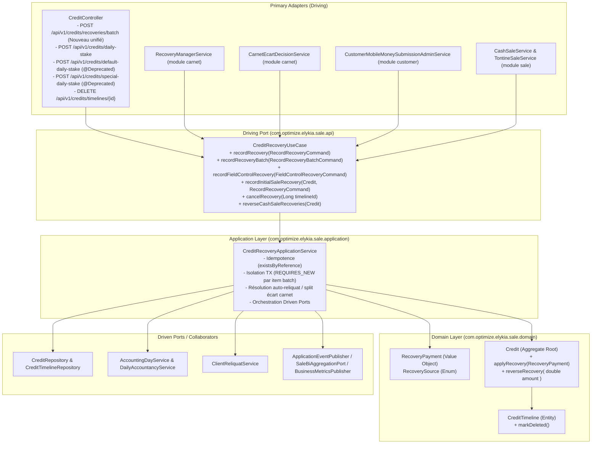

# Plan d'Architecture DDD & Hexagonale — Unification du Processus de Recouvrement

## 1. Contexte & constats sur l'existant

Au démarrage du projet, l'interface de saisie des collectes journalières distinguait deux flux techniques :
- **Mise normale (`default-daily-stake`, `normalStake = true`)** : paiement supposé égal à `1 × dailyStake` (le payload [`DefaultDailyStakeUnitDto`](backend/src/main/java/com/optimize/elykia/sale/web/dto/DefaultDailyStakeUnitDto.java) n'envoyait même pas de `amount`).
- **Mise spéciale (`special-daily-stake`, `normalStake = false`)** : paiement d'un montant différent de `dailyStake` ([`SpecialDailyStakeUnitDto`](backend/src/main/java/com/optimize/elykia/sale/web/dto/SpecialDailyStakeUnitDto.java) avec `amount`).

Avec l'arrivée de l'application Mobile, du Chef de Recouvrement (`RecoveryManager`), du paiement Mobile Money Espace Client, du Contrôle Terrain (`CarnetEcart`) et de la gestion des Reliquats (`ClientReliquat`), cette distinction n'a plus de sens métier : **tout recouvrement est l'encaissement d'un montant explicite imputé sur un `Credit`, accompagné éventuellement d'un reliquat consommé ou généré**.

Pourtant, le code actuel souffre encore de cette séparation historique à 6 endroits :

1. **Domaine ([`CreditTimeline.java`](backend/src/main/java/com/optimize/elykia/sale/domain/CreditTimeline.java) & [`Credit.java`](backend/src/main/java/com/optimize/elykia/sale/domain/Credit.java))** :
   - `CreditTimeline.dailyStakeOperation(credit)` bifurque sur `Boolean.TRUE.equals(normalStake)` :
     - Si `true` : `remainingDaysCount -= 1`.
     - Si `false` : `remainingDaysCount -= (int) (amount / credit.getDailyStake())` (division entière qui fausse `remainingDaysCount` dès qu'un paiement partiel ou libre n'est pas un multiple exact de `dailyStake`).
   - À l'inverse, l'annulation (`CreditTimelineService.reverseCreditAmounts`) recalcule `remainingDaysCount = (int) Math.ceil(totalAmountRemaining / dailyStake)`. L'aller et le retour ne sont donc même pas symétriques.
2. **Service [`CreditTimelineService.java`](backend/src/main/java/com/optimize/elykia/sale/application/CreditTimelineService.java) (684 lignes, 5 chemins d'exécution)** :
   - `makeDailyStake(CreditTimelineDto)` (Web unitaire, Mobile Money, Recovery Manager) : applique `applyAutoReliquatForClosure`, mappe via `CreditMapper`, appelle `dailyStakeFactor`.
   - `defaultDailyStakeByCollector(CollectorDailyStakeDto)` (Sync mobile / TFJ mises 1x) : appelle `processDailyStake(..., amount = null, isNormalStake = true, throwOnNotFound = false, ...)`, où le serveur déduit `stakeAmount = credit.getDailyStake()`. **Bug critique potentiel** : si la mise journalière du crédit a été modifiée sur le serveur avant la synchro mobile, ou si le reste à payer est inférieur à `dailyStake`, le serveur utilise le `dailyStake` serveur au lieu du montant réellement encaissé sur le terrain !
   - `specialDailyStakeByCollector(SpecialDailyStakeDto)` (Sync mobile / TFJ mises ≠ 1x) : appelle `processDailyStake(..., amount, isNormalStake = false, throwOnNotFound = true, ...)`.
   - `postFieldControlRecovery(Long creditId, double cashAmount, String reference)` (Écart de carnet accepté).
   - `recordInitialSaleRecovery(Credit credit, CreditTimelineDto dto)` (Vente comptant / Livraison tontine).
3. **Couplage inter-modules Spring Modulith** :
   - Les modules `carnet` ([`RecoveryManagerService`](backend/src/main/java/com/optimize/elykia/carnet/application/RecoveryManagerService.java), [`CarnetEcartDecisionService`](backend/src/main/java/com/optimize/elykia/carnet/application/CarnetEcartDecisionService.java)) et `customer` ([`CustomerMobileMoneySubmissionAdminService`](backend/src/main/java/com/optimize/elykia/customer/application/CustomerMobileMoneySubmissionAdminService.java)) importent directement la classe d'implémentation `com.optimize.elykia.sale.application.CreditTimelineService` au lieu de passer par un port `com.optimize.elykia.sale.api.*`.
4. **Synchronisation Mobile ([`RecoverySyncService.ts`](mobile/src/app/core/services/sync/recovery-sync.service.ts))** :
   - Sépare les recouvrements locaux en deux tableaux `defaultStakes` (`r.isDefaultStake`) et `specialStakes` (`!r.isDefaultStake`), et exécute **2 requêtes HTTP séparées** (`/default-daily-stake` sans `amount`, puis `/special-daily-stake` avec `amount`), avec 4 méthodes quasi-dupliquées (`syncDefaultDailyStakes`, `syncSpecialDailyStakes`, `postDefaultDailyStakes`, `postSpecialDailyStakes`).
5. **Interface Web Caisse / TFJ ([`TFJComponent.ts`](frontend/src/app/features/cash-desk/tfj/tfj.component.ts))** :
   - Sépare `this.normalStake` (`selectedMultiplier === 1`) et `this.specialStake` (`selectedMultiplier > 1`), puis enchaîne `submitOperations(defaultDailyStakeDto)` et `submitSpecialDailyStake(specialDailyStakeDto)`.
   - **Bug latent corrigé par l'unification** : `TFJComponent` construisait `DefaultDailyStakeDto { clientIds, collector, creditIds }` alors que l'endpoint backend `/api/v1/credits/default-daily-stake` attend `CollectorDailyStakeDto { collector, stakeUnits: [{ creditId, recoveryId }] }` (`dto.getStakeUnits().forEach(...)` → `NullPointerException` si `stakeUnits` est `null`).
6. **Silo mort `Recovery` / `RecoveryService` ([`Recovery.java`](backend/src/main/java/com/optimize/elykia/sale/domain/Recovery.java))** :
   - Entité JPA sur la table `recovery` qui ne participe ni au solde du crédit, ni à la journée comptable, ni à la BI.

---

## 2. Principes directeurs de la refonte

1. **Zéro changement d'interface utilisateur (Web & Mobile)** :
   - Aucun composant visuel, template HTML, style SCSS ou parcours utilisateur ne change (`DailyStakeModalComponent`, `TFJComponent`, `RecoveryPage` gardent 100 % de leur apparence et ergonomie).
2. **Zéro rupture de contrat REST ou Base de Données** :
   - Aucune migration SQL destructive : la colonne `credit_timeline.normal_stake` est conservée en base et dans les DTOs de lecture (`CreditTimelineRespDto`, `CreditTimelineMobileDto`), mais sa valeur est désormais dérivée automatiquement par le domaine (`Math.abs(amount - dailyStake) < 0.001`).
   - Les endpoints historiques `POST /api/v1/credits/daily-stake`, `POST /api/v1/credits/default-daily-stake` et `POST /api/v1/credits/special-daily-stake` restent actifs et délèguent au nouveau moteur unifié (compatibilité ascendante avec les APK mobiles déjà déployés).
3. **Architecture Hexagonale & DDD stricts dans `com.optimize.elykia.sale`** :
   - **Domaine riche (`sale.domain`)** : l'agrégat `Credit` porte les invariants financiers et les transitions d'état (`applyRecovery`, `reverseRecovery`).
   - **Driving Port (`sale.api.CreditRecoveryUseCase`)** : point d'entrée unique pour toutes les commandes de recouvrement (unitaires, batch, contrôle terrain, vente initiale, annulation).
   - **Application Service (`sale.application.CreditRecoveryApplicationService`)** : orchestration transactionnelle (`REQUIRES_NEW` par unité de lot), idempotence par `reference`, reliquats client, journée comptable, événements domaine et BI.

---

## 3. Architecture Cible (Diagramme Hexagonal)



---

## 4. Plan d'implémentation détaillé en 5 Phases

### Phase 1 — Modèle du Domaine (`com.optimize.elykia.sale.domain`)

1. **Créer l'enum `RecoverySource`** dans `com.optimize.elykia.sale.domain.RecoverySource` :
   - Valeurs :
     - `WEB_SINGLE` (saisie unitaire depuis la fiche crédit Web)
     - `WEB_TFJ_BATCH` (saisie groupée depuis le TFJ Caisse Web)
     - `MOBILE_SYNC` (synchronisation ou envoi online-first depuis l'app Mobile)
     - `RECOVERY_MANAGER` (clôture ou paiement partiel par le Chef de Recouvrement)
     - `MOBILE_MONEY` (validation d'un paiement Mobile Money Espace Client / PayGate)
     - `FIELD_CONTROL_ECART` (régularisation d'un écart de carnet accepté)
     - `INITIAL_SALE` (encaissement initial automatique d'une vente comptant ou livraison tontine)
   - Propriétés métier de l'enum :
     - `boolean requiresCollectorOwnershipCheck()` (`true` pour `WEB_SINGLE`, `WEB_TFJ_BATCH`, `MOBILE_SYNC`, `RECOVERY_MANAGER`, `MOBILE_MONEY` ; `false` pour `FIELD_CONTROL_ECART` et `INITIAL_SALE`).
     - `boolean supportsAutoReliquatClosure()` (`true` pour `WEB_SINGLE`, `RECOVERY_MANAGER`, `MOBILE_MONEY` ; `false` pour `MOBILE_SYNC`, `WEB_TFJ_BATCH`, `FIELD_CONTROL_ECART`, `INITIAL_SALE`).
     - `boolean publishesCollectionEventImmediately()` (`false` pour `FIELD_CONTROL_ECART`, `true` pour tous les autres).

2. **Créer le Value Object `RecoveryPayment` (`record` Java 25)** dans `com.optimize.elykia.sale.domain.RecoveryPayment` :
   ```java
   public record RecoveryPayment(
       double amount,
       double reliquatGeneratedAmount,
       double reliquatUsedAmount,
       String reference,
       String commercialUsername,
       String operationConsentCode,
       Double confirmedAmount,
       String syncConsentCode,
       RecoverySource source
   )
   ```
   - Validation compacte dans le constructeur du `record` :
     - `amount` doit être $> 0$ (NaN/infini/$\le 0$ rejeté avec `CustomValidationException`).
     - `reliquatGeneratedAmount >= 0` et `reliquatUsedAmount >= 0`.

3. **Refactorer [`Credit.java`](backend/src/main/java/com/optimize/elykia/sale/domain/Credit.java) et [`CreditTimeline.java`](backend/src/main/java/com/optimize/elykia/sale/domain/CreditTimeline.java)** :
   - Ajouter sur `Credit` la méthode métier riche **`CreditTimeline applyRecovery(RecoveryPayment payment, DailyAccountancy dailyAccountancy)`** :
     1. Vérifie `checkInProgressStatus()`.
     2. Vérifie que `payment.amount() <= this.totalAmountRemaining + 0.001` (sinon lève `CustomValidationException` avec référence du crédit, restant à payer et montant demandé).
     3. Met à jour `this.totalAmountPaid = Math.min(this.totalAmount, (this.totalAmountPaid != null ? this.totalAmountPaid : 0.0) + payment.amount())`.
     4. Met à jour `this.totalAmountRemaining = Math.max(0.0, this.totalAmount - this.totalAmountPaid)`.
     5. Calcule de façon **unique et déterministe** `this.remainingDaysCount` :
        - Si `this.totalAmountRemaining <= 0.001` : `this.totalAmountRemaining = 0.0` et `this.remainingDaysCount = 0`.
        - Sinon, si `this.dailyStake != null && this.dailyStake > 0` : `this.remainingDaysCount = (int) Math.ceil(this.totalAmountRemaining / this.dailyStake)`.
     6. Si `this.totalAmountRemaining == 0.0 && !awaitingWarehouseDelivery()` :
        - Passe `this.status = CreditStatus.SETTLED`, `this.effectiveEndDate = LocalDate.now()`.
        - Si `this.client != null`, `this.client.setCreditInProgress(false)`.
        - Calcule `this.solvencyNote` (`EARLY`, `TIME`, `LATE`) et `this.lateDaysCount`.
     7. Positionne `this.dailyPaid = Boolean.TRUE`.
     8. Construit et retourne l'entité `CreditTimeline` avec :
        - `credit = this`, `amount = payment.amount()`,
        - `normalStake = (this.dailyStake != null && Math.abs(payment.amount() - this.dailyStake) < 0.001)` (attribut purement informatif),
        - `remainingDaysCount = this.remainingDaysCount`,
        - `totalAmountRemaining = this.totalAmountRemaining`,
        - `commercialUsername = StringUtils.hasText(payment.commercialUsername()) ? payment.commercialUsername() : this.getCommercialUsername()`,
        - `reference = payment.reference()` (ou génération `REC-YYYYM-hex8` si absent),
        - `reliquatGeneratedAmount`, `reliquatUsedAmount`, `operationConsentCode`, `confirmedAmount`, `syncConsentCode`, `dailyAccountancy`.
   - Ajouter sur `Credit` la méthode symétrique **`boolean reverseRecovery(double amount)`** (déplacée depuis `CreditTimelineService.reverseCreditAmounts`) pour encapsuler la réouverture éventuelle (`SETTLED` → `INPROGRESS`) et le recalcul de `remainingDaysCount` dans l'agrégat.
   - Conserver `credit.dailyStakeOperation(creditTimeline)` et `creditTimeline.checkStakeValue(...)` / `creditTimeline.dailyStakeOperation(...)` en délégation `@Deprecated` pour ne casser aucun test existant qui les appellerait directement.

---

### Phase 2 — Driving Port Hexagonal & Application Service (`sale.api` & `sale.application`)

1. **Créer les DTOs/Commandes du Port Primaire dans `com.optimize.elykia.sale.api`** :
   - `RecordRecoveryCommand` (`record` Java 25) :
     ```java
     public record RecordRecoveryCommand(
         Long creditId,
         Double amount, // si null (ex: legacy default-daily-stake), résolu à min(dailyStake, totalAmountRemaining)
         String reference,
         String collector,
         Double reliquatGeneratedAmount,
         Double reliquatUsedAmount,
         String operationConsentCode,
         Double confirmedAmount,
         String syncConsentCode,
         RecoverySource source
     )
     ```
   - `RecordRecoveryBatchCommand` (`record` Java 25) :
     ```java
     public record RecordRecoveryBatchCommand(
         String collector,
         String syncConsentCode,
         List<RecordRecoveryCommand> items,
         boolean ignoreMissingOrClosedCredit // true pour legacy default-daily-stake, false sinon
     )
     ```
   - `BatchRecoveryResult` (`record` Java 25) :
     ```java
     public record BatchRecoveryResult(
         List<String> successRecoveryIds,
         List<FailedRecoveryItem> failedRecoveries
     ) {
         public record FailedRecoveryItem(String recoveryId, String errorMessage) {}
     }
     ```
   - `FieldControlRecoveryCommand` (`Long creditId, double cashAmount, String reference`).
   - Interface **`CreditRecoveryUseCase`** dans `com.optimize.elykia.sale.api.CreditRecoveryUseCase` :
     - `CreditTimeline recordRecovery(RecordRecoveryCommand command)`
     - `BatchRecoveryResult recordRecoveryBatch(RecordRecoveryBatchCommand command)`
     - `FieldControlCreditPosting recordFieldControlRecovery(FieldControlRecoveryCommand command)`
     - `void publishFieldControlCash(FieldControlCreditPosting posting)`
     - `CreditTimeline recordInitialSaleRecovery(Credit managedCredit, RecordRecoveryCommand command)`
     - `CreditTimelineRespDto cancelRecovery(Long timelineId)`
     - `void reverseCollectionsForCancelledCashSale(Credit credit)`

2. **Implémenter `CreditRecoveryApplicationService`** dans `com.optimize.elykia.sale.application.CreditRecoveryApplicationService` (implémentant `CreditRecoveryUseCase`) :
   - Centralise en **un seul pipeline d'exécution** :
     1. **Idempotence** : si `StringUtils.hasText(cmd.reference()) && timelineRepository.existsByReference(cmd.reference())`, retourne immédiatement le `CreditTimeline` existant.
     2. **Préparation journée comptable** (`accountingDayService.ensureAccountingReadyForOperations()`) hors transaction JPA avant d'ouvrir la transaction `REQUIRES_NEW` (pour `recordRecovery` et `recordRecoveryBatch`).
     3. **Chargement du crédit & contrôle d'audience** (`CollectorAudienceSecurity.assertPromoterOwnsCreditCollector` si `cmd.source().requiresCollectorOwnershipCheck()`).
     4. **Résolution du montant et du reliquat** :
        - Si `cmd.amount() == null` (legacy `default-daily-stake`), `resolvedAmount = Math.min(credit.getDailyStake(), credit.getTotalAmountRemaining())`.
        - Si `cmd.source().supportsAutoReliquatClosure()`, applique la règle d'auto-clôture par reliquat client (`applyAutoReliquatForClosure`).
     5. **Exécution domaine** : `CreditTimeline timeline = credit.applyRecovery(payment, dailyAccountancy)`.
     6. **Persistance & Effets de bord** :
        - Sauvegarde `credit` et `timeline`.
        - Si clôturé (`SETTLED`), appelle `creditService.syncClientCreditFlagsAfterClose(credit)`.
        - Met à jour le reliquat client (`clientReliquatService.addReliquat` / `consumeReliquat`).
        - Enregistre `creditPaymentEventService.recordPayment(...)` et `creditEnrichmentService.enrichCredit(...)`.
        - Publie les métriques (`metricsPublisher`), l'événement `CreditCollectionEvent` (si `publishesCollectionEventImmediately()`) et met à jour l'agrégation BI (`biAggregationService.updateCollectionAggregation`).

3. **Transformer [`CreditTimelineService`](backend/src/main/java/com/optimize/elykia/sale/application/CreditTimelineService.java) en façade délégante** vers `CreditRecoveryUseCase` :
   - Toutes les méthodes publiques existantes de `CreditTimelineService` (`makeDailyStake`, `defaultDailyStakeByCollector`, `specialDailyStakeByCollector`, `postFieldControlRecovery`, `publishFieldControlCash`, `recordInitialSaleRecovery`, `cancelRecovery`, `reverseCollectionsForCancelledCashSale`) délèguent directement à `CreditRecoveryApplicationService`.
   - Ainsi, tous les tests d'intégration et appelants existants continuent de fonctionner sans aucune modification.

---

### Phase 3 — Adapters Primaires Backend (`sale.web`, `carnet`, `customer`)

1. **Nouvel endpoint REST Batch Unifié dans [`CreditController`](backend/src/main/java/com/optimize/elykia/sale/web/CreditController.java)** :
   - Créer `UnifiedRecoveryBatchDto` et `UnifiedRecoveryUnitDto` dans `com.optimize.elykia.sale.web.dto` :
     ```java
     public class UnifiedRecoveryBatchDto {
         @NotBlank private String collector;
         private String syncConsentCode;
         private String source; // "MOBILE_SYNC" ou "WEB_TFJ_BATCH"
         @Valid @NotEmpty private List<UnifiedRecoveryUnitDto> recoveries;
     }
     public class UnifiedRecoveryUnitDto {
         @NotNull private Long creditId;
         private Long clientId;
         @NotNull @Positive private Double amount;
         @NotBlank private String recoveryId;
         private Double reliquatGeneratedAmount = 0.0;
         private Double reliquatUsedAmount = 0.0;
         private String operationConsentCode;
         private Double confirmedAmount;
     }
     ```
   - Ajouter dans `CreditController` :
     - `POST /api/v1/credits/recoveries/batch` → appelle `creditRecoveryUseCase.recordRecoveryBatch(...)` et retourne `SpecialDailyStakeResponseDto` (`{ successRecoveryIds, failedRecoveries }`).
   - Annoter `POST /api/v1/credits/default-daily-stake` et `POST /api/v1/credits/special-daily-stake` avec `@Deprecated(since = "2.17.0")` (tout en les gardant 100 % fonctionnels via conversion en `RecordRecoveryBatchCommand`).
   - Rendre `CollectorDailyStakeDto` tolérant au format legacy TFJ (`creditIds` sans `stakeUnits`) au cas où un navigateur en cache enverrait encore l'ancien payload.

2. **Bruser les modules externes sur le port `CreditRecoveryUseCase` (`sale.api`)** :
   - [`RecoveryManagerService`](backend/src/main/java/com/optimize/elykia/carnet/application/RecoveryManagerService.java) (`module carnet`) → injecte `CreditRecoveryUseCase` au lieu de `CreditTimelineService`.
   - [`CarnetEcartDecisionService`](backend/src/main/java/com/optimize/elykia/carnet/application/CarnetEcartDecisionService.java) (`module carnet`) → injecte `CreditRecoveryUseCase` au lieu de `CreditTimelineService`.
   - [`CustomerMobileMoneySubmissionAdminService`](backend/src/main/java/com/optimize/elykia/customer/application/CustomerMobileMoneySubmissionAdminService.java) (`module customer`) → injecte `CreditRecoveryUseCase` au lieu de `CreditTimelineService`.
   - [`CashSaleService`](backend/src/main/java/com/optimize/elykia/sale/application/CashSaleService.java) et [`TontineSaleService`](backend/src/main/java/com/optimize/elykia/sale/application/TontineSaleService.java) → utilisent `CreditRecoveryUseCase.recordInitialSaleRecovery(...)`.

3. **Déprécier le silo mort `Recovery` / `RecoveryService`** :
   - Annoter [`Recovery.java`](backend/src/main/java/com/optimize/elykia/sale/domain/Recovery.java), [`RecoveryRepository.java`](backend/src/main/java/com/optimize/elykia/sale/infrastructure/persistence/RecoveryRepository.java) et [`RecoveryService.java`](backend/src/main/java/com/optimize/elykia/sale/application/RecoveryService.java) avec `@Deprecated(since = "2.17.0", forRemoval = true)`.

---

### Phase 4 — Alignement sous le capot Frontend Web (`TFJComponent`) & Mobile (`RecoverySyncService`)

> **Important** : Aucun fichier `.html` ni `.scss` n'est modifié. L'interface utilisateur reste 100 % identique.

1. **Frontend Web — [`CashDeskService`](frontend/src/app/features/cash-desk/service/cash-desk.service.ts) & [`TFJComponent`](frontend/src/app/features/cash-desk/tfj/tfj.component.ts)** :
   - Dans `default-daily-stake-dto.ts`, ajouter l'interface `UnifiedRecoveryBatchDto`.
   - Dans `CashDeskService`, ajouter `submitUnifiedRecoveries(dto: UnifiedRecoveryBatchDto): Observable<any>` pointant vers `POST /api/v1/credits/recoveries/batch`.
   - Dans `TFJComponent.submitData()` :
     - Au lieu d'enchaîner `submitOperations(defaultDailyStakeDto)` puis `submitSpecialDailyStake(specialDailyStakeDto)`, combiner toutes les lignes sélectionnées (`normalStake` avec `amount = credit.dailyStake` + `specialStake` avec `amount = credit.dailyStake * credit.selectedMultiplier`) dans un seul `UnifiedRecoveryBatchDto` (avec une référence déterministe/UUID par ligne `TFJ-${creditId}-${Date.now()}`) et exécuter :
       ```typescript
       this.cashDeskService.submitUnifiedRecoveries(unifiedBatchDto).pipe(
         concatMap(() => this.cashDeskService.submitTicketing(ticketingDto))
       )
       ```
     - Les compteurs visuels de l'étape 1 (`getNormalStakeCount()` pour `1x` et `getSpecialStakeCount()` pour `>1x`) restent intacts pour l'affichage du récapitulatif à l'écran.

2. **Mobile — [`RecoverySyncService`](mobile/src/app/core/services/sync/recovery-sync.service.ts) & [`sync.model.ts`](mobile/src/app/models/sync.model.ts)** :
   - Dans `sync.model.ts`, ajouter `UnifiedRecoveryBatchRequest` et `UnifiedRecoveryBatchResponse`.
   - Dans `RecoverySyncService` :
     - Remplacer la double logique (`defaultStakes` + `specialStakes` dans `syncBatch`, `syncSingle`, `postCreateRecovery`, `syncClosingRecoveries`) par un seul flux unifié :
       - `syncRecoveriesBatch(recoveries: Recovery[])` → appelle `POST /api/v1/credits/recoveries/batch` en envoyant toujours `amount: recovery.amount`, `creditId`, `clientId`, `recoveryId: recovery.id`, `reliquatGeneratedAmount`, `reliquatUsedAmount`, `operationConsentCode`, `confirmedAmount`.
       - `postRecoveriesOnline(recoveries: Recovery[])` → appelle `POST /api/v1/credits/recoveries/batch` pour le mode online-first (`postCreateRecovery`).
     - Plus aucune perte du `recovery.amount` lors de la synchronisation des mises égales à `dailyPayment`.

---

### Phase 5 — Tests, Gouvernance Modulith & Documentation

1. **Tests Backend (JUnit 6 / Mockito / Spring Modulith)** :
   - `CreditRecoveryDomainTest` : vérifie `Credit.applyRecovery(...)` et `Credit.reverseRecovery(...)` (calcul de `remainingDaysCount` avec paiements standards, multiples, partiels, clôture exacte, dépassement refusé, réouverture après annulation, dérivation informative de `normalStake`).
   - `CreditRecoveryApplicationServiceTest` : vérifie l'idempotence par `reference`, l'auto-reliquat de clôture selon `RecoverySource`, le traitement par lot isolé (`REQUIRES_NEW` : 1 succès + 1 échec dans le même lot), la rétrocompatibilité de `defaultDailyStakeByCollector` (avec `amount` absent et crédit restant < `dailyStake`), et le contrôle terrain `recordFieldControlRecovery`.
   - `ModularityTests` : vérifie que les 20 modules Spring Modulith compilent et respectent les frontières (`carnet` et `customer` passant désormais par `sale.api.CreditRecoveryUseCase`).
2. **Tests Frontend & Mobile (Vitest)** :
   - Mettre à jour / ajouter les tests unitaires Vitest pour `TFJComponent` / `CashDeskService` et `RecoverySyncService`.
3. **Versions, Memory Bank & Changelog** :
   - Incrémenter les versions :
     - Backend : `2.16.0` → `2.17.0` (`backend/pom.xml`)
     - Frontend : `3.5.0` → `3.5.1` (`frontend/package.json`)
     - Mobile : `3.2.0` → `3.2.1` (`mobile/package.json`, `environment.ts`, `environment.prod.ts`)
   - Mettre à jour `docs/CHANGELOG.md`, `memory-bank/activeContext.md`, `memory-bank/techContext.md`, `memory-bank/decisions.md`.
