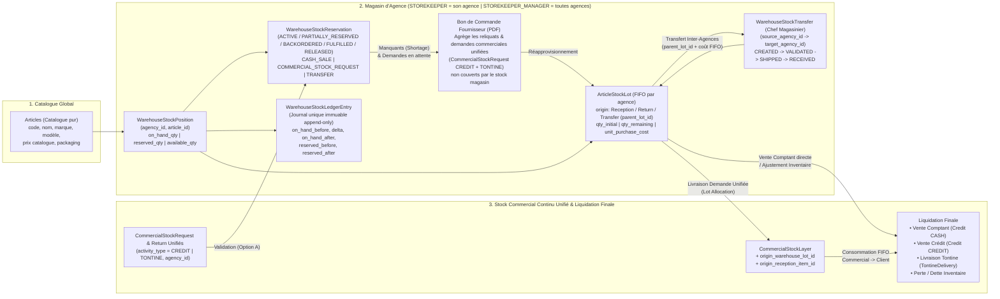

# Plan d'Architecture DDD — Refonte de la Gestion du Stock Magasin Multi-Agences, Unification des Demandes/Retours Commerciaux (`CommercialStockRequest` / `Return`), Dépréciation Explicite (`forRemoval = true`) des Silos Legacy, Réservations, Bon de Commande Fournisseur (PDF), Profil Chef Magasinier (`STOREKEEPER_MANAGER`), Transferts Inter-Agences, Traçabilité de Bout en Bout & Impact Mobile Local-First

## 1. Diagnostic de l'Existant & Alignement avec `memory-bank/`

La relecture croisée de `memory-bank/activeContext.md`, `memory-bank/systemPatterns.md` et du code actuel (`V047`..`V053`) met en évidence **7 constats structurels majeurs** :

1. **`Articles` mélange le Catalogue Produit (global) et l'État Physique du Stock (local à une agence) :**
   - `Articles` porte directement `stockQuantity`, `reservedQuantity`, `reorderPoint`, `optimalStockLevel`, `lastRestockDate`.
   - **Problème Multi-Agences :** Avec le multi-agences (`V053`), un article du catalogue (ex. *TV Samsung 32"*) est **commun à toute l'entreprise**, mais chaque agence possède son propre magasin physique avec ses propres quantités, ses propres réservations et ses propres lots FIFO. Tant que `stockQuantity` est porté par `Articles`, il est impossible d'avoir un stock par agence.
2. **Les positions et le ledger du stock commercial ont été unifiés dans `commercialstock` (`V047`/`V048`), MAIS les Demandes de Sortie et Retours sont restés scindés en deux silos non marqués `@Deprecated(forRemoval = true)` (`StockRequest` vs `StockTontineRequest` et `StockReturn` vs `StockTontineReturn`) :**
   - Lors de la migration `V047__commercial_stock_continuous_model.sql`, les tables `commercial_stock_position`, `commercial_stock_layer`, `commercial_stock_ledger_entry` et `commercial_stock_period_snapshot` ont été unifiées dans le 20e module `commercialstock` avec `activity_type ∈ {'CREDIT', 'TONTINE'}`.
   - En revanche, `commercial_stock_request` et `commercial_stock_return` n'avaient pas encore été créées : `StockRequest` / `StockReturn` dans `sale` et `StockTontineRequest` / `StockTontineReturn` dans `tontine` sont restés actifs et **sans annotation `@Deprecated(forRemoval = true)`**, tout comme `CommercialMonthlyStock*` et `TontineStock*`.
   - **Action corrective immédiate dans ce plan :**
     1. Unifier les demandes et retours dans `com.optimize.elykia.commercialstock` (`CommercialStockRequest`, `CommercialStockRequestItem`, `CommercialStockReturn`, `CommercialStockReturnItem`).
     2. **Annoter systématiquement `@Deprecated(since = "2.16.0", forRemoval = true)`** avec Javadoc explicite pointant vers la classe cible (`@see com.optimize.elykia.commercialstock.domain.CommercialStockRequest`, etc.) sur **toutes** les classes des anciens silos (`StockRequest*`, `StockTontineRequest*`, `StockReturn*`, `StockTontineReturn*`, `CommercialMonthlyStock*`, `TontineStock*`, `StockMovement`, `ArticleHistory`) et documenter cette dépréciation dans `memory-bank/systemPatterns.md` et `schema-catalog.json` pour qu'aucune analyse future ne puisse s'appuyer dessus.
3. **Double historique magasin redondant, désynchronisé et non multi-agences (`StockMovement` vs `ArticleHistory`) :**
   - `StockMovement` (`stock_movement`) et `ArticleHistory` (`article_history`) enregistrent tous les deux `stockBefore/initialQuantity`, `quantity/operationQuantity`, `stockAfter/finalQuantity`, avec des écritures incohérentes selon les flux. Ils sont remplacés par `WarehouseStockLedgerEntry` et marqués `@Deprecated(since = "2.16.0", forRemoval = true)`.
4. **Gestion embryonnaire des Réservations et absence de Bon de Commande Fournisseur basé sur les Demandes Commerciales Unifiées :**
   - `Articles.reservedQuantity` est un simple entier incrémenté uniquement par les ventes au comptant (`CashSaleService`).
   - Lorsqu'une demande de sortie commercial (`CommercialStockRequest`) est **Validée** (`VALIDATED`), le stock n'est pas réservé de manière traçable.
   - L'ancien rapport de réapprovisionnement (`OrderItemRepository.findRestockNeeded()`) ne regardait que les `OrderItem` (`OrderStatus.ACCEPTED`), **ignorait complètement les demandes de stock des commerciaux** et n'utilisait pas le thème PDF officiel Navy Elykia.
5. **Rupture de la chaîne de traçabilité entre l'Entrée Magasin et la Liquidation Finale (Vente Client) :**
   - Lorsqu'un lot entre en magasin via une réception (`StockReceptionItem` → `ArticleStockLot #L1`), puis sort vers un commercial, `CommercialStockLayer` ne conservait pas `origin_warehouse_lot_id`.
6. **Absence de distinction entre Magasinier d'Agence (`STOREKEEPER`) et Chef Magasinier Multi-Agences (`STOREKEEPER_MANAGER`) :**
   - Il manque le profil **`STOREKEEPER_MANAGER` (Chef Magasinier)** capable d'intervenir sur les stocks de toutes les agences et de piloter les **transferts inter-agences**.
7. **Sémantique spécifique de `article.stockQuantity` dans l'Application Mobile Local-First (`mobile/`) :**
   - Dans SQLite mobile, `articles.stockQuantity` représente **le stock terrain propre au commercial connecté**. Le mobile doit donc stocker séparément la disponibilité magasin de l'agence (`warehouseAvailableQuantity`).

---

## 2. Modélisation Cible (« Monde Réel » — WMS / ERP Professionnel adapté à ELYKIA)

### 2.0. Unification dans `commercialstock` (`CommercialStockRequest` & `CommercialStockReturn`) & Politique Stricte de Dépréciation (`@Deprecated(forRemoval = true)`)

1. **Nouveaux agrégats unifiés dans `com.optimize.elykia.commercialstock.domain` :**
   - **`CommercialStockRequest` (`commercial_stock_request`) & `CommercialStockRequestItem` (`commercial_stock_request_item`) :**
     - `id`, `reference` (`REQ-...` pour `CREDIT`, `TRQ-...` pour `TONTINE`), `agency_id`, `commercial_username`, `activity_type` (`CREDIT` | `TONTINE`), `tontine_session_id` (nullable si `CREDIT`), `status` (`CREATED`, `VALIDATED`, `DELIVERED`, `CANCELLED`, `REFUSED`), `request_date`, `validation_date`, `delivery_date`, `accounting_date`, `total_sale_price`, `total_purchase_price`, `note`, `parent_request_id` (pour la sous-demande issue d'une livraison partielle Scénario B), `legacy_credit_request_id`, `legacy_tontine_request_id`.
     - Chaque `CommercialStockRequestItem` porte : `article_id`, `quantity_requested`, `quantity_reserved`, `quantity_delivered`, `shortage_quantity`, `unit_sale_price`, `unit_purchase_cost`.
   - **`CommercialStockReturn` (`commercial_stock_return`) & `CommercialStockReturnItem` (`commercial_stock_return_item`) :**
     - `id`, `reference` (`RET-...`), `agency_id`, `commercial_username`, `activity_type` (`CREDIT` | `TONTINE`), `tontine_session_id`, `status` (`CREATED`, `VALIDATED`, `CANCELLED`), `return_date`, `received_date`, `received_by`, `note`, `legacy_credit_return_id`, `legacy_tontine_return_id`.
2. **Marquage `@Deprecated(since = "2.16.0", forRemoval = true)` obligatoire sur toutes les entités et services des anciens silos :**
   Afin qu'aucun développeur ni agent IA ne construise plus jamais un plan ou une requête sur les anciens modèles amenés à disparaître :
   - **Dans `com.optimize.elykia.sale` :**
     - `StockRequest`, `StockRequestItem`, `StockRequestRepository`, `StockRequestItemRepository`, `StockRequestService` → `@Deprecated(since = "2.16.0", forRemoval = true)` (avec `@see com.optimize.elykia.commercialstock.domain.CommercialStockRequest`).
     - `StockReturn`, `StockReturnItem`, `StockReturnRepository`, `StockReturnItemRepository`, `StockReturnService` → `@Deprecated(since = "2.16.0", forRemoval = true)` (avec `@see com.optimize.elykia.commercialstock.domain.CommercialStockReturn`).
     - `CommercialMonthlyStock`, `CommercialMonthlyStockItem`, `CommercialStockMovement` → `@Deprecated(since = "2.16.0", forRemoval = true)` (avec `@see com.optimize.elykia.commercialstock.domain.CommercialStockPosition`).
   - **Dans `com.optimize.elykia.tontine` :**
     - `StockTontineRequest`, `StockTontineRequestItem`, `StockTontineRequestRepository`, `StockTontineRequestItemRepository`, `StockTontineRequestService` → `@Deprecated(since = "2.16.0", forRemoval = true)` (avec `@see com.optimize.elykia.commercialstock.domain.CommercialStockRequest`).
     - `StockTontineReturn`, `StockTontineReturnItem`, `StockTontineReturnRepository`, `StockTontineReturnItemRepository`, `StockTontineReturnService` → `@Deprecated(since = "2.16.0", forRemoval = true)` (avec `@see com.optimize.elykia.commercialstock.domain.CommercialStockReturn`).
     - `TontineStock`, `TontineStockLayer`, `TontineStockMovement` → `@Deprecated(since = "2.16.0", forRemoval = true)` (avec `@see com.optimize.elykia.commercialstock.domain.CommercialStockPosition`).
   - **Dans `com.optimize.elykia.inventory` :**
     - `Articles.getStockQuantity()`, `Articles.setStockQuantity()`, `Articles.getReservedQuantity()`, `Articles.setReservedQuantity()` → `@Deprecated(since = "2.16.0", forRemoval = true)` (avec `@see com.optimize.elykia.inventory.domain.WarehouseStockPosition`).
     - `StockMovement`, `StockMovementRepository`, `StockMovementService`, `ArticleHistory`, `ArticleHistoryRepository`, `ArticleHistoryService` → `@Deprecated(since = "2.16.0", forRemoval = true)` (avec `@see com.optimize.elykia.inventory.domain.WarehouseStockLedgerEntry`).
   - **Dans `memory-bank/systemPatterns.md` et `backend/src/main/resources/ai/schema-catalog.json` :**
     - Ajout d'une section explicite **« Modèles de Stock Canoniques vs Modèles Legacy Dépréciés (`forRemoval = true`) »** dans `memory-bank/systemPatterns.md`.

---

### 2.1. Séparation stricte Catalogue (`Articles`) vs Position de Stock par Agence (`WarehouseStockPosition`)

- **`Articles` (Catalogue Global) :**
  - Conserve uniquement les données produit communes à toutes les agences : `code`, `name`, `marque`, `model`, `type`, `purchasePrice`, `sellingPrice`, `creditSalePrice`, `packagingType`, `salePacks`, `photoObjectKey`.
  - `ArticlesDto` expose explicitement : `agencyId`, `warehouseOnHandQuantity`, `warehouseReservedQuantity`, `warehouseAvailableQuantity`, et `warehouseShortageQuantity` (total des reliquats demandés par les commerciaux non encore couverts par le stock physique).
- **`WarehouseStockPosition` (`warehouse_stock_position` — 1 ligne par `(agency_id, article_id)`) :**
  - Source de vérité transactionnelle du stock magasin de chaque agence (protégée par `@Version` + verrou pessimiste `SELECT ... FOR UPDATE`).
  - **Trois compteurs explicites avec invariants SQL (`CHECK`) :**
    1. **`onHandQuantity` (`on_hand_quantity >= 0`)** — *Quantité physique en stock dans le magasin de l'agence*.
    2. **`reservedQuantity` (`reserved_quantity >= 0 AND reserved_quantity <= on_hand_quantity`)** — *Quantité engagée/réservée* sur le stock physique présent.
    3. **`availableQuantity` (calculé : `onHandQuantity - reservedQuantity >= 0`)** — *Quantité réellement disponible*.

---

### 2.2. Réservations Option A, Livraison Partielle (Scénario B) & Bon de Commande Fournisseur (Export PDF Navy Elykia)

#### A. Réservation à la validation (`VALIDATED`) & Livraison Partielle (Scénario B)
1. **À la validation d'une demande commerciale unifiée (`CommercialStockRequest`, qu'elle soit `CREDIT` ou `TONTINE`) :**
   - Crée une `WarehouseStockReservation` (`reservationType = COMMERCIAL_STOCK_REQUEST`) pour chaque article demandé :
     - `quantityRequested` = quantité validée (ex. `10`),
     - `quantityReserved` = $\min(\text{quantityRequested}, \text{position.availableQuantity})$ (ex. `6` réservées immédiatement),
     - `shortageQuantity` = $\text{quantityRequested} - \text{quantityReserved}$ (ex. `4` manquantes, statut `PARTIALLY_RESERVED` ou `BACKORDERED` si `0` disponible).
2. **Livraison Partielle (Scénario B) & Ré-allocation lors du réapprovisionnement :**
   - Si le magasinier livre **avant** le réapprovisionnement : il livre les `6` unités réservées, la réservation de la demande livrée passe à `FULFILLED`, et une **sous-demande enfant `CommercialStockRequest` (`VALIDATED`, `parentRequestId = parent.id`)** est créée automatiquement pour les `4` unités restantes avec sa réservation `BACKORDERED` (`quantityRequested = 4, quantityReserved = 0, shortageQuantity = 4`).
   - Dès que le réapprovisionnement fournisseur (`StockReception`) est réceptionné au magasin, les réservations en attente (`BACKORDERED` / `PARTIALLY_RESERVED`) de l'agence sont automatiquement complétées en FIFO (`autoAllocateIncomingStockToBackorders`).

#### B. Bon de Commande Fournisseur basé sur les Demandes Commerciales Unifiées (`SupplierRestockOrderService` + Export PDF)
- Calculé directement sur **`commercial_stock_request` / `commercial_stock_request_item`** (filtrable par `agencyId`, `activityType ∈ {ALL, CREDIT, TONTINE}`, et statuts `VALIDATED` + `CREATED`).
- Pour chaque article où la demande des commerciaux dépasse le stock magasin mobilisable, calcule :
  - `creditRequestedQty`, `tontineRequestedQty`, `totalRequestedQty` (avec références `REQ-...` / `TRQ-...` et commerciaux demandeurs),
  - `warehouseOnHandQty`, `alreadyReservedForRequestsQty`, `warehouseAvailableQty`,
  - **`quantityToOrder` (Manquant net à commander au fournisseur)**, `unitPurchasePrice` et `estimatedTotalCost`.
- **Export PDF au Thème Officiel Navy Elykia (`elykia-pdf-style`)** via `supplier-purchase-order-sheet.html` (`PdfDocumentIdentity` + `PdfHtmlRenderer` avec pagination `n/N`).

---

### 2.3. Nouveau Profil Chef Magasinier (`STOREKEEPER_MANAGER`) & Gouvernance Multi-Agences des Magasiniers

- **Magasinier simple (`STOREKEEPER` / `UserProfilConstant.MAGASINIER`) :**
  - Reste dans `AgencyProfils.TERRAIN` (strictement limité au stock de son agence assignée ; peut uniquement réceptionner un transfert inter-agences entrant destiné à son agence).
- **Chef Magasinier (`STOREKEEPER_MANAGER` / `UserProfilConstant.STOREKEEPER_MANAGER = "STOREKEEPER_MANAGER"`) :**
  - Créé dans `upro` via `V054` et ajouté à **`AgencyProfils.GLOBAL`** dans `AgencyProfils.java`.
  - Possède toutes les permissions magasinier + **`ROLE_STOREKEEPER_MANAGER`** (intervention sur le stock de toutes les agences) + **`ROLE_INTER_AGENCY_STOCK_TRANSFER`** (création, validation, expédition, réception et annulation des transferts inter-agences).

---

### 2.4. Unification de `StockMovement` et `ArticleHistory` en un Journal Unique (`WarehouseStockLedgerEntry`)

- Grand Livre immuable (`warehouse_stock_ledger_entry`) par agence traçant `on_hand_before`, `quantity_delta`, `on_hand_after`, `reserved_before`, `reserved_after`, coûts FIFO, références et opérateur.
- Reprise complète de `article_history` et `stock_movement` dans `V054`, et dépréciation `@Deprecated(since = "2.16.0", forRemoval = true)` de `StockMovement*` et `ArticleHistory*`.

---

### 2.5. Traçabilité de Bout en Bout : de l'Entrée en Stock jusqu'à la Liquidation (Vente Client)

- Chaînage complet `StockReception` → `ArticleStockLot` (`agency_id`, `lot_code`, `parent_lot_id`) → `ArticleStockLotConsumption` → `CommercialStockLayer` (`origin_warehouse_lot_id`) → `CommercialStockLayerConsumption` → `Credit` (`CREDIT` / `CASH`) / `TontineDelivery` / `InventoryDebt`.
- Exposition de `LotLifecycleTraceDto` vérifiant à tout instant : `Quantité Initiale == En Rayon Magasins + Chez Commerciaux + Vendu/Liquidé aux Clients + Pertes/Ajustements`.

---

### 2.6. Flux Complet de Transfert de Stock Inter-Agences (`WarehouseStockTransfer` — piloté par `STOREKEEPER_MANAGER`)

- Tables `warehouse_stock_transfer`, `warehouse_stock_transfer_item`, `warehouse_stock_transfer_lot_slice`.
- Cycle `CREATED` → `VALIDATED` (réservation source) → `IN_TRANSIT` / `SHIPPED` (consommation FIFO source + `AGENCY_TRANSFER_OUT`) → `RECEIVED` (création lots FIFO cible avec même coût d'achat et `parent_lot_id = source_lot_id` + `AGENCY_TRANSFER_IN`).

---

### 2.7. Impact & Adaptation de l'Application Mobile Local-First (`mobile/`)

- Migration SQLite Mobile `v40` → `v41` : ajout de `warehouseOnHandQuantity`, `warehouseReservedQuantity`, `warehouseAvailableQuantity` sur `articles` (sans toucher à `stockQuantity` qui reste 100 % dédié au stock terrain local-first du commercial), et `agencyId`, `agencyName` sur `users`.
- Affichage du badge **`Dispo magasin : X unités`** dans l'onglet Catalogue et dans le sélecteur d'articles des demandes de sortie + bump Mobile `3.1.0` → `3.2.0`.

---

## 3. Changements Proposés par Composant

### Phase 1 — Schéma PostgreSQL, Demandes/Retours Commerciaux Unifiés, Profil `STOREKEEPER_MANAGER` & Migration de Reprise (`V054`)

#### [NEW] `backend/src/main/resources/db/migration/V054__warehouse_stock_multi_agency_and_lot_traceability.sql`
- Création du profil **`STOREKEEPER_MANAGER`** (`upro`) et des permissions **`ROLE_STOREKEEPER_MANAGER`** et **`ROLE_INTER_AGENCY_STOCK_TRANSFER`** (`uperm`, `upro_perms`, `uacc_perms`).
- Création des tables magasin multi-agences :
  - `warehouse_stock_position`
  - `warehouse_stock_reservation`
  - `warehouse_stock_ledger_entry`
  - `warehouse_stock_transfer`, `warehouse_stock_transfer_item`, `warehouse_stock_transfer_lot_slice`
- Création des tables unifiées de demandes et retours commerciaux dans `commercialstock` :
  - `commercial_stock_request` & `commercial_stock_request_item` (unifiant `stock_request` [`CREDIT`] et `stock_tontine_request` [`TONTINE`])
  - `commercial_stock_return` & `commercial_stock_return_item` (unifiant `stock_return` [`CREDIT`] et `stock_tontine_return` [`TONTINE`])
- Enrichissement de `stock_reception`, `article_stock_lot` (`agency_id`, `lot_code`, `parent_lot_id`), `article_stock_lot_consumption` (`ledger_entry_id`) et `commercial_stock_layer` (`origin_warehouse_lot_id`, `origin_reception_item_id`).
- Backfill idempotent complet.

---

### Phase 2 — Sécurité (`STOREKEEPER_MANAGER`), Domaine & Services Backend (`inventory` & `commercialstock`)

- `UserProfilConstant.STOREKEEPER_MANAGER`, `UserPermissionConstant.STOREKEEPER_MANAGER`, `UserPermissionConstant.INTER_AGENCY_STOCK_TRANSFER`, `AgencyProfils.GLOBAL`, `StorekeeperManagerPermissionsInit`.
- `WarehouseStockPosition`, `WarehouseStockReservation`, `WarehouseStockLedgerEntry`, `WarehouseStockTransfer`, `WarehouseStockService`, `WarehouseStockTransferService`, `WarehouseLotTraceabilityService`.
- `CommercialStockRequest`, `CommercialStockRequestItem`, `CommercialStockReturn`, `CommercialStockReturnItem`, `CommercialStockRequestService`, `CommercialStockReturnService` dans `com.optimize.elykia.commercialstock`.
- `SupplierRestockOrderService` & template PDF Navy Elykia `supplier-purchase-order-sheet.html` calculant le bon de commande fournisseur directement à partir des demandes commerciales unifiées (`commercial_stock_request`).
- Dépréciation `@Deprecated(since = "2.16.0", forRemoval = true)` de toutes les classes des anciens silos (`StockRequest*`, `StockTontineRequest*`, `StockReturn*`, `StockTontineReturn*`, `CommercialMonthlyStock*`, `TontineStock*`, `StockMovement*`, `ArticleHistory*`, `Articles.stockQuantity`).

---

### Phase 3 — Raccordement de `sale`, `tontine` et `commercialstock`

- Chaînage `originWarehouseLotId` sur `CommercialStockLayer` à chaque livraison de demande commerciale.
- Façades rétrocompatibles sur `StockRequestService` / `StockTontineRequestService` et `StockReturnService` / `StockTontineReturnService` synchronisées avec `CommercialStockRequest` / `CommercialStockReturn` et `WarehouseStockService`.

---

### Phase 4 — API REST & Frontend Web Angular 21

- `WarehouseStockController` (`/api/v2/warehouse-stocks` : positions, réservations, ledger, traçabilité des lots, bon de commande fournisseur JSON + PDF, transferts inter-agences) & `CommercialStockRequestController` (`/api/v2/commercial-stock-requests`).
- Écrans Angular 21 : profil `STOREKEEPER_MANAGER`, 3 colonnes **En stock / Réservé / Disponible**, bouton **« Bon de Commande Fournisseur (PDF) »**, vue **« Traçabilité & Liquidation des Lots »**, et vue **« Transferts Inter-Agences »**.

---

### Phase 5 — Application Mobile Local-First (`mobile/`) & Documentation

- Migration SQLite `v41` (`warehouseOnHandQuantity`, `warehouseReservedQuantity`, `warehouseAvailableQuantity`), affichage du badge `Dispo magasin`, bump Mobile `3.1.0` → `3.2.0`.
- Mise à jour de `schema-catalog.json`, Guide Utilisateur + index RAG, `memory-bank/` et `docs/CHANGELOG.md`.

---

## 4. Plan de Vérification

- **PostgreSQL 16 (`elykia_mig`) :** exécution et validation de `V054__warehouse_stock_multi_agency_and_lot_traceability.sql`.
- **Tests Unitaires Backend & Modulith :**
  - `WarehouseStockServiceTest`, `CommercialStockRequestServiceTest`, `SupplierRestockOrderServiceTest` (calcul sur `CommercialStockRequest` + rendu PDF Navy Elykia `1/N`), `WarehouseStockTransferServiceTest`, `WarehouseLotTraceabilityServiceTest`, et `ModularityTests` (20 modules).
- **Tests Frontend & Mobile :** Vitest (`npm run test:ci`), `.github/scripts/check-frontend-architecture.py`, build Angular 21 et tests unitaires Mobile.
