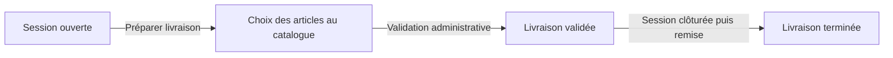

# Guide Tontines

Le module **Tontines** gère l'épargne collective et les cotisations annuelles des clients ELYKIA. Il permet d'inscrire des membres, de suivre leurs versements quotidiens sur un cycle annuel de 10 mois (de février à novembre), de vérifier la conformité de leurs carnets physiques, d'effectuer des contrôles sur le terrain, d'organiser la remise des articles de fin d'année et d'assurer l'archivage propre des campagnes passées.

> [!NOTE]
> **Visibilité selon votre profil d'utilisateur** :
> - **En tant que commercial** : vous accédez exclusivement aux membres, cotisations et livraisons de votre propre portefeuille.
> - **En tant que gestionnaire ou responsable d'agence** : vous bénéficiez d'une vision d'ensemble sur toute l'agence et pouvez filtrer les données pour chaque commercial.
> - **Habilitations** : si certaines actions, boutons ou indicateurs décrits dans ce guide ne s'affichent pas sur votre écran, c'est que vous ne disposez pas des droits d'accès correspondants.

---

## 1. Vue d'ensemble de la navigation

Le menu **Tontines** propose quatre espaces de travail adaptés au déroulement de la campagne :

| Menu / Écran | Ce que vous y trouvez | Utilisation au quotidien |
|---|---|---|
| **Tontines > Liste** | Le tableau de bord de la session active, les indicateurs d'épargne, la liste des membres et les outils de vérification. | Inscrire de nouveaux membres, suivre les adhésions, vérifier les carnets et consulter la progression. |
| **Tontines > Ancien portefeuille** | Les membres que vous avez suivis et les collectes enregistrées à votre nom. | Relire un dossier après un changement de commercial, sans enregistrer de nouvelle collecte. |
| **Tontines > Collectes** | Le journal chronologique de l'ensemble des cotisations enregistrées. | Contrôler les versements perçus, rechercher un paiement par période ou par commercial. |
| **Tontines > Livraison** | Le suivi des commandes de marchandises de fin d'année. | Suivre les colis à préparer, valider les livraisons et confirmer la remise aux membres. |
| **Tontines > Archives collectes** | L'historique des campagnes annuelles clôturées. | Consulter et télécharger les récapitulatifs PDF par commercial et par quartier des années antérieures. |

---

## 2. Tableau de bord de la session

L'écran principal de la liste vous donne une vue synthétique sur la campagne en cours.

### Les indicateurs clés de la campagne
En haut de l'écran, les cartes récapitulatives vous informent en temps réel sur la santé de la tontine.
- **Membres Actifs** : Nombre d'adhérents inscrits cette année. Lorsqu'un commercial est choisi, seuls les membres qui lui sont associés actuellement sont comptés.
- **Montant Total Collecté** : Sans commercial choisi, somme des cotisations des membres de la session. Avec un commercial choisi, somme des collectes enregistrées à son nom, y compris pour des membres transférés ensuite.
- **Revenu Total (Part Société)** : Part société de ces mêmes collectes.
- **En Attente de Livraison** : Nombre de membres encore associés qui attendent leurs articles de fin d'année (avec le nombre de colis déjà livrés).
- **Contribution Moyenne** : Montant moyen épargné par membre encore associé.
- **Collectes à la livraison** : Montants perçus lors de la délivrance des articles. Avec un commercial choisi, seules ses collectes de livraison sont additionnées.

Sous les filtres, le bouton **Voir l'historique** ouvre les membres transférés et les collectes enregistrées au nom du commercial choisi. La liste principale reste celle des membres encore associés.

### Session en cours vs Sessions antérieures
- **Session en cours (Active)** : La campagne annuelle est ouverte. Toutes les opérations quotidiennes (inscriptions, cotisations, ajustements de mise, vérifications de carnet) sont accessibles.
- **Sessions passées (Historiques)** : Permet de consulter les campagnes précédentes en mode consultation seule. Un bandeau d'information rappelle que les modifications y sont désactivées. Le bouton **« Session actuelle »** vous ramène immédiatement à l'année en cours.
- **Comparaison pluriannuelle** : Le bouton **Comparer** vous permet de sélectionner de 2 à 5 années pour observer l'évolution du nombre d'adhérents et des montants collectés.

### Téléchargements et exports PDF
La barre d'outils propose des exports prêts à imprimer :
- **Export des membres par commercial** : Génère un document récapitulant les coordonnées, la mise journalière et le total cotisé pour le portefeuille choisi.
- **Export des vérifications de carnets** : Produit la liste des carnets déjà vérifiés ou en attente de vérification, idéal pour organiser les tournées de contrôle.

### Vérifier les carnets en masse
Pour les utilisateurs habilités à viser les carnets physiques :
1. Cochez les cases des membres dont vous avez inspecté les carnets.
2. Cliquez sur le bouton **Vérifier la sélection** dans la barre d'actions groupées.
3. Confirmez l'opération : la date, l'heure et votre nom sont automatiquement enregistrés sur chacun des dossiers cochés.

### Inscrire un nouveau membre
- **Inscription individuelle** : Cliquez sur **Ajouter un Membre**, sélectionnez le client dans la liste, indiquez le montant de sa mise journalière (par exemple 500 ou 1 000 FCFA), ajoutez si besoin une observation dans **Notes**, puis enregistrez. La note est conservée sur la fiche du membre, avec la première période de mise.
- **Inscriptions multiples** : En début de campagne, le bouton **Ajout Multiple** permet d'enrôler rapidement plusieurs adhérents à la chaîne.
- **Auto-inscription Espace Client** : Les clients peuvent aussi rejoindre la session depuis l’application **Espace Client** (écran **Mes tontines** → **Rejoindre la session**). Leur premier paiement Mobile Money éventuel apparaît dans **Paiements clients** > **Cotisations tontine** pour validation.
- **Commercial tontine obligatoire** : Le client doit avoir un **commercial tontine** sur sa fiche pour être inscrit. Sinon, le message « Le client n'a pas de commercial tontine associé : impossible d'enregistrer l'adhésion. » s'affiche : renseignez d'abord le commercial tontine du client, puis recommencez.
- **Rapport journalier** : Chaque adhésion, y compris une auto-inscription depuis l’Espace Client, est comptée dans la case **Tontine Adhésions** du rapport journalier du commercial tontine du client.

---

## 3. Trouver rapidement un membre

La barre de recherche et de filtres vous permet de cibler des dossiers précis. Vos filtres restent en place si vous quittez la page puis y revenez, jusqu'à ce que vous cliquiez sur **Effacer**.

- **Par texte** : Tapez le nom, prénom, numéro de téléphone ou code du client.
- **Par commercial** : Sélectionnez un commercial dans la liste déroulante. La liste montre les membres qui lui sont associés actuellement. Le montant collecté additionne les collectes enregistrées à son nom. Le bouton **Voir l'historique** ouvre les membres transférés. Pour un commercial, votre secteur est pré-sélectionné.
- **Par statut de livraison** : Filtrez les membres en cours de session, ceux dont la livraison est en attente, validée ou déjà terminée.
- **Par état du carnet** : Affichez uniquement les membres dont le carnet est vérifié ou ceux restant à contrôler.
- **Par origine** : Choisissez **Espace client** pour ne voir que les membres qui se sont inscrits eux-mêmes depuis l'application Espace Client, ou **Personnel** pour ceux inscrits par l'agence. Dans la liste, ces auto-inscrits portent le badge violet **Espace client** sous leur nom.
- **Badge Déjà contrôlé** : dans la colonne **Carnet**, à côté de l'état de vérification. Il apparaît lorsqu'un contrôle de carnet terrain a déjà été enregistré pour ce membre.

---

## 4. Fiche détaillée d'un membre

En cliquant sur un membre, vous ouvrez sa fiche complète à 360°, véritable dossier de suivi pour toute la durée de la campagne.

### 1. En-tête du dossier et statut du carnet
- Rappel du nom, du code client et du commercial assigné.
- **Badge « Inscrit via l'Espace client »** : Affiché à côté du statut du carnet lorsque le membre a rejoint la session depuis l'application Espace Client.
- **Badge d'état du carnet** :
  - 🟢 **Carnet vérifié** : Indique la date, l'heure et le nom de l'agent qui a certifié le carnet.
  - ⚪ **Carnet non vérifié** : Indique que le carnet physique n'a pas encore été visé.
- **Badge Déjà contrôlé** : affiché à côté de l'état du carnet lorsqu'un contrôle de carnet terrain a déjà été enregistré pour ce membre.
- **Bouton Vérifier / Annuler la vérification** : Permet à un utilisateur habilité d'apposer ou de retirer la certification du carnet en un clic.
- **Bouton Télécharger** : Génère une attestation PDF complète des cotisations du membre.
- **Bouton Contrôle terrain** : Permet au chef de recouvrement de consigner un audit contradictoire.

### 2. Situation financière du membre
Quatre indicateurs résument sa position :
- **Total Contribué** : Montant brut total de ses cotisations depuis le début de la session.
- **Solde Disponible** : Somme réellement utilisable pour choisir les marchandises de fin d'année (après déduction de la part société).
- **Part Société (Payé / Dû)** : Montant de la cotisation société versée par rapport au montant théorique attendu. Le montant dû se calcule selon les mois validés et les jours entamés. Si le montant versé est insuffisant, l'indicateur apparaît en orange.
- **Collectes à la livraison** : Montants additionnels encaissés au moment de la livraison.

### 3. Répartition des cotisations par commercial
Si le membre a cotisé auprès de plusieurs commerciaux au cours de l'année (remplacement de tournée, déménagement de quartier), une grille affiche pour chaque commercial :
- Son nom et ses initiales.
- Le nombre de fois où il a encaissé pour ce membre.
- Le total perçu.
- Un badge **Actuel** met en avant le commercial officiellement affecté au dossier aujourd'hui.

### 4. Contrôle terrain contradictoire
Lorsqu'un chef de recouvrement contrôle le carnet au domicile du client, un volet dédié compare les deux sources :
- **Total système** : Somme enregistrée dans l'application sur les mois audités.
- **Total carnet** : Montant écrit de la main du commercial sur le carnet papier.
- **Écart constaté** : Différence entre le système et le carnet.
- **Statut** : 🟢 **Conforme** (aucun écart) ou 🔴 **Disparité** (différence constatée).
- Date, nom du contrôleur, remarques éventuelles et décomposition mois par mois pour localiser précisément tout écart.

Après l'enregistrement, le badge **Déjà contrôlé** s'affiche sur la fiche et dans la liste. Si l'agence a activé la vérification automatique du carnet, le badge **Carnet vérifié** s'applique en même temps. Si ce réglage est désactivé, seul le contrôle est enregistré et l'état de vérification du carnet ne change pas.

### 5. Progression sur les 10 mois (Février à Novembre)
Le cycle annuel de tontine compte exactement 10 mois d'épargne. Chaque mois nécessite **31 jours de mise** pour être considéré comme validé :
- Une grille présente les 10 mois de l'année (*Février, Mars, Avril, Mai, Juin, Juillet, Août, Septembre, Octobre, Novembre*).
- **Mois validé** : Pastille verte cochée dès que les 31 jours de cotisation sont atteints.
- **Mois en cours** : Jauge animée montrant l'avancement exact (ex. `21/31 j`).
- **Mois à venir** : Mois futurs en attente.

### 6. Synthèse des collectes et pastilles journalières
Un tableau liste chaque mois. Le mois le plus récent est en haut. Les mois plus anciens suivent, jusqu'à février.
- Le nombre de cotisations et le montant total en FCFA.
- **Des pastilles numérotées** : Chaque pastille représente un jour complet de mise acquis par le membre, calculé d'après sa mise journalière en vigueur.

### 7. Historique des changements de mise
Si la mise quotidienne du membre est modifiée en cours d'année (par exemple de 500 à 1 000 FCFA), un tableau retrace chaque période : date de début, date de fin éventuelle, montant de la mise, statut en cours ou clôturé, date d'enregistrement et **Note**.

Pour modifier la mise et garder une trace de la demande du membre :
1. Sur la fiche du membre, cliquez sur **Modifier**.
2. Dans la fenêtre **Modifier la mise du membre**, saisissez le nouveau **Montant de la mise**.
3. Choisissez la **Portée de la modification** : *Mois en cours et futurs*, *Mois futurs uniquement* ou *Rétroactif (tout recalculer)*.
4. Dans **Notes**, écrivez l'observation à conserver (par exemple les articles visés : riz, huile, sucrerie).
5. Cliquez sur **Mettre à jour**.

La note apparaît sur la ligne de la nouvelle période dans **Historique des montants de mise**. Les notes des périodes précédentes restent affichées sur leur ligne. La dernière note saisie est aussi rappelée en haut de la section, sous **Note actuelle**. Si vous laissez **Notes** vide, la note déjà enregistrée est conservée.

### 8. Enregistrer une cotisation
Deux boutons vous permettent d'enregistrer des versements :
- **Enregistrer une Collecte** : Pour un encaissement réalisé le jour même.
- **Collecte de rattrapage** : Si une cotisation d'un jour antérieur n'avait pas pu être saisie à temps. Vous choisissez la date concernée, confirmez la mise applicable à ce moment-là, et visualisez immédiatement l'effet sur le solde et les mois validés avant de confirmer.

### 9. Annulation d'une collecte
En cas d'erreur de saisie, les utilisateurs habilités peuvent annuler une ligne de collecte directement dans l'historique. Les collectes les plus récentes sont en haut de la liste. Après confirmation, l'application recalcule automatiquement le total épargné, le solde disponible, la part société et les compteurs de jours.

### Cotisations à distance par Mobile Money
Les membres peuvent également cotiser en toute autonomie depuis leur Espace Client ELYKIA :
- Le membre effectue son transfert vers le numéro Mobile Money attribué à son commercial tontine référent.
- La déclaration est transmise dans le menu latéral gauche **Paiements clients**, puis onglet **Cotisations tontine**.
- Après validation du paiement, la cotisation s'enregistre sur la session active du membre et son compteur de jours cotisés progresse immédiatement.

---

## 5. Livraisons de fin d'année

Les membres choisissent leurs marchandises pendant la campagne ouverte. La remise en mains propres se fait après la clôture de la session.

### Le cycle d'une livraison

1. **Préparer la Livraison** :
   - Tant que la session est ouverte, le bouton **Préparer la Livraison** est disponible sur la fiche du membre.
   - La fenêtre affiche le **Solde disponible** (déjà encaissé) et le **Solde prévisionnel** (estimation de fin d'année si chaque mois est cotisé en entier). Le panier peut aller jusqu'à ce prévisionnel, même si l'épargne déjà encaissée est plus basse. Il ne peut pas aller au-delà : le **Reste au plafond** passe en dessous de zéro et l'enregistrement est refusé.
   - Choisissez les articles souhaités dans le **catalogue** de l'agence (pas besoin que le commercial ait déjà du stock tontine).
   - Pour chaque article, la liste **Offre** propose l'unité, le gros, le demi-gros lorsqu'il existe, et les offres libres de la fiche (par exemple 3 unités pour 250). Le montant retenu est le prix de l'offre, pas un prix unitaire recalculé.
   - Si les articles choisis coûtent moins que le solde déjà encaissé, la différence reste conservée comme **Solde non utilisé** au profit du client.
   - Le dossier passe au statut **En attente**.

2. **Valider la Livraison** :
   - Un responsable examine la sélection et clique sur **Valider la Livraison**. Le statut passe à **Validé**.

3. **Marquer comme Livré** :
   - Une fois la session clôturée, au moment de la remise en mains propres, cliquez sur **Marquer comme Livré**.
   - La remise part seulement si le **solde disponible** couvre le montant de la commande. S'il est en dessous, la fenêtre **Solde insuffisant** propose **Réduire la commande** : retirez ou diminuez des articles jusqu'à ce que le total tienne dans le solde disponible, puis enregistrez. Le complément de cotisation au moment de la remise se fait sur l'application mobile.
   - Cette action déduit définitivement les articles du **stock tontine** du commercial et clôture le dossier du membre. Le commercial doit donc avoir reçu les articles via une demande de stock tontine avant la remise.
   - La fiche conserve la preuve complète : date, commercial ayant servi le client, détail des articles livrés et solde non utilisé éventuel.
   - Après la clôture, une livraison directe suit le même plafond : le panier peut aller jusqu'au solde prévisionnel de l'année, et la remise attend que le solde disponible couvre ce panier.

### Consulter l'ensemble des livraisons (Menu Tontines > Livraison)
Dans le menu latéral gauche, cliquez sur **Tontines** puis sur **Livraison**. Cet espace centralise toutes les opérations de distribution de l'agence :
- Indicateurs globaux : nombre de colis livrés, montant total distribué, livraisons restant à honorer, soldes non utilisés.
- Filtres temporels (ce jour, cette semaine, ce mois, plage de dates) et filtre par commercial.
- Recherche instantanée par nom ou référence de client.

---

## 6. Journal des collectes (Menu Tontines > Collectes)

Dans le menu latéral gauche, cliquez sur **Tontines** puis sur **Collectes**. C'est le grand livre de caisse de la tontine :
- Il présente les encaissements de la période, jour après jour.
- Vous pouvez filtrer les résultats par période (*du ... au ...*) et par commercial.
- Chaque ligne affiche l'heure exacte, le montant, le commercial encaisseur, le membre concerné et les codes de confirmation client.

---

## 7. Archives et transition annuelle (Menu Tontines > Archives collectes)

Dans le menu latéral gauche, cliquez sur **Tontines** puis sur **Archives collectes**. Cet espace est réservé aux responsables de l'agence pour réaliser la clôture administrative de fin d'année et préparer la plateforme pour la nouvelle campagne.

### Bibliothèque des archives PDF
Toutes les archives générées sont rangées dans une arborescence par année :
- **Par année** : Par exemple `2025`, `2026`.
- **Par exécution** : Horodatage précis de l'opération d'archivage avec le statut.
- **Par fichier** : Les récapitulatifs PDF sont découpés **par commercial et par quartier**. Un bouton de téléchargement permet d'ouvrir chaque document pour impression ou classement.

### Les deux actions disponibles
1. **Archiver uniquement** : Génère l'ensemble des documents PDF de sauvegarde pour tous les commerciaux sans modifier aucune donnée dans l'application. Recommandé pour préparer les bilans de fin d'année.
2. **Archiver et réinitialiser** :
   - Opération majeure réalisée une seule fois par an, au changement de session.
   - L'application sauvegarde d'abord l'intégralité des collectes en PDF.
   - Puis elle remet à zéro les compteurs d'épargne de la session active pour ouvrir la nouvelle année.
   - **Tous les membres, leurs coordonnées et leurs affectations commerciales restent précieusement conservés** : les clients n'ont pas besoin d'être réenrôlés pour la nouvelle campagne.

---

## 8. Ancien portefeuille (Menu Tontines > Ancien portefeuille)

Quand un membre change de commercial, il quitte votre liste de la session en cours. Vous pouvez toujours relire ce que vous avez collecté pour lui.

1. Ouvrez **Tontines**, puis **Ancien portefeuille**. Le bouton **Voir l'historique**, sous les filtres de la liste, ouvre le même écran.
2. Restez sur l'onglet **Tontine**. Le compteur **Dossiers affichés** indique le nombre de dossiers de cet onglet.
3. Chaque ligne affiche le nom, le code, le téléphone, le quartier, l'année et le total des collectes enregistrées à votre nom.
4. Cliquez sur **Voir**. Au-dessus de la liste, chaque mois de collecte affiche des pastilles numérotées. Une pastille correspond à un jour complet de mise, selon la mise en vigueur à la date de la collecte. Elles se rangent par lignes de 7 : 1 à 7, puis 8 à 14, et ainsi de suite. La liste en dessous reprend vos collectes (date, référence, montant) et leur total.
5. Cet écran ne contient pas de bouton pour enregistrer une collecte. Les nouvelles collectes se saisissent depuis la liste des membres que vous suivez actuellement.
